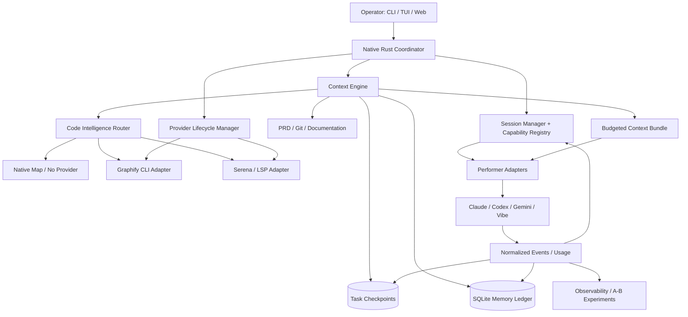
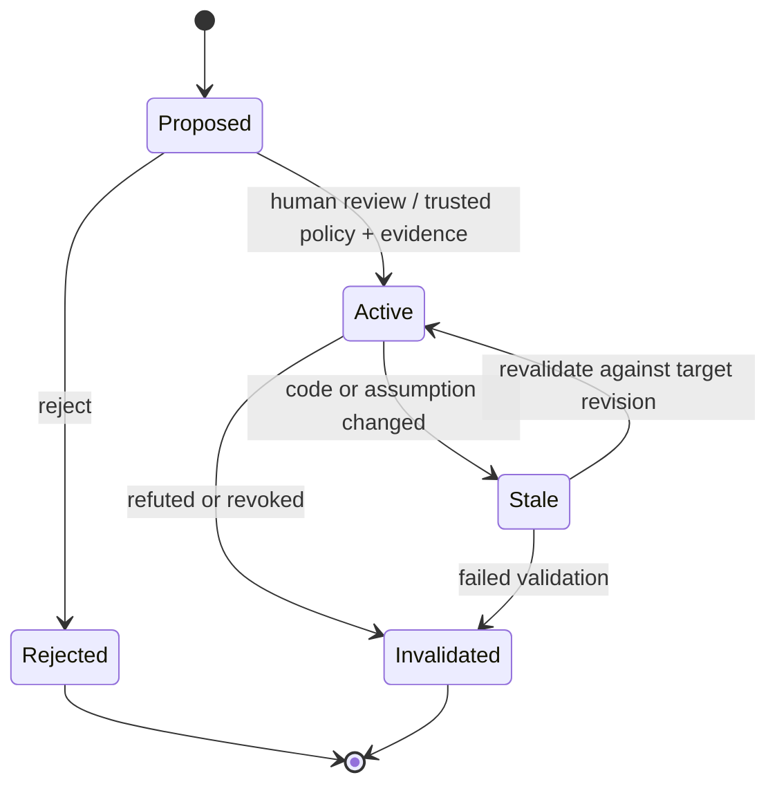
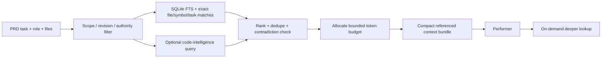
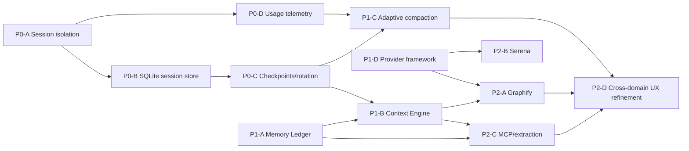

# MACC O2 — Shared Context, Knowledge Intelligence & Adaptive Session Management

**Project:** MACC — Multi-Assistant Code Config  
**Document:** Revised and unified specification of `10_MACC_O2_SQLite_Shared_Memory_Spec.md`  
**Motifs:** O2 Cross-Agent Memory Ledger; Shared Context Store; Code Intelligence Providers; Multi-Tool Session Lifecycle; Adaptive Compaction  
**Version:** 2.11 — P0/P1, P2-A Graphify, P2-B Python/Jedi Serena and P2-C memory/MCP implementation progress; later stages remain proposed
**Date:** 2026-10-17
**Code baseline inspected:** `df95759` — `feat: implement review and correction cycle budget management`  
**Language:** English  
**Applies to:** Rust core, native coordinator, performer runners, tool adapters, SQLite, local MCP, TUI, local Web UI  
**Target tools:** Claude Code, Codex CLI, Gemini CLI, Mistral Vibe CLI; extensible to future tools

> **Status and scope.** This document is a design target, not a declaration that all features already exist in MACC. It supersedes conflicting recommendations in the original O2 document, retains its evidence-backed SQLite memory concept, and incorporates the session-management, compaction and code-intelligence priorities discussed in October 2026. The commands shown under **Proposed MACC CLI** and the configuration keys under **Proposed configuration** require implementation. Third-party CLI support must be re-detected against the installed version rather than assumed from documentation alone. Version 2.1 aligns the implementation baseline and integration requirements with the local source at the revision above; it does not certify installed binaries or revalidate third-party releases. Version 2.2 adds mandatory interactive configuration and operational coverage in both TUI and Web; these requirements remain proposed until implemented and verified.

---

## 1. Executive Summary and Architecture Decisions

MACC already separates its native Rust coordinator from isolated agent worktrees and tool-specific runners. The original O2 specification proposed `.macc/memory.db`: a local **Cross-Agent Memory Ledger** of concise, evidence-backed decisions, constraints, discoveries, failures and lessons. Preserve that design. Extend it into a **Shared Context & Knowledge Engine** with independently managed session history, task checkpoints, project facts, code-intelligence indexes and token-aware retrieval.

**Foundational decision:** MACC owns the durable memory, session ownership records, checkpoint state, retrieval policy, provider lifecycle and security boundaries. External engines such as Graphify or Serena are replaceable **read-side code-intelligence providers**, not authorities for project decisions or execution state.

**Session decision:** A worktree is a reusable execution slot, **not** a durable session identity. The safe default is `one task + one agent role + one provider + one compatible execution environment` per live conversation lineage. New unrelated task => new session, regardless of worktree reuse. Continuations and corrective iterations within one task may resume. Reviewers start independent sessions by default. Task checkpoints and project memory provide continuity when rotating a session.

**Compaction decision:** Every AI tool participates in one adaptive policy, while the implementation delegates to a version-detected native auto-compaction mechanism when available. When headless explicit compaction is unsupported or unreliable, MACC performs **checkpoint → validate → new session → restore context**. A mere summary appended to an old conversation does **not** count as successful compaction. Never rely on sending interactive slash commands into headless mode unless a capability probe certifies that precise CLI version and execution mode.

**Token-efficiency decision:** Retrieval should be evidence-first, scope-restricted, version-aware and **budgeted**. A small pushed context is the default; deeper code navigation and memory search remain pull-based. Mandatory PRD acceptance criteria, explicitly imposed specifications and design-system files must not be summarized away or silently overridden.

### 1.1 Non-negotiable target invariants

1. **No cross-task conversation contamination.** Free/available session status is necessary but never sufficient for reuse. `task_id`, `role`, project identity, tool identity and compatibility must match.
2. **No concurrent session reuse.** Exactly one live lease can own a provider session. Lock acquisition and state transition must be atomic and shared across Rust and shell paths.
3. **One durable memory authority.** Agent and Graphify/Serena-generated information is proposed evidence, never authoritative instructions by itself.
4. **PRD/specification precedence.** Explicit user requirements and pinned design artifacts outrank memory and retrieval suggestions. Contradictions raise an alert; no silent reconciliation.
5. **Source and revision awareness.** Every derived code fact identifies the Git revision or worktree snapshot from which it was computed.
6. **Safe degradation.** When a provider is missing, stale, unhealthy, or incompatible, deterministic SQLite/FTS/Git fallback remains available; work must not depend on Graphify.
7. **No hidden provider execution.** Installation, upgrade, deployment, background indexers and removal are explicit managed operations with observable state and consent appropriate to risk.
8. **No unverified headless compaction.** An adapter can report `supported`, `unsupported` or `unverified`; `unverified` never automatically executes undocumented commands.
9. **Checkpoints precede destructive/irreversible session changes.** Persist and validate useful task state before compression or rotation.
10. **Measured benefit.** Optimize combined token spend, time, task success and fidelity—not only prompt length or claimed reductions.

11. **Complete TUI/Web coverage.** Every new feature, operator action and user-configurable variable introduced by this specification must be accessible in both clients when that feature ships. Advanced settings and provider overrides are included. Runtime-derived values and mandatory safety invariants remain inspectable, read-only, with a reason (§12.1, §17).

### 1.2 Preserve from the original O2 specification

- `.macc/memory.db` with WAL, FTS5, evidence, scopes and lifecycle states.
- `constraint`, `discovery`, `decision`, `gotcha`, `api_contract`, `failed_attempt`, `performance_note`, `security_note`, `migration_note`, `provider_note`, `merge_note`.
- Default `proposed` status, human promotion, `active/stale/invalidated/rejected` lifecycle.
- Memory search before dispatch, proposed lesson extraction afterward, diff-aware retrieval and MCP access.
- Local/private default; secret scanning; no full raw chat logs or source copies in the ledger.
- TUI/Web Memory Inbox, CLI import/export, diagnostics, commit/PRD linkages and worktree-shared learning.

### 1.3 What changes from original O2

| Original O2 behavior | Revised canonical behavior | Reason |
|---|---|---|
| Memory Ledger is the whole shared store | Ledger **plus** Task Checkpoints, Code Intelligence, Context Engine and Usage Telemetry | Different data have different lifecycles and trust properties |
| `max_context_tokens: 4000` broadly | Adaptive **memory push** target 300–800; default hard cap 1200; separate PRD budget; on-demand detail | Prevent automatic prompt inflation |
| `stale_after_days: 45` | Revision/evidence invalidation first; time decay only for truly time-sensitive facts | Old facts can remain valid; new edits can invalidate recent facts |
| Merge commit or single reviewer confirmation may promote | Promotion based on explicit policy and verifiable evidence; merging alone never proves a fact | Prevent durable hallucinations |
| Worktree-oriented sessions | Task/role/provider-oriented sessions independent of reused worktree slots | Avoid cross-task leakage and token growth |
| Optional memory graph in Web UI | Memory relationship visualization **distinct from** external code graph | Avoid conflating experience with source structure |
| Agent MCP can `memory.insert`/`memory.update` | Agent can **propose** only; promotion/modification of canonical fact is privileged | Governance and prompt-injection protection |
| All relevant facts injected on dispatch | Ranked, de-duplicated, revision-aware small bundle; drill-down via tool | Reduce repeated context and irrelevant data |
| External graph can be used independently | Managed `code_intelligence` provider catalog with full install/update/deploy/remove/rollback lifecycle | Reproducibility, security and UX |


### 1.4 Implementation baseline and remaining work

This table preserves the original version 2.1 inspection baseline, not deployed runtime state. Delivered P0–P2-C changes and their limits are recorded in §20.1–§20.7. **Existing** means a code path is present; it does not certify all O2 acceptance criteria or provider versions. **Partial** identifies a foundation that must be extended. Unchecked acceptance items in §22 remain delivery gates.

| Area | Current source baseline | O2 work still required |
|---|---|---|
| Coordinator persistence — **existing** | `.macc/state/coordinator.sqlite` stores tasks, task runtimes, jobs, resource locks, events, runs, controls, gate decisions and tool throttles; WAL and a five-second busy timeout. Configured JSON storage/import/export also exists. | Reuse the operational authority and migration conventions; do not replace it with the proposed memory database. |
| Provider sessions — **existing JSON, incomplete isolation** | `core/src/coordinator/session_manager.rs`, the phase runner and shared shell runner use `.macc/state/tool-sessions.json`. Save/restore, stale-owner recovery and lease release exist. | Durable task/role/project compatibility, logical lineages and transactional session fencing remain P0 work. |
| Session concurrency — **partial** | Rust uses `AdvisoryLock`; shell uses `flock` on the same `.json.lock` path. Shell currently warns and continues when `flock` is unavailable. | Preserve working shared locking; replace the unlocked fallback with a safe supported service/transaction before claiming the target invariant on every platform. |
| Session selection — **known gap** | All four registry entries declare `scope: worktree`. Rust/shell can select an available session without exact task/role compatibility. | P0-A remains open. Existing lease ownership and `last_task_id` are not sufficient semantic isolation. |
| Tool handoff — **existing** | E601/E602 continuation retains the same task, branch, worktree, commits, index, tracked edits and untracked files. Resume refuses a fresh slot when the attached worktree is unavailable. | Add structured O2 checkpoints and compatible conversation ownership on top; file preservation is not session isolation or compaction. |
| Review/correction and delivery — **existing** | `max_review_cycles: 1` includes one review plus its requested correction. Corrections re-enter validation. Completion filtering excludes WIP/partial commits from reconciliation and dependency discovery. | Preserve these rules through checkpoint restore, session rotation and memory ingestion; see §6.4 and §15.4. |
| Drain controls — **partial** | Existing SQLite drain snapshot/control stops new dispatch. The inspected snapshot/completion checks enumerate `claimed`, `in_progress`, `changes_requested` and `queued`, without the full testing/review/merge lifecycle. | Regress drain across all phase and active-job states before claiming O2-safe shutdown; do not reproduce this incomplete state enumeration in new services. |
| Supervisor lifecycle — **existing** | Per-incident diagnosis/retry state, owned `.macc/worktree/supervisor-xx` slots, evidence archival, retention of unfinished repairs and attached operator-stop handling exist. | Reference these intervention artifacts as evidence; do not treat them as promoted memory or as the proposed checkpoint schema. |
| Context generation — **existing** | `macc context` updates tool context files through `core/src/service/context.rs`; it requires an applied project configuration. | Preserve this CLI and tool configuration behavior while adding retrieval/bundle commands. |
| Output reduction — **partial** | `core/src/context/` already contains summarizers and token-budget helpers. `Engine::run_skill` applies configured summaries/budgets and exposes `SummaryMetadata`. | Extend this pipeline to coordinator/provider context instead of creating a competing one. Its byte-length token approximation is not exact provider usage or a model tokenizer. |
| Usage/context telemetry — **not unified** | Runtime phase/progress events, session use counts, output metadata, model/effort labels and provider error/throttle handling exist. | Normalized per-invocation token/cost/context-pressure records, cumulative counter handling and capability-backed compaction are not implemented by these foundations. |
| O2 and code intelligence — **proposed** | No O2 memory store, logical-session SQLite schema, O2 MCP server, Graphify/Serena manager or corresponding Ops pages is implemented in the inspected tree. | Deliver the new domains, migration, policy, CLI/API and acceptance tests described below. |

Source anchors: [coordinator storage](../../core/src/coordinator_storage.rs), [session manager](../../core/src/coordinator/session_manager.rs), [phase/session runner](../../core/src/coordinator/control_plane/phase_runner.rs), [shared runner](../../adapters/shared/performer_lib.sh), [context service](../../core/src/service/context.rs), [skill execution](../../core/src/engine.rs), [summary metadata](../../core/src/skills_runner/model.rs), [handoff contract](../TOOL_HANDOFF.md), [review cycles](../REVIEW_CYCLES.md), [completion evidence](../COMPLETION_EVIDENCE.md), [supervisor lifecycle](../SUPERVISOR_LIFECYCLE.md).

### 1.5 Related specifications and delivery boundaries

`MACC_Codex_Usage_Provider_Implementation_Spec.md` is a related **proposal**, not evidence of an implemented monitor. Its account quota/availability snapshots and this document's per-invocation context/cost measurements are different data. Reuse shared provider identity, timestamps and provenance; keep one authority per measurement and do not equate quota percentage with context pressure or token billing.

This specification must integrate with the existing coordinator, ToolSpecs and context pipeline. The proposed `core/src/sessions/` and code-intelligence domains are extraction/extension targets, not permission to introduce independent competing task schedulers, lease writers or global error taxonomies.

---

## 2. Scope, Goals, Non-Goals and Source-of-Truth Hierarchy

### 2.1 Goals

- Reduce repeated repository exploration, log re-reading and stale conversation replay.
- Enable reliable continuation of any task after model/tool change, process interruption, compaction or new session.
- Maintain consistent context and constraints across Claude, Codex, Gemini and Vibe without giving providers control of MACC state.
- Provide code structure and relationship retrieval at bounded token cost.
- Keep Linux, macOS and Windows workflows manageable; preserve Rust core's local-first operation.
- Make knowledge provenance, freshness, session ownership, auto-compaction actions and token telemetry observable.

### 2.2 Non-goals

- Training, fine-tuning or replacing tool/provider models.
- Persisting unrestricted raw chat histories or private reasoning in the memory ledger.
- Reimplementing Graphify, a full LSP server or vector database in the first delivery.
- Guaranteeing exact token billing from CLI usage counters when providers do not expose it.
- Mutating provider-owned conversation files to force compaction.
- Using provider API compaction endpoints as if they operated on opaque Codex CLI session identifiers.
- Automatically installing and executing third-party packages without a trusted manifest and consent.

### 2.3 Authority order

1. Explicit user instruction and applicable security policy.
2. Selected PRD, acceptance tests, pinned specifications and pinned design-system references.
3. Current repository source, immutable revision evidence and executed deterministic tests.
4. Human-approved architecture decisions and validated active memory.
5. Fresh code intelligence derived from the same revision or snapshot.
6. Proposed, unverified or potentially stale agent memories (research hints only).

If authority layers conflict, surface the mismatch and halt unsafe modifications rather than letting an LLM choose silently.

---

## 3. Overall Architecture

**Target architecture:** the new O2 services below are proposed. The coordinator, ToolSpecs, session JSON and context helpers already exist as listed in §1.4.



### 3.1 Ownership and runtime boundaries

- **Coordinator** owns task dispatch, lease fencing, context versions, session selection, phase transitions and checkpoint triggers.
- **`core/src/memory/`** owns memory schema and retrieval. No adapter writes database tables directly.
- **`core/src/context/`** already owns output summarizers and approximate budget helpers. Extend it to rank, deduplicate, validate and assemble source-linked O2 context; retain the existing skill-runner integration.
- **Proposed `core/src/sessions/`** will own durable logical sessions, provider IDs, lease/TTL/fencing and rotation. Extract/integrate the current `core/src/coordinator/session_manager.rs` behavior rather than leaving two mutable ownership implementations.
- **`core/src/code_intelligence/`** owns provider registry, installation/deployment, content indexing and read-side queries.
- **Tool adapters** translate versioned capabilities into concrete commands/flags/output parsing; do not determine global policy.
- **`.macc/state/tool-sessions.json`** is the current mutable provider-session authority. It becomes a legacy compatibility/migration input only after the explicit SQLite session cutover. The coordinator SQLite database currently records task claims and runtime session references, not the proposed provider-session lease tables. Migration must leave exactly one provider-session writer authority.
- **MCP** exposes restricted queries and proposals. Internal coordinator retrieval should call Rust directly (no unnecessary MCP subprocess round-trip).

### 3.2 Canonical physical layout

The layout combines existing paths with proposed O2 paths; comments identify the boundary. It is not a list of files already generated by MACC.

```text
<canonical-project-root>/
  .macc/
    macc.yaml
    memory.db                         # Proposed O2 store; not coordinator runtime state
    memory.db-wal
    memory.db-shm
    context/
      tasks/<task-id>/<phase>.md      # Generated, ephemeral, ignored
      checkpoints/<task-id>/*.json   # Durable state snapshots, ignored
    code-intelligence/
      providers.lock.json            # Installed provider inventory / version lock
      indexes/<provider>/<revision>/ # Derived rebuildable indexes
      manifests/                     # Reviewed provider manifests
    state/
      coordinator.sqlite             # Existing operational authority (SQLite mode)
      tool-sessions.json             # Current session authority; migration input after cutover
      tool-sessions.json.lock        # Current shared Rust/shell lock
    worktree/
      worker-xx/                     # Existing reusable performer slots
      supervisor-xx/                 # Existing owned intervention slots
    log/
      context-events.jsonl
      session-events.jsonl
      provider-events.jsonl
```

All paths resolve from the canonical MACC repository root, **never** relative to whichever worktree happens to invoke the performer. Worktrees receive an explicit restricted context handle (root, project UUID, task, phase, branch/revision); they must not locate or write the shared DB by opportunistic `cwd` traversal. Database and checkpoint directories must be excluded from Git, and backups must use SQLite-safe snapshot mechanisms.

---

## 4. Memory Ledger Domain (Original O2, Strengthened)

### 4.1 Memory kinds

| Kind | Durable content | Evidence examples |
|---|---|---|
| `constraint` | Behavior that must be preserved | Requirements reference, regression test |
| `discovery` | New source-backed project fact | Source location, commit, test |
| `decision` | Architecture or product choice | ADR, user-approved specification |
| `gotcha` | Fragile behavior or test setup | Reproducible failing/passing test |
| `api_contract` | Validated API expectations | Schema, contract tests, version |
| `failed_attempt` | Previously rejected/failed approach | Attempt ID, outcome and reproduction |
| `performance_note` | Performance constraints or benchmark | Metrics and conditions |
| `security_note` | Verified security-sensitive behavior | Evidence and security review |
| `migration_note` | Version and migration requirement | Schema version and change |
| `provider_note` | Observed CLI/provider behavior | CLI version, output and reproduction |
| `merge_note` | Merge or branch dependency lesson | Conflict data and resolution |

### 4.2 Trust lifecycle



- Only `active` and in-scope facts enter automated prompts by default.
- `proposed` and `stale` may appear in interactive search with explicit status labels; they must not be presented as instructions.
- Agent inserts default to `proposed`. Automatic promotion defaults to **disabled**.
- A merged commit can be evidence of an implementation, never sole evidence that a stored assertion is true.
- Confidence is distinct from **authority**. A high numerical confidence does not override a PRD or validated repository state.
- Include `source_revision`, `evidence_hash`, `last_verified_revision`, `assumption_fingerprint` and `staleness_reason` per record where applicable.

### 4.3 Freshness policy

Prefer change-triggered revalidation over global fixed-age expiry:

- File-content SHA or relevant AST symbol signature changed → candidate `stale`.
- Deleted/moved symbol → remap with traceable evidence or mark `stale`.
- API dependency version or lockfile changed → trigger affected fact verification.
- Source code differs between indexed base revision and active worktree → flag `snapshot_mismatch`, do not assert exact behavior from stale graph.
- Environment/provider behavior notes use separate short TTL + CLI version fingerprint.
- Static human-approved decisions remain valid until changed by an equal/higher authority; passage of time alone is insufficient.
- Time-sensitive operational observations may expire, according to kind-specific policy.

### 4.4 Scope and namespace

Memory entries carry project UUID, repository origin fingerprint, and one of `project | feature | task | worktree | tool | user`; project/global collision is forbidden. Worktree-scoped memories cannot be promoted to project scope without revalidation. Access checks must enforce task/worktree scope before returning records to an agent. Absolute local paths are metadata, not stable portable identities.

### 4.5 Evidence and contradictions

Every promoted entry needs at least one valid provenance record (commit, source span/hash, PRD, test, review or human approval). Contradictions must link two claims through an explicit conflict record and generate a `memory_conflict` event. Preserve invalidated records for audit by retention policy. Do not auto-delete inconvenient facts to force consensus.

---

## 5. Persistence and SQLite Schema

**Design rule (proposed O2 scope):** use one authoritative local SQLite store for ledger metadata, logical session state, checkpoints and per-invocation context usage. Existing `.macc/state/coordinator.sqlite` remains the coordinator task/runtime authority; `.macc/memory.db` does not replace it or copy its mutable task, job, control or approval tables. Decide and test the session-store cutover before enabling the proposed logical-session tables. The same operational field must not have simultaneous writable authorities in both databases. Third-party graph indexes remain versioned, derived artifacts outside the memory authority. Introduce schema migrations and never apply unreviewed migrations to an existing project without a verified backup.

### 5.1 Baseline SQL (normative target, illustrative DDL)

```sql
PRAGMA journal_mode = WAL;
PRAGMA foreign_keys = ON;
PRAGMA busy_timeout = 5000;

CREATE TABLE IF NOT EXISTS schema_migrations (
  version INTEGER PRIMARY KEY,
  applied_at TEXT NOT NULL,
  checksum TEXT NOT NULL
);

CREATE TABLE IF NOT EXISTS memories (
  id TEXT PRIMARY KEY,
  project_id TEXT NOT NULL,
  kind TEXT NOT NULL,
  title TEXT NOT NULL,
  body TEXT NOT NULL,
  scope TEXT NOT NULL DEFAULT 'project',
  scope_ref TEXT,
  status TEXT NOT NULL DEFAULT 'proposed',
  confidence REAL NOT NULL DEFAULT 0.5 CHECK (confidence BETWEEN 0 AND 1),
  source_revision TEXT,
  last_verified_revision TEXT,
  assumption_fingerprint TEXT,
  created_by_tool TEXT,
  created_by_agent TEXT,
  created_by_task_id TEXT,
  created_by_worktree TEXT,
  created_at TEXT NOT NULL,
  updated_at TEXT NOT NULL,
  last_used_at TEXT,
  expires_at TEXT,
  invalidated_reason TEXT,
  staleness_reason TEXT,
  checksum TEXT NOT NULL,
  CHECK (status IN ('proposed','active','stale','invalidated','rejected'))
);

CREATE TABLE IF NOT EXISTS memory_files (
  memory_id TEXT NOT NULL REFERENCES memories(id) ON DELETE CASCADE,
  path TEXT NOT NULL,
  file_hash TEXT,
  match_kind TEXT NOT NULL DEFAULT 'direct',
  PRIMARY KEY (memory_id, path)
);
CREATE TABLE IF NOT EXISTS memory_symbols (
  memory_id TEXT NOT NULL REFERENCES memories(id) ON DELETE CASCADE,
  symbol_id TEXT NOT NULL,
  path TEXT,
  signature_hash TEXT,
  PRIMARY KEY (memory_id, symbol_id)
);
CREATE TABLE IF NOT EXISTS memory_tags (
  memory_id TEXT NOT NULL REFERENCES memories(id) ON DELETE CASCADE,
  tag TEXT NOT NULL,
  PRIMARY KEY (memory_id, tag)
);
CREATE TABLE IF NOT EXISTS memory_tasks (
  memory_id TEXT NOT NULL REFERENCES memories(id) ON DELETE CASCADE,
  task_id TEXT NOT NULL,
  relation TEXT NOT NULL DEFAULT 'related',
  PRIMARY KEY (memory_id, task_id, relation)
);
CREATE TABLE IF NOT EXISTS memory_evidence (
  id TEXT PRIMARY KEY,
  memory_id TEXT NOT NULL REFERENCES memories(id) ON DELETE CASCADE,
  evidence_type TEXT NOT NULL,
  evidence_ref TEXT NOT NULL,
  evidence_revision TEXT,
  evidence_sha256 TEXT,
  summary TEXT,
  verdict TEXT NOT NULL DEFAULT 'observed',
  created_at TEXT NOT NULL
);
CREATE TABLE IF NOT EXISTS memory_conflicts (
  id TEXT PRIMARY KEY,
  left_memory_id TEXT NOT NULL REFERENCES memories(id),
  right_memory_id TEXT NOT NULL REFERENCES memories(id),
  status TEXT NOT NULL DEFAULT 'open',
  reason TEXT NOT NULL,
  resolved_at TEXT
);
CREATE INDEX IF NOT EXISTS idx_memories_scope_state
  ON memories(project_id, scope, scope_ref, status);
CREATE INDEX IF NOT EXISTS idx_memory_files_path ON memory_files(path);
CREATE INDEX IF NOT EXISTS idx_memory_symbols_symbol ON memory_symbols(symbol_id);
CREATE INDEX IF NOT EXISTS idx_memory_evidence_memory ON memory_evidence(memory_id);
CREATE INDEX IF NOT EXISTS idx_memory_tasks_task ON memory_tasks(task_id);
```

### 5.2 FTS5 synchronization

The original proposed an independent `memory_fts` table with denormalized tags/files/symbols but did not define maintenance. Normalize the source tables as above and implement a **transactionally maintained searchable projection**:

- `memory_search_projection(memory_id PRIMARY KEY, title, body, tags_text, files_text, symbols_text)` materialized from canonical tables.
- `memory_fts` backed by that projection via FTS5 external-content mode with an integer `rowid` key, or an ordinary synchronized FTS5 table if the cross-table projection makes triggers impractical.
- Single Rust transaction updates canonical tables, projection and FTS; SQL triggers cover direct insert/update/delete on the projection.
- Include `memory fts rebuild`, integrity checks and crash/recovery tests.
- Do **not** pretend FTS5 can index joined child tables automatically without explicit projection refreshes.
- Search uses parameterized queries, bounded result count and stable deterministic tie-breaking.

### 5.3 Checkpoint and session tables

```sql
CREATE TABLE IF NOT EXISTS task_checkpoints (
  id TEXT PRIMARY KEY,
  project_id TEXT NOT NULL,
  task_id TEXT NOT NULL,
  phase TEXT NOT NULL,
  revision TEXT NOT NULL,
  worktree_id TEXT,
  content_json TEXT NOT NULL,
  schema_version INTEGER NOT NULL,
  content_sha256 TEXT NOT NULL,
  validation_state TEXT NOT NULL DEFAULT 'pending',
  created_at TEXT NOT NULL
);
CREATE INDEX IF NOT EXISTS idx_checkpoints_task
  ON task_checkpoints(project_id, task_id, created_at DESC);

CREATE TABLE IF NOT EXISTS logical_sessions (
  id TEXT PRIMARY KEY,
  project_id TEXT NOT NULL,
  task_id TEXT NOT NULL,
  role TEXT NOT NULL,
  tool_id TEXT NOT NULL,
  model_id TEXT,
  config_fingerprint TEXT NOT NULL,
  environment_fingerprint TEXT NOT NULL,
  provider_session_id TEXT,
  lineage_id TEXT NOT NULL,
  status TEXT NOT NULL,
  context_tokens_estimate INTEGER,
  compaction_count INTEGER NOT NULL DEFAULT 0,
  use_count INTEGER NOT NULL DEFAULT 0,
  created_at TEXT NOT NULL,
  updated_at TEXT NOT NULL,
  last_verified_at TEXT
);
CREATE UNIQUE INDEX IF NOT EXISTS idx_provider_session_unique
  ON logical_sessions(tool_id, provider_session_id)
  WHERE provider_session_id IS NOT NULL;
CREATE INDEX IF NOT EXISTS idx_session_ownership
  ON logical_sessions(project_id, task_id, role, tool_id, status);

CREATE TABLE IF NOT EXISTS session_leases (
  logical_session_id TEXT PRIMARY KEY
    REFERENCES logical_sessions(id) ON DELETE CASCADE,
  lease_token TEXT NOT NULL,
  fencing_counter INTEGER NOT NULL,
  owner_process_id INTEGER,
  owner_run_id TEXT NOT NULL,
  owner_worktree_id TEXT NOT NULL,
  heartbeat_at TEXT NOT NULL,
  expires_at TEXT NOT NULL
);
CREATE TABLE IF NOT EXISTS session_events (
  id TEXT PRIMARY KEY,
  logical_session_id TEXT NOT NULL,
  event_type TEXT NOT NULL,
  payload_json TEXT NOT NULL,
  occurred_at TEXT NOT NULL
);
CREATE INDEX IF NOT EXISTS idx_session_events_session
  ON session_events(logical_session_id, occurred_at);

CREATE TABLE IF NOT EXISTS context_usage (
  id TEXT PRIMARY KEY,
  project_id TEXT NOT NULL,
  task_id TEXT NOT NULL,
  phase TEXT NOT NULL,
  tool_id TEXT NOT NULL,
  model_id TEXT,
  session_id TEXT,
  context_bundle_sha256 TEXT,
  input_uncached_tokens INTEGER,
  input_cached_read_tokens INTEGER,
  input_cached_write_tokens INTEGER,
  output_tokens INTEGER,
  billed_cost_usd REAL,
  elapsed_ms INTEGER,
  measurement_source TEXT NOT NULL,
  measurement_quality TEXT NOT NULL,
  created_at TEXT NOT NULL
);
CREATE TABLE IF NOT EXISTS context_usage_items (
  usage_id TEXT NOT NULL REFERENCES context_usage(id),
  source_kind TEXT NOT NULL,
  source_ref TEXT NOT NULL,
  estimated_injected_tokens INTEGER NOT NULL,
  PRIMARY KEY (usage_id, source_kind, source_ref)
);
```

**SQLite mechanics:** one canonical root-scoped location for the O2 store, distinct from existing coordinator runtime storage; busy timeout and short transactions; migration-on-open with backup; enforce WAL checkpoints; bounded writers; serialized lease changes; integrity verification; read-only connections for MCP search; atomic checkpoint insert; `PRAGMA foreign_keys=ON` on each connection. WAL supports readers alongside one writer, not unlimited simultaneous writers. Snapshot backups must use SQLite's backup API or equivalent consistency mechanism; do not copy a live `.db` without its WAL state.

### 5.4 Integration with current storage

The DDL in §5.1–§5.3 is a target schema, not the current `coordinator.sqlite` schema and not a migration script to execute directly against a live project. Use existing SQLite/Git error mapping and bounded-lock conventions. Preserve task claim/run/epoch references when correlating O2 records with the coordinator, without recreating task state or approval authority in memory tables. JSON-mode projects need an explicit O2/session migration policy; do not assume a coordinator storage switch automatically migrates provider sessions.

Quota/availability monitoring remains operational scheduling input. `context_usage` represents per-invocation context/token/cost observations; reuse or correlate another subsystem's observations instead of duplicating a differently normalized usage source. Never derive an exact context-window utilization from a quota cooldown.

### 5.5 Versioned evidence and derived index manifest

Record Git commit SHA, dirty worktree file digest, index provider name and version, schema version, build timestamp, supported languages, excluded paths, model/backend used for any semantic extraction, and user-approved network policy. A content index is a **cache**, never the authoritative source for PRD decisions or source truth.

---

## 6. Task Checkpoint Contract and Recovery

A checkpoint is a structured record of **what remains true and actionable for one task**; it is not a conversation transcript, nor an instruction source above the PRD.

### 6.1 Required fields

```json
{
  "schema_version": 1,
  "project_id": "repo-uuid",
  "task_id": "AUTH-042",
  "phase": "dev",
  "source_revision": "full-git-sha",
  "worktree_dirty_digest": "sha256-or-null",
  "acceptance_criteria_ids": ["AC-01", "AC-02"],
  "completed_steps": ["Created migration", "Added regression test"],
  "remaining_steps": ["Run integration tests", "Correct error handling"],
  "changed_files": ["src/auth.rs", "tests/auth.rs"],
  "decisions": [{"summary": "Keep existing API contract", "source": "prd:AUTH-042"}],
  "test_results": [{"command": "cargo test auth", "status": "failed", "artifact_ref": "log:..."}],
  "blocking_issues": ["Local database unavailable"],
  "memory_refs": ["mem_abc"],
  "source_refs": ["spec:docs/auth.md#validation"],
  "next_action": "Run the isolated integration suite",
  "validation": {"schema_ok": true, "sources_verified": true}
}
```

### 6.2 Checkpoint generation

- Prefer deterministic extraction from PRD state, normalized performer events, Git diff statistics, test summaries and review findings.
- If an LLM is used to synthesize narrative fields, tag them as inferred until validated against deterministic sources.
- Include negative results, failed attempts, outstanding review objections and unresolved assumptions; never write a falsely successful checkpoint.
- Bind checkpoint to `(project, task, phase, revision, dirty digest)` and stable acceptance-criterion identifiers.
- Token-bounded, explicitly schema-validated, checksummed, and redacted.
- Capture before compaction, tool switch, context overflow, task pause, subprocess failure recovery and coordinator restart.

### 6.3 Restore

1. Verify project/task/phase and pinned specification hashes.
2. Recompute changed-file digest and compare with checkpoint.
3. Rehydrate **mandatory** PRD acceptance criteria and source constraints.
4. Add only approved relevant project memory and current code references.
5. Include checkpoint outstanding work, tests and links; avoid replaying old tool logs.
6. Open a new provider session and verify the agent explicitly acknowledges the current phase/task (structured response where supported).
7. If mismatch is detected, mark checkpoint `needs_reconciliation` and ask coordinator to run deterministic state reconciliation before dispatch.

Checkpoint completion is a distinct operation from `memory promote`. Completed task checkpoints may be archived and compacted, but durable lessons must be separately proposed and reviewed.

### 6.4 Preserve existing continuation and delivery guarantees

The structured O2 checkpoint is new; the current same-task handoff already preserves repository work. Rotation and restore must maintain all of these existing contracts:

- Keep the task ID, expected branch and attached worktree when replacing an unavailable performer. Preserve commits, staged changes, unstaged edits and untracked implementation files, including before the first commit.
- Reserve parked continuation slots from unrelated dispatch and cleanup. Missing/mismatched worktrees or incomplete Git operations require recovery; do not silently allocate a fresh slot, reset or clean the retained work.
- Retain provider-specific session history but never pass one provider's session ID as another provider's ID. The stronger task/role ownership requirement in §9 is still an implementation gap.
- Checkpoint persistence is not success. `precondition_unmet` (`E903`) retains concrete unmet conditions and partial work; it does not authorize a commit/merge as completed work, broaden task scope or manufacture missing approval.
- A WIP/checkpoint commit remains partial even if it mentions the task or carries `[macc:task ID]`. Use the existing completion filter before treating any Git artifact as delivery. Memory/checkpoint records cannot satisfy dependencies by themselves.
- Preserve `task_runtime.review_cycles`: it counts completed reviews. A rejection at `max_review_cycles: 1` still owns its correction; successful correction re-enters configured validation, then queues merge without a second review. A failed correction stays blocked with its worktree preserved.

A checkpoint that reports completed work must link the actual delivery evidence and phase state. A summary, a successful memory write, or exhaustion of a review/rotation budget never marks a task `merged`.

---

## 7. Token-Aware Context Engine

### 7.1 Retrieval stages



**Push vs pull:** automatically push a minimal summary of validated facts and essential pointers; defer full code maps, excerpts, dependency paths and historical failures until requested. If a `code_intelligence` provider is unavailable, fall back to `git grep`, filesystem existence checks, PRD references and FTS. Avoid recurring external LLM calls during ordinary retrieval.

### 7.2 Context priority and budgets

| Content | Policy | Suggested initial target |
|---|---|---|
| Mandatory PRD / acceptance criteria | Exact source of truth, preserved and pinned; size not subordinated to memory budget | Required, separate budget |
| Explicit design-system / reference files | Exact references and fidelity instructions, not dropped | Required, separate budget |
| Verified project constraints and decisions | Small automatic push | 300–800 tokens typical; 1200 soft cap |
| Task checkpoint | Small automatic push on restore | 400–1000 tokens initial |
| Code map / symbol context | Query on demand or brief one-hop scoped summary | 0–700 tokens automatic |
| Full file contents / diffs / test logs | Pull only, with source-specific caps | As needed |

These numbers are **pilot hypotheses**, not validated defaults. The `max_context_tokens: 4000` figure from O2 remains a configurable **absolute memory ceiling**, not a normal injection target; PRD requirements are managed separately. Never truncate acceptance criteria, security instructions, or an imposed visual specification merely to fit discretionary memory limits; instead reduce optional context or select a larger session/model.

### 7.3 Ranking and evidence

Rank with interpretable weighted factors: same task, exact file/symbol, dependency neighborhood, approved status, revision freshness, evidence strength, source authority and recency where meaningful. Penalize duplicates, unresolved contradictions, stale references and long summaries. Use deterministic tie-breaks. Store ranking explanation and `source_ref` in internal context manifest; never present an inferred relationship as an explicitly parsed one.

### 7.4 Context packaging

One versioned manifest per task phase describes `bundle_id`, task, role, source revision, checkpoint ID, knowledge provider ID/version/index revision, selected memory IDs, exclusions, estimated token budget, spec hashes and exact source references. Generated `.md` files are **outputs of the Context Engine**, never user-editable authorities. Validate source refs before dispatch. Cache by content fingerprint, not only task title. Regenerate after branch reset or task change.

### 7.5 Tool-output reduction (all tool adapters)

**Current foundation:** `core/src/context/summarizers.rs` and `token_budget.rs` are already used by `Engine::run_skill`, configured through existing `context.summarization` and `context.token_budget`. `SummaryMetadata` records output-reduction details. This is not yet universal interception of provider-native tool output, O2 retrieval or exact usage metering. Extend the existing path; preserve Unicode boundaries, essential diagnostics and raw artifacts when improving its approximate truncation.

Preserve raw outputs in bounded local log storage, but pass concise, deterministic extracts to the model:

- `test-output-failures-only`: retain failing test IDs, concise assertion and trace source; on success show counts.
- `lint-errors-only`: diagnostics and file/line; omit repetitive successes.
- `stacktrace-collapse`: top causal frames plus source-link reference to full trace.
- `git-diff-stat-before-full-diff`: files/stats first, bounded relevant hunks upon request.
- `log-grep-error-first`: contextual errors + raw artifact pointer.

Implement per-tool hook capability probing; fall back to coordinator-side output transformation for tools lacking replaceable tool-output hooks. Do not discard debugging artifacts or hide failures from reviewers.

---

## 8. Code Intelligence: Managed Multi-Provider Framework

The `code_intelligence` subsystem is **distinct** from AI model providers and from the durable memory ledger. It offers code-aware indexing, symbol navigation, call/import/inheritance relationships, dependency paths and architecture summaries. MACC must manage the providers throughout their full lifecycle, not merely call an executable that happens to exist.

### 8.1 Provider strategy

| Provider ID | Responsibilities | Dependencies | Recommended default |
|---|---|---|---|
| `none` | Explicitly disable intelligent code indexing; retain ordinary Git/SQLite search | None | Supported |
| `native` | Deterministic lightweight file, language, manifest and selected symbol map; incremental when feasible | Rust, optionally Tree-sitter grammars | **Default baseline**, built in |
| `graphify` | Rich local AST knowledge graph; `query`, `path`, `explain`; optional docs/media semantic analysis | Python 3.10+, `graphifyy` CLI; optional backends | **Recommended opt-in** |
| `serena` | Precise language-server-backed symbol lookup, references and targeted editing tools | Serena runtime, language servers | Optional on-demand |
| `custom` | User-defined provider implementing MACC's versioned interface | Per manifest | Advanced |

A second-pass embedding backend (local-only, optional) may supplement FTS but is **not** part of v1. Mem0 and Graphiti are alternative agent-memory architectures, not required code-intelligence dependencies. Graphify's saved-query `reflect` or `LESSONS.md` may suggest new `proposed` MACC memories, but must never become a parallel source of approved truth.

### 8.2 Provider registration and separation of duties

The **Provider Registry** is the sole authority for installed-provider metadata, capabilities, manifests, pinned versions and deployment health. A provider uses one stable identity (`provider_id`) across CLI, TUI, Web and config. A provider instance also carries scope (user/project), operating system, installed path, manifest digest, actual version, requested version and runtime environment.

Separate the following concepts:

- **Provider package:** installed executable/runtime and immutable provenance.
- **Provider deployment:** MACC-managed configuration and activation for one project.
- **Provider index:** derived data for a particular commit/snapshot.
- **Provider session/process:** optional transient worker or MCP process; restartable.
- **Provider selection:** retrieval routing priority and fallback policy.

A package can be installed once and deployed to many projects; project-specific indexes and settings must not leak across repositories. Never remove a shared user installation while another MACC project depends on it without explicit confirmation.

### 8.3 Common Rust trait (conceptual interface)

```rust
// Proposed interface. All comments are in English.
#[async_trait::async_trait]
pub trait CodeIntelligenceProvider: Send + Sync {
    fn id(&self) -> &'static str;
    async fn detect(&self, ctx: &ProviderContext) -> ProviderDetection;
    async fn probe(&self, ctx: &ProviderContext) -> CapabilityProbe;
    async fn plan_install(&self, req: InstallRequest) -> InstallPlan;
    async fn install(&self, approved: ApprovedPlan) -> Result<InstallReceipt>;
    async fn plan_update(&self, req: UpdateRequest) -> UpdatePlan;
    async fn update(&self, approved: ApprovedPlan) -> Result<InstallReceipt>;
    async fn deploy(&self, req: DeployRequest) -> Result<DeployReceipt>;
    async fn health(&self, deployment: &ProviderDeployment) -> ProviderHealth;
    async fn build_index(&self, req: IndexRequest) -> Result<IndexArtifact>;
    async fn update_index(&self, req: IndexDelta) -> Result<IndexArtifact>;
    async fn query(&self, req: CodeQuery) -> Result<CodeQueryResult>;
    async fn teardown(&self, req: TeardownRequest) -> Result<TeardownReceipt>;
    async fn uninstall(&self, approved: ApprovedPlan) -> Result<UninstallReceipt>;
}
```

An adapter may mark some capabilities unsupported; for example Serena may provide live LSP symbol lookup rather than a durable graph index. Unsupported capabilities must return typed `UnsupportedCapability` outcomes so the router can retry with another provider. Implementation modules should not run arbitrary command strings built from untrusted PRD text.

### 8.4 Capability contract

Every provider publishes a versioned machine-readable capability descriptor:

```json
{
  "schema_version": 1,
  "provider_id": "graphify",
  "package": "graphifyy",
  "version": "detected-at-runtime",
  "install_scope": ["user", "project-isolated"],
  "platforms": ["linux", "macos", "windows"],
  "operations": ["detect", "install", "update", "deploy", "uninstall", "index", "query", "path", "explain"],
  "features": {
    "symbol_lookup": true,
    "cross_file_relations": true,
    "semantic_documents": "optional-with-backend",
    "incremental_update": true,
    "offline_code_only": true,
    "mcp_server": "optional"
  },
  "capability_status": "unverified"
}
```

This JSON is an **illustrative provider manifest**. Do not hardcode support based on a marketing description; the installed executable, command help and smoke tests set the actual runtime status. Store `verified_at`, version hash, version range and test evidence. Trigger re-probe after every provider upgrade, config change or failed operation.

### 8.5 Detection and verification

**Detection stages (never skip):**

1. Locate the command through a sanitized PATH or a MACC-managed isolated environment.
2. Read `--version` with a short timeout; parse semver or opaque version safely.
3. Verify declared dependencies (Python/`uv`/language server) and OS/architecture.
4. Compare installed version to supported version range / lockfile.
5. Execute a no-network read-only smoke test in a temporary sample corpus (or provider-specific health command).
6. Validate output schema and feature availability (`query`, `path`, `explain`, `--budget`, etc.).
7. Return `missing | detected | installed | deployed | healthy | degraded | incompatible | update_available | failed` plus actionable diagnostics.

A provider's mere presence in PATH is not evidence it is functioning. `macc doctor` must identify local environment conflicts, missing grammars, unavailable documents backend, blocked binary execution, index corruption and stale caches without assuming network access.

### 8.6 Safe installation

Installation is **plan → show diff/permissions/download size → explicit approval → verify → install → smoke test → deployment**. Use pinned package version and checksum where possible. Preferred strategies:

- Graphify: isolated `uv tool install graphifyy==<verified-version>` or project-managed `uv tool install --directory ...` only if supported by the installed `uv`; do not guess flags. In fully managed project mode, use a MACC-owned venv and verified `uv pip install --python <managed-python> ...` with pinned lock to avoid modifying arbitrary user environments.
- Serena: use its documented installer/runtime mechanism in a pinned isolated environment; language-server dependencies separately identified and consented.
- Native: the proposed provider will ship with the MACC binary when implemented; `install` is then a no-op and `update` follows MACC release/update. Existing context summarizers do not constitute that code-intelligence provider.
- Custom: require signed/pinned manifest, executable allowlist, source disclosure and explicit operator approval.

Never treat MACC's historical **data-only remote skill packages** as permission to run third-party provider installation scripts. Provider runtime installation is a **distinct high-risk operation** with its own sandbox and operator approval. `curl | sh` and arbitrary post-install execution are forbidden by default. Avoid `pip install` into system Python. External providers must not silently download a new model, phone home or upload source files.

### 8.7 Deployment and configuration ownership

Deployment is independent from package installation:

1. Select scope: project or user-level shared installation.
2. Resolve executable/venv location and `provider_id`.
3. Write a MACC-owned provider deployment receipt and normalized config through `macc plan/apply`.
4. Choose `code_only` vs semantic docs/media; **code-only local** by default.
5. Configure an index root and exclusion lists (`.gitignore`, `.graphifyignore`, `.macc/`, secrets, generated outputs).
6. Validate per-project index ownership and filesystem access.
7. Run initial indexing only when explicitly requested or approved for auto-index.
8. Mark provider healthy and eligible for retrieval only after a successful smoke query.

Avoid installing a Graphify skill globally via `graphify install` without going through MACC's config ownership: it may change assistant files outside the managed installation plan. Index build must not auto-enable cloud services or incur LLM expenses without explicit configuration and limits.

### 8.8 Updating, rollbacks and uninstalling

- **Update check:** fetch trusted release metadata only when network checks are enabled; pin versions; show compatibility and security changes.
- **Update plan:** snapshot current deployment receipt, lockfile, provider settings, health data and index manifest; estimate rebuild requirements.
- **Atomic switch:** install new package in a side-by-side location, probe compatibility, switch routing pointer only after health passes; retain prior package for rollback.
- **Rollback:** restore previous binary pointer/config and rebuild indexes if schema changed; never blindly reinterpret incompatible graph JSON.
- **Deactivate:** stop future queries but preserve installation/index for later reactivation.
- **Undeploy:** remove only MACC-managed project configs, generated skills/hook entries and local indexes; preserve non-managed files and shared packages.
- **Uninstall:** check reverse dependencies and active sessions; stop managed background processes, remove owned files/venv, prune optional cache, preserve memory.db and user data; require confirmation for shared-user install or non-empty indexes.
- **Crash recovery:** plan/receipt journal supports idempotent resume or rollback after partial installation.
- **Offline mode:** allow `detect`, `doctor`, `query` and cached install only if trusted package bits exist; never silently reach the network.

All state-changing provider actions emit structured events and carry the invoking principal, plan ID, package origin, actual installed version and affected paths. Removal must be safe if another application installed the same command name outside MACC ownership.

### 8.9 Provider runtime and indexing policy

- Base graph/index keyed by provider ID + provider version + project ID + commit SHA + parser settings digest.
- Track index source revision and every dirty-worktree overlay with an explicit snapshot ID.
- On merge into reference branch: deterministic changed-file detection; incremental update when supported; otherwise schedule bounded rebuild.
- On worktree branch changes: never assume the base graph exactly matches unsaved changes; overlay or use native fallback with mismatch marker.
- Never index credentials, `.env`, secret directories or project-defined restricted paths.
- The provider cache is expendable; deleting it must not destroy the memory ledger, checkpoint or task registry.
- Coordinate one index writer per `(provider, project, revision)` with timeout and lease; queries use immutable completed snapshots.
- Apply per-query token/output caps and subprocess CPU/memory/time limits.
- Verify native and Graphify indexes by sampling exact source locations and import relationships; preserve `EXTRACTED` vs `INFERRED` provenance labels.

### 8.10 Retrieval routing and graceful fallback

A query specifies type (`file_search`, `symbol_definition`, `references`, `dependency_path`, `architecture_summary`, `impact_analysis`), task scope, worktree snapshot, output budget and freshness requirements. Router order is policy-driven; do not send a request to Graphify simply because it is installed. Suggested selection:

1. Exact file/path and PRD references: deterministic native/Git search.
2. Symbol definition/references: Serena (if healthy/available) or Graphify/native.
3. Multi-hop architectural relationships: Graphify if correct revision/index; otherwise native read-only walk.
4. Experience/decisions and task constraints: SQLite O2 only.
5. Unavailable provider: warn, record degraded retrieval and use deterministic fallback rather than blocking implementation.

The context engine merges code query results with evidence-backed O2 entries but never merges their confidence/authority semantics. A semantic explanation from a provider is an observation, not an approved architecture decision.

### 8.11 Proposed MACC commands (not current CLI promises)

```bash
macc code-intelligence providers list
macc code-intelligence providers status
macc code-intelligence providers inspect graphify
macc code-intelligence providers doctor graphify
macc code-intelligence providers check-updates
macc code-intelligence providers install graphify --version <pinned-version> --dry-run
macc code-intelligence providers install graphify --version <pinned-version>
macc code-intelligence providers deploy graphify --scope project
macc code-intelligence providers update graphify --plan
macc code-intelligence providers update graphify --approve <plan-id>
macc code-intelligence providers rollback graphify
macc code-intelligence providers disable graphify
macc code-intelligence providers undeploy graphify --scope project
macc code-intelligence providers uninstall graphify --dry-run
macc code-intelligence providers uninstall graphify --purge-owned-cache
macc code-intelligence index build --provider graphify --revision HEAD
macc code-intelligence index update --provider graphify
macc code-intelligence index doctor --provider graphify
macc code-intelligence query "where are sessions acquired?" --max-tokens 600
macc code-intelligence path "SessionManager" "PerformerRunner"
```

All lifecycle commands support machine-readable `--json`, `--dry-run` (where applicable), operation IDs, logs and actionable exit codes. Interactive TUI/Web workflows use the **same Rust plan/execute engine**; never duplicate install logic in the UI.

### 8.12 Example Graphify integration (illustrative, contingent on capability probe)

```bash
# The following are third-party commands, not MACC command implementations.
uv tool install graphifyy
# Build a local-only AST code index; no semantic docs pass.
graphify extract . --code-only
# Query the generated graph with a bounded response.
graphify query "where is session reuse implemented?" --budget 600
# Update a code graph after a verified change.
graphify update .
```

Check command syntax for the installed Graphify release and capture the actual `graph.json` output location. Graphify can expose a separate MCP server, but Coordinator-side CLI invocation is the preferred default so every agent does not pay tool-definition overhead. Its claimed token savings are not a MACC guarantee; evaluate with project-level A/B benchmarks.

---

## 9. Unified Multi-Tool Session Management

### 9.1 Required change from current MACC behavior

At source baseline `df95759`, all four tool registries still declare `performer.session.scope: worktree`. Shell `find_available_session_id()` and Rust `read_session_id_from_state()` in the phase runner can select available tool sessions without exact task/role matching. The shell reads `session_scope` but does not use it to enforce semantic selection. Lease release clears active `owner_task_id` and can record `last_task_id`; this history is not an eligibility check. **Cross-task history reuse remains possible**, so P0-A is still required.

Do not describe concurrency protection as entirely absent: Rust and shell already coordinate through the same lock file. Preserve this protection during migration, while addressing the shell's unlocked fallback, missing semantic ownership and absent session-generation fencing. Existing same-worktree continuation and provider-ID separation reduce work loss but do not close the cross-task/role isolation gap.

**Immediate safety fix (P0):** reject resuming any session whose ownership metadata does not match the current `project_id + task_id + role + tool_id + execution fingerprint`. Unknown legacy ownership means **new session**, not guesswork. An available lease is not evidence of compatible history. The session scope key in `tool.json` must be honored by both Rust coordinator and `automat/performer.sh` / `adapters/shared/performer_lib.sh`.

### 9.2 Session identity

Logical identity = `(project UUID, task ID, role, tool ID, model/config compatibility, execution environment)`. Physical worktree is only the current lease owner. Maintain a lineage ID across deliberate rotations and tool switches, but **never** reuse the old provider transcript across a new task.

- `role`: `performer`, `reviewer`, `planner`, `merge_fix`, `audit` (extensible).
- `phase`: `dev`, `review`, `fix`, `merge` (different from role; a performer can span dev/fix).
- Provider ID and model may vary within lineage only if compatibility rules permit resume; switching providers always opens a new provider session and restores from checkpoint.
- Preserve owner task ID after releasing a lease. Do not erase semantic ownership when marking a session available.
- Maintain `session_generation`, `use_count`, `compaction_count`, `context_estimate`, capability snapshot and last checkpoint ID.

### 9.3 Allowed resume matrix

| Transition | Default | Explanation |
|---|---|---|
| Task A dev iteration → Task A dev iteration | Resume | Same task and performer role |
| Task A dev → Task A fix after review | Conditional resume | Same performer lineage; revalidate checkpoint, code and session context |
| Task A performer → Task A reviewer | **New session** | Independent, less biased review |
| Task A reviewer → Task A reviewer iteration | Conditional resume | Same role, same task and compatible scope |
| Task A → Task B on reused worktree | **New session** | Never transfer unrelated history |
| Task A Claude → Task A Codex | **New Codex session + checkpoint** | Provider transcripts are not portable |
| Task A model change within same tool | Probe compatibility; otherwise rotate | Context window, tools and instruction fingerprint may differ |
| Process crashed, same task/role | Resume if valid lease recovered and provider transcript healthy | Bounded recovery with fencing token |
| Failed compact validation | Rotate using validated checkpoint | Never rely on ambiguous compact result |
| Completed/merged task | Archive/close session | Preserve lineage and audit only |

### 9.4 Session finite-state machine

```mermaid
stateDiagram-v2
  [*] --> Created
  Created --> Active: claim lease + start provider conversation
  Active --> Available: process exited cleanly; task not complete
  Available --> Active: same task+role, compatible, lease acquired
  Active --> Checkpointing: context pressure / phase boundary / switch
  Checkpointing --> Compacting: supported native compaction
  Compacting --> Active: verified compact and resume
  Checkpointing --> Rotating: unsupported, failed, or unsuitable compact
  Rotating --> Active: verified new session restored from checkpoint
  Available --> Closed: task completed
  Active --> Closed: terminal phase
  Active --> Failed: unrecoverable provider error
  Failed --> Rotating: checkpoint exists + retry policy
  Closed --> Archived: retention policy
```



The coordinator records independent `task_state` and `session_state`. A successful session compaction never advances PRD task state by itself. A failed compaction never triggers automatic task completion, merge or deletion.

### 9.5 Lease, concurrency and recovery

- Persist durable sessions in SQLite; all Rust and shell callers use one shared session service/IPC or the same SQLite lease transaction—not competing JSON and SQLite writers.
- Atomic `BEGIN IMMEDIATE` claim, unique lease token, monotonic fencing generation and bounded heartbeat TTL.
- A released session retains `task_id`, `role`, environment fingerprint and `provider_session_id`; availability is scoped, never global.
- Reclaim only after verifying process liveness, heartbeat expiry, abandoned ownership and provider non-concurrency; prefer new provider session if ambiguous.
- Do not let two processes resume the same provider session after lease expiry while the original process remains alive; combine lease fencing and OS process supervision.
- Idempotent `claim/resume/release/rotate/close`, event-sourced audit, crash-injection tests and no indefinite lock waits.
- Session data may contain sensitive material; protect on-disk DB ownership/permissions and never expose provider transcript IDs to unrelated projects via MCP.

### 9.6 Legacy `tool-sessions.json` migration

1. Back up legacy session JSON and record hash.
2. Parse entries including old worktree-keyed and newer ID-keyed pool formats.
3. Infer `task_id`/`role` **only** when supported by verified coordinator task/runtime records; never infer solely from path or arbitrary first session.
4. Mark unknown ownership `legacy_untrusted` and **not resumable automatically**.
5. Copy verifiable sessions to SQLite with provider tool/version and created/updated metadata.
6. Switch tool runner to session-service IPC using an explicit feature flag.
7. Support read-only legacy inspection and rollback of MACC runtime; no simultaneous mutable stores. A rollback to a JSON-based runtime requires an explicit ownership-safe reverse migration while all affected consumers are stopped; it must not resume concurrent JSON/SQLite writers.
8. Record migration report with imported/skipped counts, reasons and operator-visible warnings.

`init_prompt: "Bonjour"` / `"Hello"` is not a valid mechanism for initializing semantic ownership. Replace it with a task-scoped real first instruction containing task identifiers and pinned context manifest.

---

## 10. Adaptive Context Pressure and Automatic Compaction Policy

### 10.1 Core principle

MACC must provide **one policy and telemetry surface** for Claude Code, Codex CLI, Gemini CLI and Mistral Vibe, but the **native mechanisms differ by installed version and mode**. A capability flag can represent:

- `native_auto`: provider performs automatic history compression by CLI settings/flags.
- `native_explicit_headless`: verified, provider-supported explicit compression while noninteractive.
- `native_explicit_interactive_only`: slash command documented in TUI but not validated in headless execution.
- `checkpoint_rotate`: MACC's provider-independent reliable fallback.
- `usage_observable`: exact/cached token metrics or estimates, with provenance.

Never claim that sending a prompt such as `"/compact"` to an ordinary noninteractive CLI prompt is guaranteed to invoke an internal slash command. Probe this in an isolated disposable test session for each CLI version; avoid mutating a real session during feature discovery.

### 10.2 What counts as a successful compaction?

A native provider reports a successful context reduction **and** remains resumable with the correct task/role, or MACC starts a new session containing only validated checkpoint/relevant source context. A narrative summary appended to the existing full history, a fork with inherited transcript or an API compression response unrelated to the current CLI transcript **does not** meet this criterion.

### 10.3 Dynamic pressure signals

The adaptive policy consumes:

- `context_tokens_used / effective_model_context_window` where reliable.
- Provider-exposed native compression event, if emitted.
- Estimated session history growth, tool-output size, repeated prior material and age/use count.
- Cost per useful step, cached token reads/writes and API vs subscription cost model.
- Work remaining (from checkpoints and PRD), phase boundary and likelihood of a further continuation.
- Available native compaction method and expected compaction overhead.
- Quality-risk hints: open failing tests, unresolved decisions, incomplete PRD acceptance criteria, imminent review.

When measurements are absent, mark `pressure_estimated`, avoid hard claims and favor checkpoint + new session on safe phase boundaries over uncertain in-place compaction.

### 10.4 Proposed initial adaptive decision policy

```text
On each completed provider invocation or a provider-reported pressure event:
  1. Persist normalized token/usage data and task progress.
  2. If task is complete: archive and close session; no compaction.
  3. If task or agent role changed: start new session with minimal context.
  4. If resume compatibility failed: checkpoint and rotate.
  5. If context pressure is low: reuse for same task; no compaction.
  6. If estimated future savings cannot repay compaction cost: defer or rotate.
  7. When approaching policy warning threshold: generate/refresh checkpoint.
  8. If verified native auto-compaction configured: allow provider to compact;
     observe event and check the session remains valid.
  9. Else, if verified explicit headless compact supported: compact with testable
     success and post-compact checkpoint/source validation.
 10. Else: close or archive old session; open fresh one from validated checkpoint.
 11. If high pressure recurs or post-compact quality fails: force checkpoint rotation.
```

### 10.5 Suggested thresholds: experimental, adaptive

| Signal | Initial candidate | Action |
|---|---:|---|
| Context pressure warning | `0.55` of effective window | Precompute checkpoint, watch next steps |
| Context pressure action | `0.70` of effective window | Native compact/rotate if beneficial |
| High pressure guard | `0.85` | Prioritize safe rotation at invocation boundary; avoid overflow |
| Max proactive compactions per task/session | `2` | Rotate after repeated compaction unless proved useful |
| Minimum turns before action | `3` | Avoid immediate expensive summarization |
| Estimated future continuations | `>=2` | Prefer compaction only when probable reuse exists |

These are **MACC policy experiments**, not CLI flag values. Native CLIs may impose their own trigger semantics, thresholds and context-window sizes. Read the actual provider configuration schema before applying an override. The coordinator may choose different effective limits per model, provider and task type. Never overrule an explicit user-disabled native compaction without warning/consent.

### 10.6 Compaction decision quality guardrails

- Create a checkpoint **before** requesting native compaction.
- Preserve task ID, PRD criteria and pinned design-system instructions outside the compressible session history.
- Validate post-compaction continuity with structured facts (e.g., outstanding steps, file changes, next action) using cheap tests or deterministic readback. No private reasoning extraction.
- If source revision changed during the compact phase, regenerate the bundle before resuming.
- Rate-limit compaction attempts and prevent recursive retry storms.
- Do not compact while a tool call is in flight or unresolved write operation is occurring.
- Audit `compact_requested`, `compact_skipped`, `compact_completed`, `compact_unverified`, `session_rotated`, `checkpoint_restored`.
- Tool/provider retry on rate-limit, quota exhaustion or timeout is **not** a compaction trigger by itself; retain existing provider-aware error normalization.
- Costs must be computed from **incremental per-invocation usage**, not by summing providers' possibly cumulative session totals.

---

## 11. Provider-Specific Compaction and Headless Compatibility

**Current MACC invocation baseline:** the installed CLI capabilities and the ToolSpec declarations are separate facts. At that historical baseline, registry definitions had no unified compaction/usage capability contract; the P0-D implementation progress in §20.3 supersedes the usage portion. Claude uses text output, generated IDs with create-only `--session-id`, and `-r` for continuation. Codex uses explicit model/effort overrides and `--yolo exec`, with `exec resume <id>` for continuation; it does not currently enable `--json` in its declared performer args. Gemini still has a `--list-sessions` discovery fallback. Vibe declares generated IDs with text output. The structured-output examples below are proposed adapter changes, not a description of the existing runner.

Any adapter change for telemetry/compaction must retain current invocation permissions, model/effort resolution, create/resume flags and retry behavior unless separately authorized. Do not silently remove `--yolo` or replace established args as a side effect of adding memory. A declared generated ID or regex is not proof that a provider accepted a new session under that ID.

**Documentation research baseline: 2026-10-15.** A feature described in an interactive CLI does not prove it works as a headless control action. Record both the documented surface and the tested support in the capability registry. Use installed-version tests to replace assumptions; the entries below are design inputs, not guaranteed syntax for every release.

### 11.1 Compatibility matrix

| Tool | Headless invocation / resume | Documented compression | MACC default strategy |
|---|---|---|---|
| **Claude Code** | `claude -p "..."`, `claude -p --resume <id> "..."`; `--session-id` creates, `--resume` resumes | Built-in auto-compaction; CLI `--autocompact <auto\|tokens>` (version gated); `/compact` interactive. Explicit headless slash-compaction must be probed. | Configure native auto window if supported; checkpoint/rotate otherwise. Never use `--session-id` to resume. |
| **Codex CLI** | `codex exec "..."`, `codex exec resume <id> "..."` | Automatic compaction; config `model_auto_compact_token_limit` / scope; `/compact` is a TUI command | Use model/config-controlled native automatic compaction, plus checkpoint/rotate; no assumed `codex exec compact` command. |
| **Gemini CLI** | `gemini -p "..."`, `gemini --resume <id> -p "..."` | Automatic compression via `model.compressionThreshold` and context management settings; `/compress` interactive | Set supported settings carefully; observe headless usage; checkpoint/rotate if unsupported/too large. |
| **Mistral Vibe** | `vibe --prompt "..." --output json`; `vibe --resume <id> --prompt "..."` | Auto-compaction controlled by model `max_context_length` / `auto_compact_threshold`; `compaction_model` config; `/compact` interactive | Configure native automatic compaction if model settings verified; checkpoint/rotate otherwise. |

**Version-sensitive references:** Anthropic CLI reference and costs; OpenAI/Codex CLI reference and configuration; Gemini CLI reference/settings; Mistral Vibe CLI/configuration reference (URLs in §26). Verify before shipping each adapter.

### 11.2 Claude Code adapter

- Preserve create/resume semantics: `--session-id <UUID>` for first launch only; `-r/--resume <UUID>` for continuation.
- Native auto-compaction through `--autocompact` only when installed Claude Code supports it; do not assume the setting exists on older CLI releases.
- Structured `--output-format stream-json` with `--verbose` can provide events and usage context; parse versioned schemas, do not infer from arbitrary stderr text when JSON is available.
- Auto compact is provider-managed and may have its own cost. MACC decides whether the expected future reuse is worthwhile.
- Headless `claude -p --resume "$SESSION_ID" "/compact"` has been observed in some versions but should remain **experimental** until a reproducible integration test proves the slash command invoked internal compaction, not a text response.
- If native explicit compaction cannot be validated: checkpoint + open a new Claude session; do not use `--fork-session` as a context reset because it carries prior history.
- Add `--autocompact <provider-valid-setting>` only after parsing installed CLI support and respecting existing CLI/user settings precedence.

**Documented invocation examples (not proof of headless explicit compact):**

```bash
claude -p --output-format stream-json --verbose "Implement AUTH-042"
claude -p --resume "$CLAUDE_SESSION_ID" "Continue AUTH-042"
# When supported by the installed version:
claude -p --autocompact auto "Continue AUTH-042"
```

### 11.3 Codex CLI adapter

- Resume **only** with `codex exec resume <SESSION_ID> [PROMPT]`; start a fresh conversation with `codex exec [PROMPT]`.
- Configure automatic history compaction with supported Codex config keys, e.g. `model_auto_compact_token_limit` and optional `model_auto_compact_token_limit_scope`. Preserve Codex model default when MACC has no verified safer override.
- `/compact` is documented for the interactive developer command surface; **do not assume** `codex exec resume <id> '/compact'` performs compaction. A `codex exec compact` subcommand is not established by the referenced official CLI documentation.
- The OpenAI **Responses API** compaction endpoint is not interchangeable with `codex exec` CLI session history; use it only for an independent API-based adapter that owns those API messages/state.
- Parse `codex exec --json` JSONL usage/event semantics and session ID; avoid `--last` when multiple MACC tasks/worktrees could race—use the exact leased session ID.
- Before switching from a noninteractive session to another model or effort level, check compatibility or rotate with a checkpoint.
- Avoid API-expensive forced compaction when a task is nearly complete. Codex's own automatic mechanisms may be more efficient than out-of-band summarization.

```toml
# Proposed managed Codex configuration fragment; applied only after capability probing.
# Value shown is an experimental model-dependent example, not a universal default.
model_auto_compact_token_limit = 80000
model_auto_compact_token_limit_scope = "total"
```

```bash
codex exec --json "Implement AUTH-042"
codex exec resume "$CODEX_SESSION_ID" "Continue AUTH-042"
```

### 11.4 Gemini CLI adapter

- Resume explicitly by **UUID**, never blindly by `latest` when many worktrees are active.
- Support headless `--output-format json` / `stream-json` and parse `init` session metadata and aggregated `result` usage.
- Native context compression: `model.compressionThreshold` and documented `contextManagement.historyWindow` settings, with version-aware precedence.
- `/compress` is documented as an in-session interactive command, not a guaranteed headless compact API; use checkpoint/rotate unless a probe validates otherwise.
- `model.summarizeToolOutput` and context-management output masking are separate token-saving mechanisms, not necessarily session compaction. Configure separately and avoid suppressing critical test evidence.
- Existing MACC shell session-discovery pattern that uses `--list-sessions | grep | tail` can attach the wrong session under concurrency. Prefer an ID emitted in structured `init` event and exact ownership binding; if ID discovery cannot be proven, rotate without resume.

```json
{
  "model": {
    "compressionThreshold": 0.5
  }
}
```

`0.5` is the documented Gemini CLI default for the referenced settings version; use explicit override only when MACC policy decides and the installed release supports it. Do not conflate this fraction with `historyWindow.maxTokens` (absolute tokens).

```bash
gemini -p "Implement AUTH-042" --output-format stream-json
gemini --resume "$GEMINI_SESSION_ID" -p "Continue AUTH-042" --output-format stream-json
```

### 11.5 Mistral Vibe CLI adapter

- Use `vibe --prompt "..." --output json` for programmatic operation; optionally bound turns with `--max-turns`.
- Use `vibe --resume <id>` to resume a specified logged session; session logging (`log_interactions = true`) is required according to vendor docs.
- `/compact` is documented within interactive Vibe; do not assume that `--prompt '/compact'` compacts an existing headless session.
- Its configuration reference documents `compaction_model`, model `max_context_length` and model `auto_compact_threshold`, with a default automatic trigger around 80% of context length. Probe precise TOML layout for installed version/model before writing.
- Validate that configured compaction model is available and permitted. If token usage or session ID is not reliably observable, **checkpoint + rotate** at bounded phase boundaries.
- Current MACC Vibe registry declares generated session IDs; the Vibe CLI documentation only establishes `--resume <id>` for existing sessions, not a generic `--session-id` creation flag. Do **not** generate a UUID and assume Vibe will create a session under it. Capture actual ID from supported structured output or discover with an unambiguous provider-supported mechanism; otherwise treat the run as non-resumable.
- Vibe's `--max-price` uses configured price values that may be incomplete/outdated; do not treat it as reliable hard budget enforcement.

```toml
# Proposed Vibe config fragment; actual placement must match the installed version.
log_interactions = true

# Model-specific fields must be configured under the correct [[models]] entry.
# max_context_length = <model-specific-supported-number>
# auto_compact_threshold = <validated-token-threshold>
# compaction_model = { ... }  # Only if a supported model entry is configured.
```

```bash
vibe --prompt "Implement AUTH-042" --max-turns 5 --output json
vibe --resume "$VIBE_SESSION_ID" --prompt "Continue AUTH-042" --output json
```

### 11.6 Cross-provider capability probes (required tests)

For each supported CLI/version/OS, MACC must run synthetic disposable integration tests that:

1. Confirm noninteractive launch and capture exact provider session ID.
2. Resume by exact ID and demonstrate continuation without session collision.
3. Verify two unrelated tasks cannot acquire each other's session even after release.
4. Verify native auto-compaction setting is accepted **and** produces a measurable event/context difference when pressure is induced (test only in disposable sandbox).
5. For headless explicit commands, confirm an actual compact event or retained-context reduction; a textual acknowledgement is insufficient.
6. Simulate compaction/CLI failure; verify checkpoint rotation recovers task progress without history leakage.
7. Verify version upgrade invalidates stale capability reports and updates config without unexpected user-file modifications.
8. Include unknown model-context windows and unavailable usage metrics; ensure conservative fallback.

A probe involving model calls may cost tokens. Cache verified compatibility by `(provider, CLI version, OS, mode, settings fingerprint)` and run costly probes only on operator request/CI/after meaningful upgrades; inexpensive help/config probes can be automatic.

---

## 12. Proposed Canonical MACC Configuration

Existing configuration already includes `context.token_budget` (`default: 12000`, `tool_output: 4000`, `diff: 6000`, `logs: 3000`) and `context.summarization` with global/per-skill/per-tool fields. These are skill/output-reduction controls; they are not the proposed O2 memory-push or compaction thresholds. Extend their integration without silently changing existing budgets.

The keys below are a **proposed schema**, requiring additions to `CanonicalConfig`, migration, validation, CLI/TUI/Web editors and `macc apply`. Top-level `memory`, `context_engine`, `session_management` and `code_intelligence` are not current implemented O2 configuration domains. They do not necessarily exist in the present MACC version. Global switches have explicit defaults; per-provider overrides must not silently override stronger user/security policies. All examples are in English.

```yaml
# .macc/macc.yaml — proposed configuration fragment (not current schema)
context_engine:
  enabled: true
  mode: adaptive                  # off | conservative | adaptive
  local_only: true
  project_root_resolution: canonical

  sources:
    prd: { enabled: true, authority: mandatory }
    specifications: { enabled: true, authority: mandatory }
    git: { enabled: true }
    memory: { enabled: true }
    task_checkpoints: { enabled: true }
    code_intelligence: { enabled: true, optional: true }

  retrieval:
    push_memory_target_tokens: 600
    push_memory_soft_limit_tokens: 1200
    memory_absolute_limit_tokens: 4000
    checkpoint_target_tokens: 800
    code_map_auto_target_tokens: 350
    context_pull_max_tokens: 2000
    min_confidence: 0.6
    allow_proposed_in_automatic_context: false
    allow_stale_in_automatic_context: false
    require_source_refs: true
    require_revision_match: true
    allow_revision_mismatch_with_warning: false
    deduplicate: true
    use_expensive_semantic_reranker: false

  output_reduction:
    enabled: true
    bundles:
      - test-output-failures-only
      - lint-errors-only
      - stacktrace-collapse
      - git-diff-stat-before-full-diff
      - log-grep-error-first
    preserve_raw_artifacts: true

memory:
  enabled: true
  path: .macc/memory.db
  default_status: proposed
  database:
    wal: true
    busy_timeout_ms: 5000
    migrate_with_backup: true
  mcp:
    enabled: true
    command: macc
    args: [memory, mcp]
    default_agent_write_permission: propose_only
  write_policy:
    agent_proposals_allowed: true
    agent_promotion_allowed: false
    require_provenance: true
    auto_promote_enabled: false
    max_body_chars: 1200
  freshness:
    strategy: revision_and_evidence
    invalidate_on_relevant_file_change: false # Mark stale, then verify
    stale_on_symbol_removed: true
    provider_notes_ttl_days: 14
  privacy:
    local_only: true
    redact_secrets: true
    reject_raw_logs: true
    scan_on_export: true
    max_evidence_excerpt_chars: 500

session_management:
  enabled: true
  storage: sqlite
  default_scope: task_role_tool
  reuse_policy: same_task_and_role
  review_isolation: true
  rotate_on_new_task: true
  rotate_on_tool_switch: true
  checkpoint_before_rotation: true
  legacy_unscoped_sessions: reject_for_auto_resume
  lease:
    ttl_seconds: 1800
    heartbeat_seconds: 30
    use_fencing_token: true
    reject_ambiguous_owners: true
  lifecycle:
    archive_on_task_completion: true
    max_idle_hours: 24
    verify_on_resume: true
  checkpoints:
    enabled: true
    on_phase_end: true
    before_compaction: true
    before_tool_switch: true
    on_provider_failure: true
    require_validation: true

adaptive_compaction:
  enabled: true
  policy: adaptive
  prefer_native_auto: true
  explicit_headless_requires_probe: true
  fallback: checkpoint_rotate
  thresholds:
    warning_ratio: 0.55
    action_ratio: 0.70
    guard_ratio: 0.85
  min_session_turns: 3
  minimum_expected_future_turns: 2
  max_compactions_per_session: 2
  measure_savings: true
  preserve_acceptance_criteria: true
  preserve_pinned_design_refs: true
  providers:
    claude:
      native_auto: detected
      explicit_headless: probe_required
    codex:
      native_auto: detected
      explicit_headless: disabled_unless_verified
    gemini:
      native_auto: detected
      explicit_headless: disabled_unless_verified
    vibe:
      native_auto: detected
      explicit_headless: disabled_unless_verified

code_intelligence:
  enabled: true
  routing: adaptive                # native_only | selected | adaptive
  default_provider: native
  allow_parallel_providers: false
  fallback_chain: [native, git_search]
  auto_install_missing: false
  auto_update_packages: false
  auto_deploy_after_install: false
  require_install_approval: true
  check_for_updates: manual
  managed_packages_path: .macc/code-intelligence/packages
  lockfile: .macc/code-intelligence/providers.lock.json
  provider_health_cache_minutes: 30
  indexing:
    mode: on_demand                # on_demand | after_merge | scheduled
    code_only_default: true
    network_semantic_indexing: false
    exclude_gitignored: true
    exclude_sensitive_paths: true
    max_parallel_index_jobs: 1
    require_revision_fingerprint: true
    allow_dirty_worktree_overlay: true
  query:
    max_output_tokens: 600
    timeout_seconds: 15
    require_source_locations: true
    disallow_stale_exact_answers: true
  providers:
    native:
      enabled: true
      managed: builtin
    graphify:
      enabled: false
      deployment_scope: project
      installed_version: null     # Populated by provider discovery/lock
      install_method: uv_isolated
      offline_code_only: true
      semantic_documents: false
      expose_mcp_to_agents: false
    serena:
      enabled: false
      deployment_scope: project
      backend: language_server
      expose_mcp_to_agents: false

observability:
  context_metrics_enabled: true
  cost_metrics_quality: source_labeled
  record_compaction_events: true
  record_provider_lifecycle_events: true
  record_retrieval_sources: true
  mask_sensitive_fields: true
```

**Config migration contract:** older O2 `memory.max_context_tokens` maps to `context_engine.retrieval.memory_absolute_limit_tokens`. `memory.retention.stale_after_days` becomes a kind-specific time-sensitive TTL only, not mandatory project-wide staleness. Old session `scope: worktree` must migrate to safe task-scoped logical sessions, rather than continuing with previous semantics. Unknown options must fail schema validation clearly or remain in explicitly supported extension namespaces.

### 12.1 Configuration coverage and shared field contract

The YAML above is illustrative, not a ceiling on client coverage. **Every user-configurable field added by O2, including future extensions, must have a typed editor in both TUI and Web.** This includes feature/rollout flags, nested objects, lists, maps, per-tool/model/provider overrides, maintenance policies and advanced performance settings. Routine configuration must not require editing YAML, using a CLI, or setting an undocumented environment variable. A raw configuration editor may supplement typed controls but cannot replace them.

Extend the existing canonical Rust configuration and validation services. Both clients consume one versioned field catalog derived from the canonical schema, with presentation metadata where needed; do not maintain independent frontend defaults or validation rules. Each descriptor includes:

- Canonical field path, stable identifier, domain, label, help and searchable terms.
- Type, units, default, enum choices, bounds, nullable/unset semantics and cross-field constraints.
- Supported scope and override precedence; current persisted value, effective value and its source.
- Dependencies, applicable tools/models/providers, detected capability and disabled-state explanation.
- Editability, sensitivity, ownership requirements and activation timing: immediate, next dispatch/session/index build, or restart required.
- Corresponding typed TUI/Web control and validation error path; dynamic map entries use the same descriptor contract.

Classify every new field explicitly as **editable**, **derived read-only**, **secret reference**, or **mandatory invariant**. Installed versions, usage counters, native session IDs, lease owners/fencing tokens and detected capabilities are inspectable runtime state, not arbitrary inputs. Mandatory isolation, provenance and security constraints cannot be disabled through an advanced editor even where the illustrative YAML shows their required values. Secret inputs use the established secure credential mechanism and show masked status or references; never echo secret values into configuration previews, exports or logs. Capability restrictions must remain visible with a reason.

CI must compare the canonical schema/catalog with both client editor registries, including nested/provider-specific fields. Any uncovered configurable field blocks delivery. New provider descriptors must supply editor metadata with their schema; unsupported fields cannot silently disappear.

### 12.2 Persistence, validation and activation

Use one canonical configuration transaction for CLI, TUI and Web. A client edits a draft based on a configuration revision; the shared core validates types, dependencies, permissions and safety invariants, computes the effective diff and activation impact, then atomically persists an explicit Apply. Retain existing `macc apply` planning for generated tool configuration; distinguish **saved**, **deployment pending** and **effective at runtime**. A save must not imply that tool files were regenerated or a running session was reconfigured.

Reject stale writes from either client or external file changes with a structured revision conflict. Preserve the user's draft and offer reload/rebase with a reviewed diff; never silently overwrite newer settings. Failed validation or persistence leaves the last valid configuration active. Preserve unrelated fields and supported extension namespaces. Reset to default and remove override are separate operations with previews of the resulting effective values.

Changes affecting a running task must declare their activation boundary. Do not restart workers, discard worktrees, rotate sessions or install packages as an implicit side effect of saving settings. Where immediate application is supported, show the impacted scope; otherwise display pending activation and provide the relevant explicit action. Preview operations are read-only and must not invoke paid AI calls, mutate indexes or perform network installation without a separate operation.

---

## 13. MACC CLI Design (Proposed)

### 13.1 Memory

```bash
macc memory search "db pool" --status active
macc memory search --file src/db/client.ts --max-tokens 600
macc memory list --status proposed
macc memory show mem_01hx_example
macc memory propose --kind gotcha --title "Auth fixture required" --body "..."
macc memory promote mem_01hx_example --evidence test:auth_redirect
macc memory reject mem_01hx_example --reason "Not reproducible"
macc memory invalidate mem_01hx_example --reason "API contract replaced"
macc memory verify --against HEAD
macc memory related-to-diff --base main
macc memory dedupe --dry-run
macc memory export --format jsonl --status active --review
macc memory import ./reviewed-memories.jsonl --dry-run
macc memory fts rebuild
macc memory vacuum               # SQLite maintenance; NOT LLM session compaction
macc memory doctor --json
```

`macc memory compact` was used in the original O2 CLI proposal for database maintenance. Avoid ambiguity with AI session compaction: prefer `macc memory vacuum` for DB maintenance and reserve `macc session compact` for provider context. Support `macc memory compact` only as a clearly documented legacy alias if required.

### 13.2 Sessions and checkpoints

```bash
macc session list --task AUTH-042
macc session inspect <logical-session-id>
macc session doctor --tool claude
macc session capabilities --tool codex
macc session checkpoint --task AUTH-042 --phase dev
macc session compact <logical-session-id> --policy adaptive
macc session rotate <logical-session-id> --reason high_context
macc session resume <logical-session-id> --verify
macc session archive --task AUTH-042
macc session migrate-legacy --dry-run
macc session migrate-legacy --approve <plan-id>
macc session metrics --task AUTH-042
macc session test-capabilities --tool vibe --sandbox-only
```

Commands must not allow operators to violate the session isolation policy accidentally. An override for cross-task resume is intentionally **not provided** in normal Coordinator mode; archival replay for debugging can be read-only and isolated from performers.

### 13.3 Context

Current CLI: `macc context --tool <id> --from <path> --dry-run --print-prompt` generates/updates provider context files after configuration has been applied. The subcommands below do not exist yet. Add them with a backward-compatible parser migration (for example retaining no-subcommand generation); do not reinterpret existing flags as O2 retrieval or remove the current command path.

```bash
macc context preview --task AUTH-042 --phase dev --max-tokens 1500
macc context explain --bundle <bundle-id>
macc context sources --task AUTH-042
macc context refresh --task AUTH-042 --revision HEAD
macc context metrics --since 7d
macc context benchmark --suite .macc/benchmarks/context-v1.yaml
```

### 13.4 Provider operations

Use the commands defined in §8.11; integrate with `macc plan`, `macc apply`, `macc doctor`, `macc backups` and `macc restore`. Commands must expose machine-readable plans, installed/active versions and whether an operation modifies user-level files or downloads/executes code.

---

## 14. MCP Contracts and Security Model

### 14.1 Default MCP server

The delivered P2-C command is `macc o2 mcp` (`macc memory mcp` was the proposed namespace). Use it as a single local stdio server, with a restricted project/task token or equivalent signed local session context supplied by the coordinator. The coordinator itself calls the Rust API directly; external agents receive only scoped capabilities. Avoid a separate always-on Graphify MCP by default.

### 14.2 Recommended tools

| MCP tool | Access | Purpose |
|---|---|---|
| `memory.search` | Read | Search approved in-scope facts by task/file/symbol/tag/query |
| `memory.get` | Read | Fetch one fact with evidence and status |
| `memory.related_to_diff` | Read | Facts associated with changed file/symbol scope |
| `memory.propose` | Limited write | Submit an evidence-backed proposal; always starts `proposed` |
| `memory.challenge` | Limited write | Flag a potentially contradictory/stale memory for review |
| `context.get_checkpoint` | Read, own task only | Retrieve verified checkpoint summary |
| `context.search_sources` | Read | Query trusted, bounded contextual references |
| `code.query` | Read | Optional provider-routed code search with revision and budget |
| `code.path` | Read | Optional structural path query with provenance |

**Privileged MACC-only actions:** promotion, rejection, invalidation, scope expansion, export/import, provider installation/update/uninstall, session rotation, lease reassignment, checkpoint modification and arbitrary provider commands. These must **not** be exposed as agent-callable MCP tools by default. Operators use CLI/TUI/Web APIs with appropriate confirmation.

### 14.3 Search contract

```json
{
  "query": "database connection pool",
  "project_id": "repo-uuid",
  "task_id": "AUTH-042",
  "files": ["src/db/client.ts"],
  "symbols": ["createDbPool"],
  "statuses": ["active"],
  "source_revision": "full-git-sha",
  "max_results": 8,
  "max_output_tokens": 600
}
```

The example above describes the internal retrieval target. In delivered P2-C MCP, project/task/worktree/feature/tool scope is derived from the runner capability, and caller-supplied scope/status fields are rejected. The scoped search arguments are `query`, `cursor` and `limit`; detailed source queries use the provider port.

Response includes `memory_id`, `kind`, `title`, concise body, authority/status, evidence source references, freshness and reason for ranking. Do not return unbounded full logs or arbitrary file contents. Enforce auth-derived scope; never trust `project_id`/`task_id` supplied by the agent alone to escalate access.

### 14.4 Context query contract

```json
{
  "task_id": "AUTH-042",
  "phase": "review",
  "revision": "full-git-sha",
  "query": "What constraints apply to src/auth.rs?",
  "max_output_tokens": 500,
  "minimum_source_authority": "verified"
}
```

Delivered P2-C `context.get_checkpoint` takes no scope arguments and returns the invocation’s granted checkpoint summary. Code/source query arguments are `text`, optional `kind` and optional relative `path`; callers cannot supply a task, revision or execution root.

### 14.5 Isolation and prompt-injection controls

- Provider responses, retrieved README files and memories are **untrusted input**; sanitize control sequences and hostile markup before model injection.
- Trusted instructions and PRD are rendered in separate, explicitly identified prompt sections; never concatenate retrieved documents as top-level system instructions.
- Reject MCP calls that attempt to access another project's ledger, another task's private checkpoint or an unrelated worktree's file contents.
- Secret scan before insertion/export, cap excerpts, redact credentials/PII and forbid adding private keys/tokens to FTS indexes.
- Restrict optional network indexing and external embeddings by explicit consent; code-only Graphify should be local/offline by default.
- Provider install plans must validate pinned origins, hashes, paths, executable permissions and environment changes; block arbitrary package-provided post-install scripts unless separately approved as trusted runtime installation.
- Local Web UI default binding remains loopback; if exposed remotely, require an explicit authentication/access-control layer before enabling memory/session/provider actions.

---

## 15. Coordinator Lifecycle Integration

**Target hooks, existing control plane:** extend the current `control_plane`, FSM, storage and ToolSpec runners. O2 lifecycle steps below are proposed and must preserve the implemented contracts in §1.4 and §6.4. Do not introduce a second dispatch/retry loop for memory or compaction.

### 15.1 Before dispatch

1. Load canonical config/PRD/task registry and acquire immutable task+phase identity.
2. Verify referenced design system/specification files; pin checksums.
3. Resolve task scope, dependencies, worktree snapshot and available code provider/index revision.
4. Query O2 active memory for exact relevant files/symbols/tasks, with scope and freshness filters.
5. Load validated task checkpoint if continuing, never from an unrelated task.
6. Assemble minimal context bundle; compute token estimate and source references.
7. Select tool/model/effort according to MACC routing policy, then probe or read cached session capability profile.
8. Resume only an exact compatible session; otherwise create a new session with checkpoint-based continuity.
9. Record `context_dispatched` and `session_claimed` in audit telemetry.

### 15.2 During execution

- Preserve existing normalized heartbeat/progress/phase-result events. Add versioned usage/model-usage events and consumers explicitly; the current `CoordinatorRuntimeEventKind` does not already implement the unified usage stream proposed here.
- Keep output summaries in context and full artifacts on disk with retention controls.
- Permit limited memory proposals but never direct trusted-memory mutation.
- Update context pressure when usage data arrives; perform no concurrent compaction with live tool calls.
- If a context limit approaches, finish or safely interrupt at a supported boundary, checkpoint and invoke configured native compact or rotate.
- Source or PRD updates during a run require deterministic revalidation at the next safe boundary; do not automatically overwrite task acceptance criteria in a resumed session.

### 15.3 After execution

1. Parse provider exit and normalized usage/errors.
2. Save a task checkpoint if incomplete, interrupted or moving phases.
3. Extract **candidate** project lessons from test failures, reviews, diffs, conflict summaries or provider notes, with evidence and secret scanning.
4. Transition task state strictly through existing Coordinator FSM; avoid adding `memory` or `compaction` as reasons for marking work complete.
5. Release the lease while retaining semantic session ownership; close/archive on task completion.
6. Incrementally update a code index only when necessary/approved and when the branch snapshot is well defined.
7. Record metrics and quality signals for future policy tuning.

### 15.4 On task merge and worktree reuse

- Commit reconciliation uses the existing completion rules in `core/src/commit_completion.rs`, not task-ID extraction alone. WIP/partial/draft/checkpoint/fixup/squash/revert subjects and explicit non-success/failed-validation markers are not delivery. A mixed branch with newer unfinished task work must not be implicitly merged because another commit looks complete.
- Add semantic `closed`/`archived` session handling for completed tasks; current JSON lease release alone does not provide it. Do not transfer their conversation IDs to the next task.
- Preserve approved O2 memory in the shared ledger, and archive task checkpoints according to retention policy.
- Reset worktree slot to target reference branch and regenerate a **new context bundle**.
- New task => new logical session; re-verify provider index revision and relevant memories.
- Run any Graphify incremental indexing after the merged base branch advances, not against an unspecified dirty worktree.

### 15.5 Errors and resume policy

Preserve MACC's canonical provider-aware error normalization for rate limits, overload, quota exhaustion, auth, timeout, malformed output and session conflicts. Extend classifications:

| Proposed error | Meaning | Coordinator action |
|---|---|---|
| `CTX_STALE_SOURCE` | Required context references no longer match | Rebuild context/reconcile PRD |
| `CTX_UNVERIFIED_CHECKPOINT` | Checkpoint validation failed | Pause or reconstruct deterministic checkpoint |
| `SES_OWNERSHIP_MISMATCH` | Attempt to resume another task/role session | Reject; create fresh session; audit |
| `SES_CONCURRENT_LEASE` | Provider session still owned | Wait or use a new independent session; never steal silently |
| `SES_COMPACT_UNSUPPORTED` | Native compaction not available | Checkpoint + rotate |
| `SES_COMPACT_FAILED` | Provider compaction failed or could not be verified | Validate checkpoint, rotate, record failure |
| `CI_PROVIDER_MISSING` | Required optional indexer absent | Fallback to native/Git search |
| `CI_PROVIDER_INCOMPATIBLE` | Installed version/schema incompatible | Disable provider, offer repair/update |
| `CI_INDEX_STALE` | Indexed revision mismatches code | Update/overlay or mark result nonauthoritative |
| `CI_INSTALL_PARTIAL` | Interrupted provider install/update | Rollback or resume approved plan |

A transient error must not cause an uncontrolled retry that repeatedly resumes a huge or invalid session. Existing E601/E602 handling retains same-task work and schedules according to provider cooldown/fallback policy; availability waits must not consume the implementation retry budget. Compaction does not repair exhausted billing/quota. A reset timestamp permits rechecking availability, not a claim that the provider is usable.

The labels above are proposed domain reasons, not a parallel canonical error taxonomy. Map them through existing `MaccError`, `CanonicalClass`, E-series retry semantics and event envelopes, retaining the specific reason and evidence. Preserve E903 unmet-precondition reporting and E910 phase-outcome recovery instead of replacing task failures with generic context errors.

### 15.6 Operator stop, drain and supervisor boundaries

**Required integration behavior:** a drain request stops fresh dispatch and lets the selected active tasks progress through their permitted correction, validation and integration phases. The current snapshot/state checks do not cover every phase (see §1.4); closing that gap is an explicit prerequisite for claiming this guarantee. O2 must not start indexing, compaction, fresh-task sessions or memory-extraction invocations that keep the run alive or restart it after an operator stop. Availability waits and task preconditions remain separate from the reason the coordinator run ended.

Reuse current supervisor per-incident state and evidence archives. An unchanged external-condition diagnosis waits for relevant source/configuration/tool-availability change or its recorded reset check; classified transient intervention failures alone qualify for automatic bounded retries. Retain `.macc/worktree/supervisor-xx` ownership, exclude these slots from performer pooling, archive intervention evidence before closing clean integrated slots, and preserve dirty/unintegrated repairs. An attached supervisor cancels on an explicit coordinator stop, including during an AI intervention. None of these artifacts is automatically an `active` O2 memory.

Drain behavior must be tested across review, fix, testing, merge and provider-unavailable states as part of O2 integration. Existing drain control is not proof that new asynchronous O2 services obey the same shutdown boundary.

---

## 16. Observability: Tokens, Sessions, Providers and Quality

### 16.1 Metrics semantics

**Current boundary:** output-summary metadata and `text.len() / 4`-style byte estimates do not establish provider input/output token counts, billed cost or model context utilization. P0-D now provides a normalized per-call baseline in SQLite; see §20.3 and [Usage Telemetry](../USAGE_TELEMETRY.md). Full context-item attribution remains proposed. Keep subscription quota/availability observations from the related usage-provider proposal distinct from per-task consumption and context pressure.

Record per-invocation and per-task metrics separately:

- **Input:** uncached input tokens, cached reads, cached writes if available, provider-native tokens (schema dependent).
- **Output:** generated tokens and optional reasoning tokens when exposed.
- **Cost:** incremental billed charge vs estimate vs unknown; account/subscription usage estimates must be clearly distinguished from API invoices.
- **Context:** exact provider window if known, approximated pressure ratio, memory push tokens, checkpoint tokens, code-index result tokens, retrieval query latency.
- **Session:** logical ID, provider ID, role, use count, age, compaction/rotation events and cause, checkpoint IDs and resume success.
- **Provider:** detected/installed/deployed version, health, query latency, index size/freshness, fallback counts, install/upgrade/rollback history.
- **Quality:** PRD acceptance pass rate, regression failures, reviewer rejection/rework, task retries, hallucinated/stale memory conflicts, checkpoint restoration success.

Provider reports may include cumulative session totals; **never sum cumulative totals across invocations**. Maintain a normalization layer with `measurement_source`, `measurement_quality` (`exact | estimated | unknown`) and provider/version schema. Keep raw structured stats for audit without persisting sensitive transcripts.

### 16.2 Optimization objective

Optimize **completed and accepted tasks per unit of verified cost and latency**, under correctness and requirements-fidelity constraints:

```text
Primary: accepted PRD tasks / incremental token cost (where meaningful)
Guardrails: test pass rate, review finding severity, retry rate, spec fidelity
Secondary: latency, context pressure, cache read ratio, provider availability
```

Subscription usage and API charges may be non-comparable; report both transparently rather than fabricating a universal cost. Graphify vendor claims of token reduction are not benchmarked MACC outcomes.

### 16.3 Dashboard KPIs

- Session pressure trend by tool/model/task/role.
- Session reuse count vs rotation count; cross-task reuse violations (target **zero**).
- Number of native compactions and safe checkpoint rotations.
- Token usage before/after compaction, with cost and measured quality.
- Memory search relevance, retrieval hit/miss and stale-result rejection.
- Provider `healthy/degraded/missing/update_available` counts, index freshness and query latency.
- Per-phase failure/retry and accepted task outcomes.
- Optional A/B baseline: no memory / O2 alone / O2 + Graphify / O2 + native map.

---

## 17. TUI and Web UX Specification

MACC already has a local Ops-oriented Web UI and Ratatui screens. Live-task presentation resolves model and effort through shared Rust execution labels; retain these beside any new session/pressure indicators. Existing registry, cooldown and supervisor views are not the proposed O2 Memory/Context/Code Intelligence pages. New features must use shared Rust APIs, not parallel frontend business logic. Keep the interface compact, self-explanatory and action-oriented.

**Delivery requirement:** feature and configuration parity is mandatory across TUI and Web. Layouts may differ, but capabilities, defaults, validation, permissions and activation semantics must match. All pages and routes added below are proposed; the existing Settings/Automation and Web `/config` navigation are integration points, not evidence that O2 editors already exist.

### 17.1 TUI

Add:

- **Ops → Memory Ledger:** Proposed Inbox, Active, Stale, Invalidated, evidence and safe review actions.
- **Ops → Context:** current task bundle, budget composition, ranked references, cache status and missing requirements warning.
- **Ops → Sessions:** logical ownership, tool/model, role, pressure, age, native compaction capability, checkpoint and rotation history.
- **Ops → Code Intelligence:** provider inventory, installation/deployment status, health, active version, index revision and updates.

Keyboard actions must be discoverable and safe: inspect, preview, rebuild index, create checkpoint, rotate session, promote/reject memory with confirmation. Destructive provider remove and global package update require explicit review plans.

### 17.2 Web routes (proposed)

| Route | View |
|---|---|
| `/ops/memory` | Memory Inbox and Active Facts Browser |
| `/ops/memory/:id` | Evidence, revisions, conflicts and lifecycle |
| `/ops/context` | Global context efficiency and retrieval metrics |
| `/ops/context/task/:taskId` | Per-task bundle preview and source audit |
| `/ops/sessions` | Session table, pressure and tool comparison |
| `/ops/sessions/:sessionId` | Lifecycle timeline, checkpoint, compaction and costs |
| `/ops/code-intelligence` | Provider selection, lifecycle and installation plans |
| `/ops/code-intelligence/:providerId` | Version, health, deployment, indexes and diagnostics |

Add proposed configuration routes under the existing `/config` group: `/config/memory`, `/config/context`, `/config/sessions`, `/config/compaction` and `/config/code-intelligence`. Extend `/config/settings` with an O2 Observability tab. Each page links to the matching Ops view and back, preserving selected task/provider and filters. TUI exposes equivalent sections in its existing configuration navigation, with direct access from Ops detail views.

### 17.3 Provider Manager UX

Each provider card shows name, purpose, capability coverage, package/version, installation ownership, scope, privacy/network implications, index freshness, estimated resources and one primary next action. State-specific actions:

- Missing → `Inspect` / `Install` (plan and confirmation).
- Installed, not deployed → `Deploy`.
- Deployed and healthy → `Index`, `Query`, `Disable`.
- Update available → `Review update` with change summary and rollback option.
- Degraded → `Doctor`, `Repair`, `Fallback`.
- Incompatible → `Disable` and explanation; no silent forced update.
- Not owned by MACC → `Use existing`, `Unlink`; never destructive uninstall of unknown external package.
- Managed and unused → `Undeploy`, `Uninstall` with protected data and dependent-project checks.

Provider cards need explicit trust badges only for genuinely meaningful statuses; do not use decorative status colors for every ordinary metadata field. Screen shows whether data may leave the machine before permitting semantic document indexing.

### 17.4 Session UX

Display **context pressure** only with measurement quality. Separate `estimated` vs `provider reported`; include task, role and session lineage. Provide manual `Create checkpoint`, `Rotate now`, `Re-check compatibility`, `View audit`. For a native compact request, show its capability status and whether an actual compression was verified. Do not allow a manual action to resume a different task's transcript.

### 17.5 Memory UX retained from O2

Memory Inbox shows title, type, status, confidence, project/feature scope, source task, evidence count, last verified revision and conflict flags. Diff-aware panels show relevant approved facts. The memory graph may visualize links among **memories, tasks, files, commits, tags**, while code-intelligence graphs remain a separate view/source clearly labelled as derived index data. Provide keyboard-accessible filtering and non-destructive review.

### 17.6 Complete configuration navigation and controls

| Domain / field coverage | TUI configuration section | Proposed Web page / tabs | Interactive controls and feedback |
|---|---|---|---|
| Feature enablement, staged rollout, local/offline/network policy and source selection | Settings → O2 overview; links to each domain | Settings → O2 overview; domain pages | Toggles, dependency summary, capability badges, pending activation; mandatory sources locked with explanation |
| `memory.*`: storage, database, MCP, write policy, freshness, privacy and future retention/backup controls | Memory → General / Storage / MCP / Policies | `/config/memory`, matching tabs | Path validation, enum/select controls, typed numeric limits, TTL units, scope/permission summary; migration/backup plan links |
| `context_engine.*` and existing `context.token_budget` / `context.summarization` | Context → Sources / Budgets / Retrieval / Output reduction | `/config/context`, matching tabs | Budget composition chart plus numeric table; ordered source/bundle lists, confidence limits, per-skill/tool overrides and sample bundle preview |
| `session_management.*`: identity, reuse, isolation, leases, lifecycle and checkpoints | Sessions → Policies / Leases / Checkpoints | `/config/sessions`, matching tabs | Timing inputs, heartbeat/TTL validation, scope explanations, read-only owners and checkpoint/rotation impact preview |
| `adaptive_compaction.*`: policy, thresholds, safeguards and per-provider/model options | Compaction → Policy / Thresholds / Tool overrides | `/config/compaction`, matching tabs | Coupled threshold controls with exact numeric entry, provider/model selectors, detected support, fallback and estimated decision preview |
| `code_intelligence.*`: routing, fallback order, paths, lifecycle, indexing, query and provider-specific fields | Code Intelligence → Routing / Indexing / Providers / Advanced | `/config/code-intelligence`, matching tabs | Provider cards, reorderable fallback list with keyboard equivalent, schema-driven provider forms, version/health state, install/deploy/update plans |
| `observability.*`, telemetry quality, event recording, privacy and future sampling/retention settings | Settings → O2 Observability | `/config/settings`, O2 Observability tab | Toggles, interval/retention inputs where configurable, metric provenance, sensitive-field masking status and live sample |
| All additional advanced keys and supported extension namespaces introduced by O2 | Searchable Advanced fields within each section | Advanced tab within each domain | Typed object/map/list editors, field search, inherited/effective values, contextual help; no hidden YAML-only settings |

A domain-level search must find fields by label and canonical path and open the relevant editor. Basic and Advanced views are progressive disclosure, not separate coverage levels. Presets such as conservative/adaptive may set several fields but must show the exact diff, preserve unrelated overrides and never silently loosen privacy or isolation. Do not offer a control for an operation the backend cannot perform; keep its capability and explanation visible.

### 17.7 Interactive editing and explainable previews

- Use toggles for booleans, selects for enums, explicit unset/inherit controls, path inputs with validation, and editable lists/maps for nested configuration. Numeric steppers or sliders must also permit exact entry and show units and allowed bounds.
- Show inline validation and a summary linking to invalid fields. Debounce previews, cancel obsolete requests and keep editing responsive during refresh. Cross-field errors explain the relationship, for example `warning < action < guard` and heartbeat shorter than lease TTL.
- Provide **Validate**, **Preview changes**, **Apply**, **Discard draft**, **Reset to default** and **Remove override** where applicable. Applying an ordinary configuration diff is the explicit save action; typing, navigating or read-only inspection needs no confirmation dialog. Preserve unsaved drafts during live updates and warn before discarding them on navigation.
- Preview the configuration diff, effective values, scope, affected tools and activation timing. Context previews explain selected/excluded evidence and budget allocation; compaction previews explain a hypothetical decision and its signal quality. Clearly distinguish estimates, simulations and actual runtime measurements.
- Link errors to field help and relevant diagnostics. Show actionable empty states, unavailable providers and offline behavior. Unsupported native compaction must expose the checkpoint/rotation fallback without guessing a command.
- Show successful persistence separately from deployment and runtime activation. Maintain visible dirty/pending/error states; a later Web refresh or TUI tick must not erase the draft or present pending configuration as effective.

### 17.8 Operational actions, live feedback and accessibility

Both clients must support every operator workflow in this specification: memory proposal/evidence inspection and lifecycle actions; context search/preview; session/checkpoint inspection, guarded checkpoint/compaction/rotation/recovery; provider discovery, health checks, installation, deployment, indexing, update, rollback and removal; and available backup/migration/export workflows. Use the same core actions and permission/risk policies as the CLI. State-specific actions must explain why they are unavailable, including task ownership, unsupported platforms and active leases. Recovery must respect fencing and live ownership.

Use filterable, sortable, paginated lists with detail panels, timelines, contextual actions and deep links. Display operation progress, sanitized logs, result evidence and retry/cancel controls only where the backend supports them. An interrupted client connection must not duplicate an operation or falsely imply cancellation. Persist operation IDs for reattachment and idempotent requests. Retry must respect quota cooldowns and transient-error classification; retain the diagnostic until a relevant state change.

Stream updates through the existing event infrastructure with reconnect, gap recovery and explicit stale/last-updated indicators. Keep model and effort visible in live tasks beside session/context pressure. Refresh preserves selection, filters, focus and unsaved configuration. Separate **current effective policy**, **pending changes**, **detected capability** and **actual operation state** visually and textually.

All workflows must be keyboard accessible in both clients, with discoverable TUI shortcuts, predictable focus order, accessible Web labels and validation announcements. Use text/icons alongside color, readable contrast, responsive detail views and a numeric/table equivalent for every chart. Reuse existing components and configuration navigation; split domain editors into focused modules rather than expanding a single application/state file without bounds.

---

## 18. Proposed Web API Contracts

The current Web client already uses `GET /api/v1/config` and `PUT /api/v1/config`. Extend that canonical service rather than creating a second O2 settings store. Proposed additions below require implementation through the current Axum `/api/v1` security and audit conventions; TUI calls the same Rust domain services directly.

| Method / path | Description |
|---|---|
| `GET /api/v1/config/schema` | Proposed shared field catalog, schema version and presentation metadata for §12.1 |
| `GET /api/v1/config` (extend existing) | Persisted configuration/revision plus effective values, provenance, capability and pending activation metadata; redact secrets |
| `POST /api/v1/config/validate` | Proposed side-effect-free draft validation with field-addressed errors and cross-field constraints |
| `POST /api/v1/config/preview` | Proposed revision-bound effective diff, activation impact and deployment requirements |
| `PUT /api/v1/config` (extend existing) | Apply validated draft atomically with expected revision; return conflict without overwriting newer settings |
| `GET /api/v1/memory` | Paginated memory search/filter |
| `POST /api/v1/memory/proposals` | Create proposed memory; restricted origin |
| `POST /api/v1/memory/{id}/promote` | Privileged evidence-gated promotion |
| `POST /api/v1/memory/{id}/invalidate` | Privileged invalidation |
| `GET /api/v1/context/tasks/{id}` | Context manifest, budget, source refs |
| `POST /api/v1/context/tasks/{id}/preview` | Deterministic read-only context preview |
| `GET /api/v1/sessions` | Logical session inventory |
| `GET /api/v1/sessions/{id}` | Session status, capability and event timeline |
| `POST /api/v1/sessions/{id}/checkpoint` | Guarded checkpoint request |
| `POST /api/v1/sessions/{id}/rotate` | Guarded checkpoint+rotation |
| `POST /api/v1/sessions/{id}/compact` | Supported native compact or fallback plan; no unsupported silent action |
| `GET /api/v1/code-intelligence/providers` | Provider inventory and capabilities |
| `POST /api/v1/code-intelligence/providers/{id}/plan` | Install/update/deploy/uninstall plan |
| `POST /api/v1/code-intelligence/providers/{id}/apply` | Apply an approved signed plan |
| `POST /api/v1/code-intelligence/index` | Build/update index request |
| `GET /api/v1/code-intelligence/health` | Provider/index health |
| `GET /api/v1/metrics/context` | Token/session/context telemetry |

Configuration responses use a shared structured error contract for invalid fields, revision conflicts, unsupported capabilities, permission denial and restart/deployment requirements. Runtime state remains read-only; active-job configuration changes follow §12.2. Long operations return a durable operation ID and status/events for both clients. Additional action endpoints for lifecycle, backup and recovery must be defined alongside their owning feature before client delivery; the table is not a UI scope limitation.

Maintain explicit risk classes: read-only safe, project write requires confirmation, network/third-party install requires reviewed consent, destructive user-level uninstall requires enhanced confirmation. All plans have short expiry, idempotency keys and source/target fingerprint validation. Output is sanitized and secrets redacted. Existing SSE event service should stream provider/session/memory lifecycle events with gap recovery.

---

## 19. Provider Security, Privacy, and Supply-Chain Requirements

### 19.1 Privacy tiers

- `offline_code`: purely local AST/navigation and file references, no network.
- `local_semantic`: optional local model (e.g., a separately managed local backend) with resource/user consent.
- `remote_semantic`: explicit, opt-in cloud backend; surfaces provider, destination, data categories, budget and retention policy.

Do not silently promote a code-only provider deployment to remote docs/media indexing. The provider health interface must accurately disclose whether any subprocess can upload contents.

### 19.2 Installation trust

- Signed/pinned manifests or verified checksums; allowlist repository/package origins.
- Scoped writable installation directories; no privilege escalation by default.
- No blind shell-interpreted installer scripts or untrusted package hooks; distinguish runtime package installation from data-only skill installation in MACC's existing threat model.
- Dependency/version/SBOM reporting where available, and a vulnerability advisory path.
- Verify that `uninstall` removes **only** MACC-owned assets; preserve user-installed shared runtimes.
- Atomic receipt/journal and rollback; never delete a DB/checkpoint merely because a graph provider is removed.

### 19.3 Local data protection

- Encrypt at rest only if MACC adds a user-managed key; do not claim SQLite WAL is encryption.
- Restrict filesystem permissions and avoid leaking session IDs, tokens, email addresses or secrets in TUI/SSE diagnostics.
- Scan memory proposals and checkpoints for credentials, personal data and unsafe file excerpts.
- Keep raw tool logs separate, permission-restricted and on a bounded retention plan; link by reference rather than ingest into memory.
- Reject malicious memory/graph text pretending to be a system instruction; treat content as cited evidence only.
- Do not expose local MCP over public TCP. Local Web UI requires additional authentication before non-loopback deployment.

---

## 20. Prioritized Implementation Roadmap

The order below deliberately prioritizes correcting known session-scope hazards **before** adding more context caching or external knowledge providers. Preserve and extend the foundations listed in §1.4: shared JSON locking, same-worktree handoff, output reduction, delivery filtering, review/correction budgets and supervisor evidence already exist; they must not be reimplemented as independent O2 mechanisms. P0 items should be completed as a compatibility-safe release or explicit feature-flag rollout.

| Priority | Work package | Critical deliverables | Gate |
|---|---|---|---|
| **P0-A** | Session isolation hotfix | Enforce task/role/project matching in shell/Rust; remove global available-session pickup; correct Vibe/Gemini ID discovery; regression tests | Zero cross-task resume cases |
| **P0-B** | Canonical session ownership | SQLite logical sessions/leases, atomic claim/fence/recovery; migration/rollback of JSON store | Concurrent worker test pass |
| **P0-C** | Task checkpoints and rotation | Structured validated checkpoints, fresh session on task/tool switch, phase reconciliation and complete drain-state coverage | Restart/switch/phase-drain continuation tests |
| **P0-D** | Baseline usage telemetry | Per-call usage, cached/uncached input, output, source quality, cumulative-cost normalization | No double-counting across resumes |
| **P1-A** | O2 Memory Ledger core | SQLite/FTS5, evidence, scope, status, secrets scan, CLI, migrations | Durable facts and safe search |
| **P1-B** | Context Engine | Authority-aware ranking, small push/large pull, mandatory PRD preservation, output-reduction bundles | No PRD/spec omission in tests |
| **P1-C** | Multi-tool compaction | Version/capability registry, native auto config for Claude/Codex/Gemini/Vibe; checkpoint+rotate fallback | Headless integration matrix |
| **P1-D** | Code Intelligence framework | Native fallback, provider traits, lifecycle plan/install/deploy/update/rollback/uninstall, state/health | Safe provider lifecycle tests |
| **P2-A** | Graphify integration | Managed isolated install, code-only index, revision freshness, bounded CLI query | A/B test vs native index |
| **P2-B** | Serena integration | Optional LSP/symbol lookup, runtime dependency diagnosis, policy-based query routing | Symbol accuracy tests |
| **P2-C** | Memory extraction & MCP | Agent proposals, phase-derived lesson candidates, restrictive MCP tools | No unreviewed active memory |
| **P2-D** | TUI/Web integration and UX refinement | Cross-domain workflows, consolidated dashboards and usability improvements on already delivered domain editors/actions | End-to-end parity and accessibility checks |
| **P3-A** | Advanced freshness & quality | Symbol-aware invalidation, contradiction workflow, provider-note version TTL, ranking tuning | Evidence-based staleness tests |
| **P3-B** | Optional native map expansion | Tree-sitter selected grammars, incremental symbol/signature index | Comparable accuracy at low cost |
| **P3-C** | Optional semantic search | Local embeddings only if benchmarks justify | Quality/cost/security gate |
| **P3-D** | Adaptive self-tuning | Policy tuning using task quality and actual cost; no silent policy changes | Statistically meaningful trials |

**Client coverage is part of every work package:** each P0/P1/P2/P3 package must deliver its applicable TUI and Web configuration editors, inspectable state, operator actions and contract tests at the same time as its backend. Establish the shared field catalog and configuration transaction contract with the first package introducing configurable fields. P2-D refines cross-domain UX; it must not postpone earlier features' client access. Feature flags and staged-rollout controls are included in coverage and cannot disable P0 safety invariants.

### 20.1 Dependency graph



### 20.2 Rollout flags

Introduce `session_management_v2`, `memory_ledger_v2`, `context_engine`, `adaptive_compaction`, `code_intelligence` and individual provider enabled flags. P0 session isolation hotfix must not be bypassed by turning off newer memory features. Ship a migration dry run, observability-only period, then staged enablement with quick rollback. Defaults should not auto-install Graphify/Serena or force unknown compaction commands.


### 20.3 Initial P0 implementation progress

The first implementation increment delivers **P0-A JSON session isolation hardening** through the common runner and native coordinator. See [Session Isolation](../SESSION_ISOLATION.md) for the versioned ownership contract, adapter behavior, recovery quarantine and regression commands. Task/role/project/configuration checks are mandatory and cannot be disabled. Existing TUI/Web log views expose the registered lifecycle events; this increment adds no editable policy switch.

The inspected revision in §1.4 and §9.1 remains a historical baseline. The P0-A changes supersede its unsafe global session selection, unlocked shell fallback and unverified ID creation/discovery. For projects not migrated to P0-B, JSON remains the mutable authority: P0-D normalized usage telemetry requires SQLite authority; its dedicated TUI/Web workflows are described below. This increment does not claim full P0 completion or verified live-provider capability probes.


**P0-B is implemented as an explicit rollout**, on top of the P0-A baseline at `b316e2f`. The shared Rust ownership service adds durable project UUIDs, logical sessions, transactional leases, generation fencing, process birth verification, invocation replay protection, heartbeat/release, conservative recovery and a JSON migration/rollback path. See [Session Store](../SESSION_STORE.md) for the current schema, atomic authority switch, limitations and verification commands.

TUI **J → Session Ownership** and Web **Setup → Sessions** (`/config/sessions`, also `/ops/sessions`) expose the three delivered canonical settings: `session_management.lease.ttl_seconds`, `session_management.lease.heartbeat_seconds` and `session_management.lifecycle.max_idle_hours`. Both clients use the same field catalog and validation, show the effective source, preserve drafts and reject stale revisions. They provide migration/rollback previews and Apply, session events/closure, recovery and consistent backups. The remaining §12 example keys are still proposed; isolation and lease identities are enforced invariants rather than editable bypasses.

The single authority switch is now the `session_store` header in `.macc/state/tool-sessions.json`. SQLite mode replaces the legacy pool with a frozen envelope whose `tools` array prevents P0-A JSON writers from creating a parallel pool. Only SQLite stores mutable sessions after cutover. Rollback atomically replaces the envelope with exported JSON and a JSON-mode header. Original JSON evidence is archived with its SHA-256; SQLite backups include committed WAL data. Legacy JSON session bundle/restore paths are blocked in SQLite mode; operators use the consistent session-store backup operation or explicitly roll back, and may still save configuration bundles with `--no-sessions`.

**P0-C now adds provider-neutral checkpoints and bounded session rotation.** See [Task Checkpoints](../TASK_CHECKPOINTS.md) for the shipped contract, rollout and limits. New SQLite migrations include checkpoint schema v1; existing P0-B SQLite projects require a reviewed upgrade with a consistent backup. The shared runner captures mandatory scoped PRD criteria, pinned explicit sources, Git HEAD/index/content evidence and unresolved outcomes before/after invocations. Fresh sessions acknowledge task/phase. Tool/configuration switches and invocation-budget rotation preserve lineage, branch, index, tracked edits and untracked implementation files. Source drift/history rewrites require reviewed reconciliation; safe retained Git changes are deterministically reconciled without claiming delivery.

The two additional canonical controls are `session_management.checkpoints.max_content_bytes` (default 16384, bounds 2048–65536 bytes) and `session_management.checkpoints.rotate_after_uses` (default 20, bounds 1–1000 invocations). TUI **J → h** and the Web Sessions checkpoint section expose inventory, inspection, schema upgrade planning and reviewed reconciliation. Both clients edit all five delivered policy fields through the shared catalog. Checkpoint records are checksummed/redacted and SQLite-backed; oversized mandatory context fails rather than being truncated. Known limits include no semantic completed-step extraction from transcripts, bounded Git evidence, and conservative recovery after uncatchable process loss. JSON projects retain P0-A behavior until migrated.

Drain requests and completion now share a complete phase definition, include parked continuations, and account for active performer/merge jobs. Only captured tasks can resume dispatch during drain. Existing review/correction budgets, WIP filtering and coordinator completion authority remain unchanged. The later adaptive/native compaction packages are not implemented by this increment.


**Save/restore integration:** `macc save` now captures SQLite session authority, checkpoints and usage in a checksummed version 2 bundle. Restoration requires stopped owners, preserves a destination backup, validates project/root identity and quarantines restored transcripts. Existing version 1 JSON bundles remain readable; configuration-only restore bypasses session installation. See [Save and Restore](../SAVE_RESTORE.md).

**P0-D adds baseline invocation usage telemetry.** See [Usage Telemetry](../USAGE_TELEMETRY.md) for the architecture, adapter mappings, primary references, provenance, rollout and limits. The provider-neutral service records a pending invocation before launch and a fenced, replay-safe receipt afterward, with separate cached/uncached input, output, optional reasoning and costs. Durable session watermarks prevent repeated cumulative charges on resume. Missing fields/baselines, resets and pending gaps remain unknown; totals expose per-dimension coverage and separate cost quality/currency. No raw transcript is persisted in usage rows and no token-price estimate is fabricated.

New SQLite migrations include usage schema v1. Existing stores require a reviewed `usage-upgrade` with a consistent backup. TUI **J → Sessions → t** and Web **Setup → Sessions** expose receipts, totals, provenance and upgrade workflows. Both clients edit `session_management.usage.capture_mode` and `session_management.usage.max_output_bytes` through the shared catalog, preview and revision-checked Apply. Passive mode is the default; explicit structured mode changes only output flags and preserves model/effort, permissions and native session routing. Codex, Claude and Gemini have declarative fixture-tested profiles; other tools, including Vibe, retain unknown measurements until a verified mapping exists. Installed provider version probing, adaptive pressure, pricing, context-item attribution and native compaction remain later work. This completes the P0 baseline packages within their explicit SQLite rollout; it does not claim the complete O2 specification or live-provider certification.

---

### 20.4 P1 implementation progress and current boundaries

The P1 increment implements the shared services in `core/src/o2/`, backed by the
existing canonical session SQLite authority. See [O2 P1](../O2_P1.md) for the
architecture decision, migration, canonical field catalog, client actions,
adapter matrix, command examples and verification boundaries.

- **P1-A:** checksummed Memory Ledger, source evidence, scoped FTS5 search,
  explicit review/revalidation, conflict exclusion, freshness and known-secret
  checks; reviewed additive migration with backup. Agent writes remain proposals.
- **P1-B:** checkpoint-integrated retrieval, ranked/deduplicated optional memory,
  separate mandatory PRD/pinned sources, versioned manifests, content-fingerprint
  selection cache, exact invocation linkage to estimated context items, and
  Unicode-safe output reduction in the shared skill execution pipeline, optional
  adapter transformations with coordinator fallback, bounded pull/read pagination
  and private raw artifact references. Opaque protocol/watch streams pass through.
- **P1-C:** declarative adapter compaction profiles, bounded version/help probes,
  opt-in native auto configuration with per-setting ownership/update/removal and
  reviewed adoption of legacy overrides, generation-fenced exact-pressure observations
  where an adapter declares them, and existing safe checkpoint/rotation fallback.
  Version/help is observed; actual native compression is not certified. Shipped
  profiles provide no exact pressure pointers. Vibe native configuration and
  explicit headless compact operations remain Unsupported rather than guessed.
- **P1-D:** provider registration/traits, bundled current-file literal fallback,
  reviewed lifecycle plans/receipts and rollback, owned-path removal, health/state
  inspection and receipt/version/source-validated adaptive fallback routing.
  Native install downloads nothing.

TUI **Sessions → o** and Web **Ops / Settings → Memory, Context, Compaction, Code
Intelligence** expose policies, inspection and reviewed actions through the same
application service. Edits use preview plus revision-checked apply, preserve
policy drafts and honor existing process ownership. Four optional canonical
sections (`memory`, `context_engine`, `adaptive_compaction`, `code_intelligence`)
replace neither P0 invariants nor existing `context` output controls. Features
are opt-in; existing SQLite projects need a reviewed O2 upgrade before enabling.
`macc save` snapshots the new tables through the existing SQLite save path.
O2 schema version 2 adds native-setting ownership; version 1 P1 stores require the
same reviewed upgrade/backup workflow. New SQLite migrations include version 2.

The audit corrections preserve project facts across divergent worktrees, expose
snapshot exclusions, derive feature scope from task metadata, and keep user scope
explicit pull-only. Pressure inspection defers actual active leases. TUI conflict
resolution uses a typed confirmation form. Web policy previews are tied to the
exact draft/revision and preserve edits made during saves. See the canonical
implementation audit for evidence and remaining certification boundaries.

The P1 verification corrections budget the complete optional push prompt and the
canonical compact agent JSON response, including references and framing. Cache
fingerprint version 3 replaces undercounted selections without a database upgrade.
Unclassified successful output is bounded raw; failed commands preserve raw
diagnostics and bypass semantic reducers. Current bounded version checks invalidate
capabilities after runtime upgrades behind unchanged launchers. All registered code
providers share complete-envelope response budgeting with explicit partial results.
These corrections introduce no new user policy fields; TUI/Web continue to use the
existing shared catalog, budgets and compaction inspection/probe actions.

The examples elsewhere in this specification remain target designs unless they
match the delivered contract in O2 P1. External Graphify/Serena installers,
parsed symbols/graphs, local MCP and universal provider-native tool-output
interception are not delivered by P1. Full live-provider compression and token
savings still require a separately controlled benchmark; mock headless regression
coverage does not certify installed third-party binaries.

---

### 20.5 P2-A implementation progress

P2-A adds a registered Graphify adapter through the shared provider abstraction.
See [Managed Graphify](../O2_P2_GRAPHIFY.md) for exact commands, all eight canonical
settings, supported platform, provenance, recovery and validation boundaries.
The pinned `graphifyy==0.9.92` wheel-only runtime uses an isolated project venv
and hash-locked dependencies. Installation/update require a network-bearing
reviewed plan; canonical offline mode rejects them. Deployment and restricted
code-only indexing remain explicit. Health requires local extraction/query
smokes, manifest/runtime checks and source/ignore freshness. Native literal
search stays first for file search and is retained on graph failure or drift.

TUI and Web expose typed settings, reviewed lifecycle operations, operation UUID
progress, bounded code queries and native/provider A/B comparison. External work
runs outside the session authority transaction and client event loop. Side-by-side
generations support validated rollback; owned-file removal preserves modified or
added user files. Receipts stay SQLite-backed; no O2 schema migration is needed
for the optional JSON metadata. Failed/interrupted unactivated stages are retained
for explicit operator inspection. Automatic merge-triggered/incremental indexing,
release discovery, shared-user installations and MCP remain later work.
P2-B adds the separately scoped Serena implementation described below.
P2-A supports Linux x86_64 / Python 3.12; other platforms retain native fallback.
Fixture A/B results do not establish production quality or token savings.


### 20.6 P2-B implementation progress

P2-B registers an optional `serena` adapter using the existing provider abstraction,
SQLite receipts, reviewed plans, operation progress and bounded query responses.
See [Managed Serena](../O2_P2_SERENA.md) for exact behavior and boundaries.
The pinned runtime uses the Serena 2.0.0 SolidLSP read-side subset and
jedi-language-server 0.46.0, installed from 35 explicitly hash-locked wheel packages.
It requires Linux x86_64 / Python 3.12. Only Python/Jedi is enabled; all other
language backends remain explicitly unsupported until independently verified.

Serena performs current-source LSP definitions and references rather than building
a durable graph index. The provider port distinguishes live-source queries from
cached-snapshot queries; Graphify retains its existing freshness checks. Adaptive
routing prefers eligible Serena for scoped symbols/references and keeps native
first for file search. A Python definition-file path is required to prevent partial
cross-language answers. Names support `Class/method` and `/top_level`; ambiguous
references produce diagnostic fallback. Every citation is checked against exported
source hashes, and in-flight source changes reject the LSP result.

All seven `serena_*` settings and query file scope are exposed through the shared
CLI/TUI/Web actions and typed policy editors. Install/deploy/update remain explicit;
flags stay disabled by default. The reviewed installation includes the pinned Jedi
dependency; queries never install language servers or access the network. Shared
ownership proofs preserve user-added/modified files on removal. No new SQLite
schema migration is required. The AI tool adapter/session path is unchanged.

Deterministic lifecycle/routing/freshness/security tests and an opt-in real-package
symbol accuracy fixture cover the supported backend. Full upstream language
coverage, editing tools, MCP exposure, persistent LSP workers, release discovery,
and production performance/token-savings claims are outside this milestone.

---

### 20.7 P2-C implementation progress

P2-C adds deterministic phase-observation proposals and a local, restricted MCP
stdio adapter over the shared memory/checkpoint/provider ports. See
[Memory proposals and scoped MCP](../O2_P2_MEMORY_MCP.md) for settings, registration,
protocol boundaries and operational behavior. The common runner grants derived
capabilities bound to its live SQLite lease, task, role, generation and worktree.
Clients must register the MCP command and forward its runtime environment through
their supported configuration; universal automatic client registration is not
claimed. Feature scope is pinned to the checkpoint granted at reservation.

Read operations use read-only/query-only SQLite connections. The fixed catalog
exposes approved scoped memory lookup, checksum-linked fragments, current-diff
relations, checkpoint summaries and existing code-query ports. Limited writes
create idempotent, rate-limited task proposals/challenges only. Privileged review,
scope expansion, arbitrary commands, provider lifecycle and checkpoint mutation
are absent. Tool responses include JSON-RPC envelope/escaping in their token budget;
fixed protocol control replies are separate. Evidence freshness, secret/control
checks and live authorization remain required.

Failure and changes-requested checkpoints can propose observations with source and
checkpoint evidence, without inferring a root cause, passing test or task delivery.
Unchanged observations deduplicate and retain operator decisions. No extra AI worker
or timer is launched. Backfill uses the recorded outcome of a validated checkpoint.
All six new policies use the existing typed CLI/TUI/Web catalog; both interactive
clients expose redacted setup and extraction controls. Optional features default
off and require no new migration on an existing O2 schema. Semantic lesson inference,
universal client setup and protection from unrestricted same-user shell access are
outside this milestone. Operator review remains mandatory for active memory.

---

## 21. Implementation Modules and Proposed File Tree

```text
macc/
  core/src/
    memory/
      mod.rs, model.rs, migrations.rs, store.rs, fts.rs
      evidence.rs, lifecycle.rs, freshness.rs, scoring.rs
      redaction.rs, doctor.rs, import_export.rs
    context/
      mod.rs, source_registry.rs, retrieval.rs, ranking.rs
      budget.rs, dedup.rs, bundler.rs, validation.rs
      task_checkpoints.rs, output_reduction.rs, metrics.rs
    sessions/
      mod.rs, model.rs, ownership.rs, lease.rs, persistence.rs
      compatibility.rs, capability.rs, pressure.rs
      compaction.rs, checkpoint_rotation.rs, migration.rs
      usage_normalization.rs, doctor.rs
    code_intelligence/
      mod.rs, provider.rs, registry.rs, capability.rs
      lifecycle.rs, installer.rs, deployment.rs, lockfile.rs
      health.rs, index.rs, revision.rs, router.rs, doctor.rs
      providers/
        native.rs, graphify.rs, serena.rs
    coordinator/
      memory_context.rs, memory_extractor.rs
      session_dispatch.rs, context_pressure.rs
  adapters/
    shared/performer_lib.sh       # Delegates ownership to canonical service
    claude/claude.performer.sh
    codex/codex.performer.sh
    gemini/gemini.performer.sh
    vibe/vibe.performer.sh
  registry/
    tools.d/                     # Versioned compaction/usage capabilities
    code-intelligence.d/         # Provider manifests and tested installs
  cli/src/commands/
    memory.rs, memory_mcp.rs, context.rs, session.rs
    code_intelligence.rs
    web/
      memory.rs, context.rs, sessions.rs, code_intelligence.rs
  tui/src/screens/
    memory.rs, context.rs, sessions.rs, code_intelligence.rs
  web/src/pages/ops/
    Memory.tsx, MemoryDetail.tsx, Context.tsx
    Sessions.tsx, SessionDetail.tsx
    CodeIntelligence.tsx, CodeIntelligenceProvider.tsx
  tests/
    session_isolation/
    context_bundles/
    provider_lifecycle/
    headless_compaction/
    migration/
    token_metrics/
```

The module tree is conceptual and may be adapted to MACC's current crate boundaries. `core/src/context/{mod.rs,token_budget.rs,summarizers.rs}`, `core/src/service/context.rs`, `core/src/coordinator/session_manager.rs`, `core/src/skills_runner/` and `cli/src/commands/context.rs` already exist. Extend or extract these responsibilities; do not overwrite working modules with stubs or duplicate their state. Preserve `CanonicalConfig`/ToolAdapter architecture and existing event schemas; extend them via versioned additive fields rather than a parallel implementation.

---

## 22. Acceptance Criteria and Regression Matrix

These checkboxes are target release criteria, not a statement that corresponding tests ran during this documentation update. Existing regression foundations include `automat/tests/test_session_resume_flags.sh`, `test_codex_resume_failure.sh`, `test_continuation_prompt.sh`, coordinator `handoff_tests.rs`/`phase_handoff_tests.rs`, `engine/advance_plan.rs`, `commit_reconciler_completion_tests.rs`, `cli/tests/completion_reconciliation.rs` and `cli/tests/support/supervisor_lifecycle.rs`. Keep them passing and add O2-specific coverage; they do not collectively prove task/role isolation or compaction.

### 22.1 P0 session safety acceptance

- [ ] After Task A closes, Task B in the **same reused worktree** never resumes A's Claude/Codex/Gemini/Vibe session.
- [ ] Task A performer session cannot be resumed by Task A reviewer.
- [ ] Same-task performer may resume after a clean exit and verified compatible checkpoint.
- [ ] Concurrent performers requesting the same available session result in exactly one successful claim.
- [ ] Lease expiry plus a live old process cannot cause two concurrent consumers of one provider session.
- [ ] Legacy session records with unknown task ownership are never auto-resumed.
- [ ] Vibe-generated UUIDs are not treated as provider-created sessions unless validated by the adapter.
- [ ] Gemini session discovery is unambiguous under parallel worktrees; `latest` is not used for coordinator ownership.
- [ ] Recovery after kill -9 / coordinator restart preserves task state and does not leak stale active leases.
- [ ] Tool-specific permission, sandbox and model settings are retained through new session / resume transitions.

### 22.2 Checkpoint correctness

- [ ] Before rotation, checkpoint includes outstanding PRD acceptance criteria, modified files, tests and unresolved issues.
- [ ] Checkpoint restores the same task/role without copying full old chat or raw logs.
- [ ] Checkpoint with conflicting Git revision/dirty snapshot is marked invalid and reconciled before continuation.
- [ ] Switching Claude→Codex, Codex→Gemini, or Gemini→Vibe opens a **new** provider session.
- [ ] Reviewer cannot mark task accepted solely from a checkpoint summary; must evaluate code/tests/spec.
- [ ] No duplicate or silent lost task progress after interrupted checkpoint write.
- [ ] Same-task rotation/handoff preserves the exact branch, index, unstaged edits and untracked implementation files; an unavailable attached worktree never silently falls back to a fresh slot.
- [ ] `max_review_cycles: 1` restores an owed correction at counter `1`; failed correction remains blocked, successful correction runs enabled validation before queuing merge.
- [ ] WIP/checkpoint commits and memory summaries cannot validate tasks or external dependencies during sync/startup/state reconstruction; a later legitimate delivery remains recognizable.
- [ ] Drain/operator stop cannot be undone by O2 background work or an attached supervisor; unfinished repairs survive and clean-slot evidence is archived before removal.

### 22.3 Adaptive compaction, all four tools

- [ ] Capability matrix records installed version, headless/auto support, probe evidence and freshness.
- [ ] Native automatic compaction settings are applied only when verified and permissible.
- [ ] Explicit headless slash command is **not** attempted when unverified.
- [ ] On unsupported or failed compact, checkpoint+rotate occurs safely and audibly in logs.
- [ ] A textual summary inside an unchanged transcript is not marked `compact_completed`.
- [ ] CLI upgrade invalidates old capability assumptions.
- [ ] No repeated compaction loop on quota/rate-limit/failed sessions.
- [ ] Mandatory acceptance criteria and pinned design references survive compaction/rotation.
- [ ] Native compaction events and rotation events record reason, measurements and validation outcomes.
- [ ] Test suites cover Claude, Codex, Gemini and Vibe with mocks **plus** opt-in real provider smoke tests.

### 22.4 Memory and context acceptance

- [ ] SQLite schema migrates safely and restores from a tested backup.
- [ ] FTS5 inserts, updates and deletes remain synchronized with canonical entries and child tags/files/symbols.
- [ ] Only scoped `active` memories enter default automatic context.
- [ ] Merged commits never automatically promote a fact without policy/evidence validation.
- [ ] Memory tied to changed/deleted files or symbols is flagged for verification.
- [ ] Exact PRD requirements and imposed design-system references are not silently truncated, overruled or substituted by memory.
- [ ] Retrieval includes source refs, index revision and token estimate; stale code graph answers are flagged.
- [ ] A missing Graphify/Serena provider causes graceful native/Git fallback.
- [ ] Secret scan rejects or redacts credentials before store/export/context injection.
- [ ] Memory MCP write path cannot promote, invalidate or export arbitrarily on agent authority.

### 22.5 Provider lifecycle acceptance

- [ ] `detect` distinguishes installed/healthy from merely present in PATH.
- [ ] `install` supports dry-run and explicit consent with pinned source/version and path ownership.
- [ ] `deploy` writes only managed project settings and a receipt.
- [ ] `update` keeps old version until new version passes a smoke test; rollback is tested.
- [ ] `undeploy` removes project-managed files without removing shared installation.
- [ ] `uninstall` refuses destructive removal of unowned package installs and detects dependent projects.
- [ ] Offline mode never silently downloads a dependency or executes a network backend.
- [ ] Provider index revision is validated before code answers are injected.
- [ ] Graphify indexes remain optional and disposable; uninstall does not delete O2 memory or checkpoints.
- [ ] Linux, Windows and macOS supported paths are tested or marked unsupported with clear diagnostics.

### 22.6 Telemetry and performance acceptance

- [ ] Provider cumulative cost/usage values are not double-counted on repeated resume.
- [ ] Token metrics distinguish exact, estimated, unknown and cached/uncached dimensions.
- [ ] Memory/context budget reductions do not worsen acceptance pass rates beyond agreed thresholds.
- [ ] Compare task completion, rework, cost, latency and hallucination risk across 4 benchmark arms.
- [ ] Baseline/optimized test results are reproducible with pinned tasks, models, provider versions and project revisions.

### 22.7 TUI/Web configuration and operational parity acceptance

- [ ] Every O2 configurable schema field, including advanced/nested/provider/model/rollout options, has a discoverable typed editor in both clients; automated catalog coverage fails for omissions.
- [ ] Derived state, mandatory invariants and secret references are classified consistently, visible with explanations and protected against arbitrary writes through all entry points.
- [ ] Every operator workflow in §17.8 is executable in both clients or explicitly unavailable for the same backend capability/permission reason; routine workflows require no YAML/CLI workaround.
- [ ] Editing in TUI then reopening in Web, and vice versa, round-trips values, unset/inheritance semantics, maps/lists, overrides and unrelated configuration without loss.
- [ ] Shared validation rejects invalid thresholds, lease timing, unsafe paths and policy violations with matching field-addressed errors; failed applies preserve the last valid configuration.
- [ ] Concurrent TUI/Web or external-file edits produce revision conflicts; drafts survive refresh/reconnect and can be rebased without silent overwrites.
- [ ] Previews perform no writes, paid calls, installation or indexing; preset/reset/remove-override actions expose their effective diff before Apply.
- [ ] Saved, deployment-pending, next-dispatch and restart-required states are distinguishable; configuration changes cannot implicitly interrupt active workers or lose uncommitted work.
- [ ] Provider install/update/rollback/uninstall and session/checkpoint actions share existing ownership, reviewed-plan and audit policies across clients; reconnect/retry does not duplicate execution.
- [ ] Live progress, sanitized logs, cooldowns, stale data and errors remain visible; model and effort are preserved in live tasks.
- [ ] Keyboard-only TUI/Web journeys cover search, edit, validation, preview, apply and operational recovery; Web accessibility and narrow-terminal/small-screen behavior are verified.
- [ ] Regression checks cover feature-off, missing/unsupported providers, offline mode, redacted secret handling and domain-page navigation from Ops details.

---

## 23. Benchmark and Experiment Plan

### 23.1 Four arms (same tasks and repository commits)

- **A:** MACC P0-safe fresh sessions, no O2/Graphify.
- **B:** A + SQLite Memory Ledger + checkpoints.
- **C:** B + native lightweight code map.
- **D:** B + managed Graphify code-only index (optionally Serena in separate fifth arm).

Each arm runs a representative mix of frontend/design-fidelity, Rust refactors, test repair, API integration, reviewer/fix loops, interrupted recovery and independent tasks on reused worktree pools.

### 23.2 Measurements and non-regression gates

- Primary: task acceptance criteria met; test pass; reviewer severity; total incremental provider usage/cost.
- Secondary: number/bytes of files read; retrieved context size; context pressure; compaction and rotation overhead; provider index/query latency.
- Reliability: invalid resume attempts, stale index answers, session collisions, checkpoint failures, SQL busy errors.
- Audit: document provider price source, use zero/unknown where model usage is unavailable, and do not imply vendor claim percentages have been reproduced.
- Initial release criteria: **zero** cross-task session contamination, no unapproved provider installs, no secret leakage, no regression in PRD fidelity, and measurable benefit in at least one representative benchmark class.

### 23.3 Cost-sensitive compaction experiment

Vary pressure threshold by model/provider and work remaining. Compare provider native auto vs forced checkpoint rotation vs no proactive action. Determine whether compaction helps only for long multi-iteration tasks or if new sessions outperform when work is nearly complete. Incorporate prompt caching—not all repeated input has the same billed cost. Do not choose thresholds based only on raw context length.

---

## 24. Explicit Open Questions and Engineering Decision Records

These questions must be resolved by tests and existing repo architecture review before implementing provider-specific mutations; default to the safe conservative behavior meanwhile.

1. **Provider release matrix:** which exact CLI versions are supported, and which compact events/usage fields are machine readable? Maintain a live compatibility table rather than pinning assumptions in prose.
2. **Claude explicit headless:** does the installed version execute `/compact` internally under `-p --resume`, and can MACC prove context was compressed without relying on a textual reply?
3. **Codex usage detail:** which JSONL event(s) expose incremental input/cached/output counters, and is a session cost cumulative or per turn in this release?
4. **Gemini compression precedence:** how do `model.compressionThreshold` and `contextManagement.historyWindow` interact for the installed version? Resolve via docs/config smoke test.
5. **Vibe headless session ID:** what structured output exposes an unambiguous session ID, and is automatic compression available for every active model profile? If not, treat as non-resumable with checkpoint rotation.
6. **Graphify package/install:** which tested version, checksum, Python runtime and output schema should MACC pin? Lock and re-probe after upgrade.
7. **Serena deployment:** which language servers are available and which operations can run without network/setup cost? Disable unsupported languages explicitly.
8. **SQLite ownership and ACL:** decide whether the coordinator operates as sole writer via IPC or allows controlled direct connections; enforce consistent locking across all OS targets.
9. **User-level shared providers:** establish reference counting/dependency ownership before exposing uninstall of a shared runtime.
10. **Checkpoint schema evolution:** define schema migrations and compaction validation per PRD task class (front-end design files, firmware/realtime work, architecture, tests).
11. **Index consistency:** determine efficient worktree overlays and when a full rebuild is unavoidable.
12. **Benchmarks:** select representative PRD tasks and objective acceptance checks before optimizing retrieval/scoring policy.

---

## 25. End-to-End Scenarios

### Scenario A — Cross-agent learning without chat leakage

1. Agent A in `worktree/auth-01` encounters a reproducible authentication fixture failure.
2. The performer emits a concise failure artifact and proposes a `gotcha` memory with source/task/test evidence.
3. Reviewer or operator verifies the finding and promotes it to `active`.
4. Task A merges; MACC archives A's conversation and retains the fact in `.macc/memory.db`.
5. The same worktree slot begins Task B with a **new** provider session.
6. Before editing the auth subsystem, B receives the approved 2–3 sentence fact with evidence ref—not A's full transcript.

### Scenario B — Claude high context during a long PRD task

1. Task C continues in a single Claude performer lineage across multiple validated dev iterations.
2. Usage approaches the warning threshold; MACC emits `context_pressure_warning` and writes a checkpoint.
3. If native auto-compaction is verified and enabled, Claude compacts according to its supported settings; MACC checks continued task identity and remains in the lineage.
4. If compaction cannot be demonstrated or the session becomes unreliable, MACC archives it, starts a fresh Claude provider session and restores mandatory PRD/spec + checkpoint + relevant O2 facts.
5. Metrics record incremental usage and avoid counting cumulative totals twice.

### Scenario C — Codex/Gemini/Vibe interrupted or lacking headless explicit compact

1. A long-running task hits a high-pressure or failure condition at a safe invocation boundary.
2. MACC checks native auto support for the installed version and reads its exact config/usage data if available.
3. Where a headless explicit compaction API is unavailable/unverified, no slash command is injected as if it were guaranteed.
4. MACC creates a validated checkpoint and starts a new task-scoped conversation; if the provider cannot expose a stable session ID, the old invocation remains non-resumable and state continuity is still maintained through the checkpoint.
5. Reviewer and acceptance tests verify that work remains correct after rotation.

### Scenario D — Full Graphify provider lifecycle

1. Operator opens Code Intelligence Manager, sees Graphify `missing` and compares it with native fallback.
2. Chooses `Install`: MACC previews isolated Python dependency, pinned version, disk/network implications, owned install path and rollback plan.
3. Operator approves; MACC installs, verifies CLI version, runs a local sample-index smoke test and stores receipt.
4. Operator chooses `Deploy to project`; MACC writes managed settings, performs code-only graph extraction at a known revision and checks source locations.
5. Coordinator performs bounded `graphify query --budget` as needed, with fallback if graph is stale.
6. On update, MACC installs side-by-side, probes new version/schema and rolls back on failure.
7. Operator chooses `Undeploy` then `Uninstall`; MACC removes only owned assets after dependency checks, leaving `.macc/memory.db` and task checkpoints untouched.

### Scenario E — Strict UX/UI PRD fidelity

1. PRD references a pinned HTML design system and precise visual acceptance requirements.
2. Context Engine marks the design artifact/acceptance criteria `mandatory` and preserves their source hashes.
3. Graphify code map and O2 memories help locate affected UI components but may not override the HTML reference.
4. On session rotation, new agent receives the exact visual constraints and checkpoint; absent/changed design files trigger a blocking mismatch instead of an improvised design.
5. Reviewer checks acceptance artifacts and visual fidelity independently, not merely the checkpoint narrative.

---

## 26. References and Verification Sources

The original O2 file and MACC project documentation provide the project-specific requirements and the original schema/workflow. Third-party entries below are the external research references recorded by version 2.0, dated **2026-10-15**; they were not revalidated during the version 2.1 local-code alignment. Each installed version must still be probed. These links are external references, not a guarantee of installed behavior.

### 26.1 MACC / project sources

- Original source: `10_MACC_O2_SQLite_Shared_Memory_Spec.md` — O2 SQLite Shared Memory / Cross-Agent Memory Ledger.
- Project baseline: `MACC.md` — coordinator, worktree pooling, tool session strategy and error handling.
- Source repository: https://github.com/mod-one/macc
- Current tool registries:
  - https://github.com/mod-one/macc/blob/main/registry/tools.d/claude.tool.yaml
  - https://github.com/mod-one/macc/blob/main/registry/tools.d/codex.tool.yaml
  - https://github.com/mod-one/macc/blob/main/registry/tools.d/gemini.tool.yaml
  - https://github.com/mod-one/macc/blob/main/registry/tools.d/vibe.tool.yaml
- Shared runner paths:
  - https://github.com/mod-one/macc/blob/main/adapters/shared/performer_lib.sh
  - https://github.com/mod-one/macc/blob/main/automat/performer.sh
  - https://github.com/mod-one/macc/blob/main/core/src/coordinator/session_manager.rs

Additional local baseline references (inspected for version 2.1):

- `core/src/config/mod.rs`, `core/src/coordinator_storage.rs`, `core/src/coordinator/control_plane/{dispatch.rs,phase_runner.rs}`.
- `core/src/context/{mod.rs,token_budget.rs,summarizers.rs}`, `core/src/engine.rs`, `core/src/skills_runner/model.rs`, `core/src/service/context.rs`.
- `core/src/coordinator/engine/advance_plan.rs`, `core/src/commit_completion.rs`, `core/src/coordinator/commit_reconciler.rs`.
- `cli/src/commands/supervisor_runtime/{policy.rs,workspace.rs,shutdown.rs,report.rs}`.
- `docs/TOOL_HANDOFF.md`, `docs/REVIEW_CYCLES.md`, `docs/COMPLETION_EVIDENCE.md`, `docs/SUPERVISOR_LIFECYCLE.md`.
- Related proposal: `docs/prd/MACC_Codex_Usage_Provider_Implementation_Spec.md`; coexistence does not imply its features are shipped.

### 26.2 AI coding CLIs

- Claude CLI reference: https://code.claude.com/docs/en/cli-reference
- Claude noninteractive/programmatic: https://code.claude.com/docs/en/headless
- Claude token/cost/auto-compaction: https://code.claude.com/docs/en/costs
- Codex noninteractive: https://developers.openai.com/codex/noninteractive
- Codex CLI/developer commands: https://learn.chatgpt.com/docs/developer-commands
- Codex CLI reference: https://learn.chatgpt.com/docs/cli/reference
- Codex configuration reference: https://learn.chatgpt.com/docs/config-file/config-reference
- OpenAI Responses API compaction (separate from Codex CLI sessions): https://developers.openai.com/api/docs/guides/compaction
- Gemini CLI headless: https://geminicli.com/docs/cli/headless/
- Gemini CLI reference: https://geminicli.com/docs/cli/cli-reference/
- Gemini session management: https://geminicli.com/docs/cli/session-management/
- Gemini commands (`/compress`): https://geminicli.com/docs/reference/commands/
- Gemini configuration: https://geminicli.com/docs/reference/configuration/
- Mistral Vibe CLI: https://docs.mistral.ai/vibe/code/cli/work-with-cli
- Mistral Vibe config: https://docs.mistral.ai/vibe/code/cli/configuration-reference
- Mistral Vibe commands (`/compact`): https://docs.mistral.ai/vibe/code/cli/commands-shortcuts

### 26.3 Code-intelligence engines

- Graphify GitHub: https://github.com/Graphify-Labs/graphify
- Graphify docs: https://docs.graphify.com
- Graphify learning/reflect implementation: https://github.com/Graphify-Labs/graphify/blob/v8/graphify/reflect.py
- Serena GitHub: https://github.com/oraios/serena
- Aider repository map design: https://aider.chat/docs/repomap.html
- SQLite FTS5: https://www.sqlite.org/fts5.html
- SQLite WAL: https://www.sqlite.org/wal.html

---

## 27. Final Recommendation / Definition of Done

MACC should **build and own** a minimal, robust Rust+SQLite Shared Context Engine. Graphify is an opt-in, fully managed code-intelligence provider; Serena is an optional precise symbol-navigation provider. Neither replaces the O2 Memory Ledger or the task checkpoint store. The Coordinator should give each new task a fresh compatible conversation, retrieve only approved and relevant project knowledge, and adaptively compact or rotate sessions using the strongest **verified** mechanism supported by each tool.

**Delivery order matters:** fix cross-task session reuse (P0), implement checkpoints and trustworthy metrics (P0), deliver O2/context retrieval (P1), then provider-neutral compaction and managed code-intelligence lifecycle (P1), and only afterward measure Graphify/Serena benefits (P2). Never accept token savings that degrade correctness, test results, security boundaries or adherence to pinned PRD/design-system requirements.

**A release is complete only when:** a Claude/Codex/Gemini/Vibe worker can stop or rotate safely mid-task, another worker can start an unrelated task in the same worktree without inheriting its conversation, both can retrieve evidence-backed common project lessons under a bounded context budget, and code-intelligence providers can be installed, deployed, updated, rolled back and removed without compromising MACC-managed data or the user's environment.

**Client completion gate:** every delivered feature satisfies §12.1–§12.2, §17 and §22.7 in both TUI and Web. Complete field coverage, interactive validation/previews, explicit activation timing and operational parity are acceptance requirements for each work package, not optional follow-up work.
