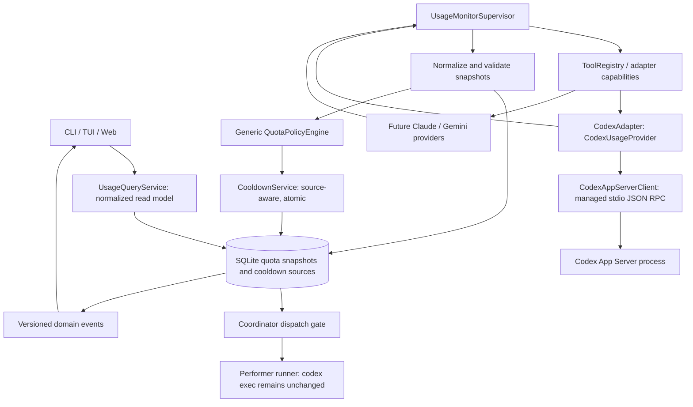
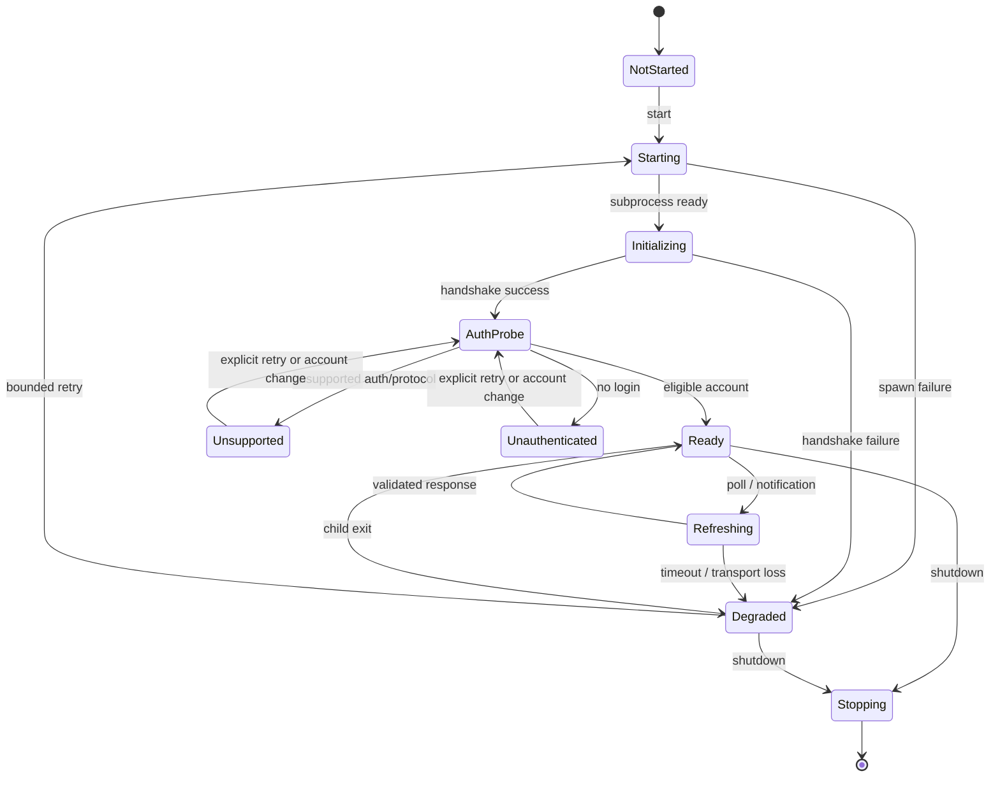
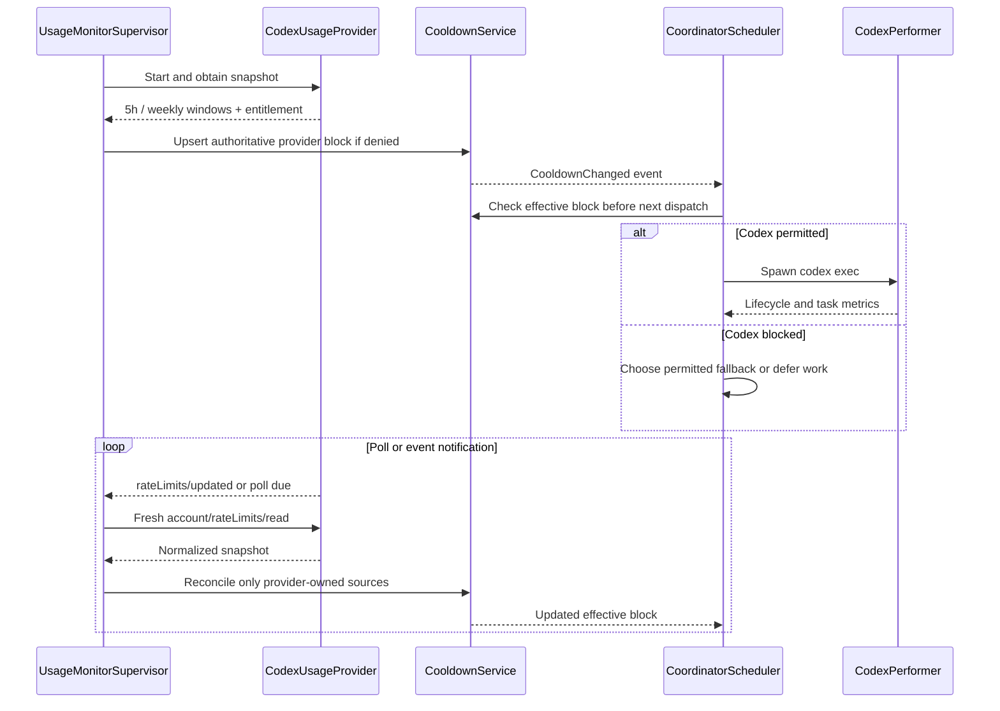

# MACC — Provider Usage Monitoring and Codex Quota-Aware Coordination

**Document type:** Detailed engineering implementation specification  
**Version:** 1.0 — implementation baseline  
**Date:** 2026-10-15  
**Status:** Proposed; implementation not performed by this document  
**Primary target:** MACC (`mod-one/macc`) — Rust core, provider adapters, CLI, Ratatui TUI, Axum API, React Web client  
**Primary feature:** Fully implemented `CodexUsageProvider` with automatic, live quota monitoring and durable, quota-triggered tool cooldowns  
**Generalization target:** Any future tool supported by MACC, without provider-specific logic in the coordinator

> **Provenance and scope.** The baseline below combines the uploaded `MACC.md` architectural specification with an inspection of MACC repository code on 2026-10-15 and the published OpenAI Codex App Server protocol. Existing names and behavior are reported as observed; all newly proposed traits, file paths, configuration keys, migrations, HTTP routes, and options are **implementation requirements**, not claims that these features already exist. Before modifying the repository, the implementation agent must re-check the current branch and adapt paths if the code has evolved.

---

## 1. Executive decision

Implement a **provider-agnostic `UsageMonitoring` capability** inside the MACC tool abstraction layer. Register the first concrete provider, **`CodexUsageProvider`**, from the existing Codex adapter. It reads the authenticated account's quota snapshots from a locally managed `codex app-server` process, maintains fresh usage state before and throughout `macc coordinator`, and drives the existing tool-cooldown mechanism when usage is demonstrably blocked.

The project MUST preserve these architectural boundaries:

1. **Generic core:** normalized usage/limit types, lifecycle coordination, quota policy, cooldown orchestration, storage abstractions and events. No Codex JSON fields, Codex RPC method names or Codex-specific subprocess commands in generic coordinator logic.
2. **Provider adapter:** Codex App Server process management, JSON-RPC transport, authentication detection, protocol parsing, interpretation of Codex-specific account permission and quota fields, and optional token-activity reading.
3. **Coordinator:** consumes normalized decisions, applies a shared tool block using a domain service equivalent to `macc coordinator tool-cooldown-set --tool codex --duration <seconds>`, stops dispatching new work to an exhausted tool, continuously updates its runtime view, and resumes only when policy and new provider evidence permit.
4. **Shared presentation contracts:** the CLI, TUI, Web API and Web client render the **same** normalized snapshot and effective cooldown state; presentation code never calls Codex directly.
5. **Forward compatibility:** Claude, Gemini and other providers can register the same capability independently, or opt out cleanly.

**Critical implementation rule:** do **not** shell out from the coordinator to execute `macc coordinator tool-cooldown-set`. That command must delegate to the **same core cooldown service** used by automatic quota enforcement. Shelling out would introduce latency, recursion, IPC races and avoidable error handling.

**Also critical:** a tool cooldown is a restriction on **new scheduling**, not a request to kill or interrupt already running performers. Existing tasks complete unless a separate user stop policy applies.

---

## 2. Baseline: what already exists in MACC

### 2.1 Confirmed architecture

Based on the uploaded MACC specification and the inspected repository:

| Area | Existing baseline | Required enhancement |
|---|---|---|
| Tool abstraction | `core/src/tool/registry.rs` defines `ToolAdapter` and inventory-backed `ToolRegistry` | Add optional usage provider capability/factory, preserving default implementations |
| Codex adapter | `adapters/codex/src/adapter.rs` implements `ToolAdapter` | Register/construct `CodexUsageProvider` from the adapter crate |
| Error normalization | Per-adapter normalization including `E601` and `E602` | Keep this reactive path; integrate proactive quota evidence without collapsing semantics |
| Coordinator throttle registry | `core/src/coordinator/rate_limit.rs` defines `ToolThrottleState`, `ToolThrottleRegistry` and `is_tool_throttled` | Add provenance-aware, coherent effective cooldown management |
| Durable throttle storage | `core/src/coordinator_storage.rs` has SQLite `tool_throttle` and load/upsert/delete methods | Remove unsafe replace-all races; add quota-source persistence and transactional reconciliation |
| Existing CLI command | `CoordinatorCommand::ToolCooldownSet { tool, duration }`, parsed from `tool-cooldown-set --tool ... --duration <seconds>` | Reuse the operation through a shared domain service |
| Existing commands | `tool-cooldown-list`, `tool-cooldown-set`, `tool-cooldown-clear` | Extend visibility and source-specific clearing without breaking old commands |
| Web API | `GET/POST /api/v1/coordinator/tool-cooldown` and `DELETE /api/v1/coordinator/tool-cooldown/{tool}` | Add read-only provider-usage endpoints and a safe refresh action |
| Web UI | `web/src/components/ToolCooldownPanel.tsx` provides manual cooldown controls | Add quota panels and explain automatically managed cooldowns |
| TUI | Ratatui with live coordinator, including throttle status | Add generic quota cards, countdowns and real-time state updates |
| Dispatch selection | `core/src/coordinator/task_selector.rs` receives throttle state | Enforce blocked tools regardless of fallback setting; refresh throttles before scheduling |

### 2.2 Confirmed integration hazards to fix

The inspected implementation includes the following hazards. They must be addressed **as part of this feature**, not deferred:

- `tool-cooldown-set` writes a single SQLite row via `SqliteStorage::upsert_tool_throttle`, while coordinator runtime also maintains an in-memory `ToolThrottleRegistry`.
- The coordinator restores the registry on startup, but can subsequently persist the **whole** in-memory registry with `save_throttle_registry`, which issues `DELETE FROM tool_throttle` before rewriting all rows. An external cooldown update can therefore be overwritten or remain invisible until restart.
- The selection logic has branches where throttle filtering depends on `rate_limit_fallback_enabled`. **A disabled fallback must never mean ignoring an active block.** The scheduler must always exclude blocked tools; fallback only controls whether another tool may replace the blocked one.
- A successful phase can clear a tool throttle entry. This must never clear a still-valid **provider quota** block or an unrelated manual cooldown.
- Existing manual cooldowns have a single `tool_id` key, with no explicit source (`manual`, `error`, or `provider_quota`). The feature needs composable sources and ownership.
- A cooldown duration alone does not guarantee restored quota. At reset time MACC must **re-query** the provider before dispatching fresh work.

These are functional safety and concurrency issues, not merely presentation details.

### 2.3 Compatibility constraints

- Preserve `.macc/macc.yaml` as canonical project configuration.
- Preserve `ToolAdapter` and inventory registration conventions; avoid breaking existing adapters that do not implement monitoring.
- Preserve existing manual cooldown CLI and REST semantics for the current release, extending rather than replacing them.
- Preserve existing tool fallback, worktree pool, session handling, E601/E602 normalization, TUI and Web operations.
- Continue to use the project SQLite infrastructure instead of introducing another database.
- Keep provider credentials out of project files, databases, output logs and the Web API.

---

## 3. Functional requirements and invariants

### 3.1 Feature requirements

| ID | Priority | Requirement |
|---|---|---|
| USG-001 | MUST | Auto-discover a usage-capable provider for each enabled tool through the tool adapter registry |
| USG-002 | MUST | Authenticate using the user's existing supported Codex login without requesting an API key |
| USG-003 | MUST | Read all available quota buckets/windows, including commonly observed 5-hour and weekly windows |
| USG-004 | MUST | Display remaining %, used %, reset timestamp, availability, status and sample age where supplied |
| USG-005 | MUST | Check before coordinator dispatch and monitor continuously throughout a running coordinator |
| USG-006 | MUST | Apply a durable Codex tool cooldown automatically when included Codex usage is confirmed unavailable |
| USG-007 | MUST | Compute cooldown from blocking window resets when trustworthy; otherwise use short monitored/probe cooldowns |
| USG-008 | MUST | Re-read provider state before removing an exhausted-provider block; a timer alone is insufficient |
| USG-009 | MUST | Do not dispatch a tool during an active manual, provider or error cooldown |
| USG-010 | MUST | Preserve the ability to fallback to another tool where permitted; never change task model/tool ownership silently |
| USG-011 | MUST | Display quota status in CLI, Ratatui TUI and React Web UI |
| USG-012 | MUST | Expose normalized, read-only status and live events from the Web API |
| USG-013 | MUST | Survive coordinator restarts, App Server crashes, polling failures, account changes and schema differences |
| USG-014 | MUST | Avoid multiple writers corrupting cooldown state; use transactional persistence |
| USG-015 | MUST | Support non-Codex providers later without editing scheduler-specific provider branches |
| USG-016 | MUST | Provide deterministic fixtures, unit, integration, concurrency and end-to-end tests |
| USG-017 | SHOULD | Store sanitized quota history and optional per-task token activity for reporting |
| USG-018 | SHOULD | Handle additional Codex quota buckets and model-specific limits without guessing their applicability |
| USG-019 | SHOULD | Provide an explicit `macc usage refresh` and health/doctor diagnostics |
| USG-020 | MUST NOT | Automatically redeem credits, purchase credits, change billing, logout or trigger a login flow without user action |

### 3.2 Core invariants

- **INV-1:** UI refreshes and quota parsing do not write coordinator task or worktree state.
- **INV-2:** A provider failure cannot directly produce an arbitrary permanent cooldown.
- **INV-3:** An active block of *any source* always prevents new dispatch to that tool.
- **INV-4:** Removing one source of a cooldown does not remove another.
- **INV-5:** A timestamp passing is not proof of renewed entitlement.
- **INV-6:** A null/missing field means *unknown*, never implicitly zero, full or recovered.
- **INV-7:** Quota percentages are **not** tokens or money; do not infer quota remaining from `codex exec` token counts.
- **INV-8:** Only one active, managed monitor should own a given `(local user, credential context, provider)` within a coordinator process.
- **INV-9:** A backend-provided permission flag takes precedence over simplistic percentage heuristics.
- **INV-10:** A provider-specific data structure never escapes the adapter into the generic scheduler.
- **INV-11:** All times are UTC on the wire and in storage; clients format them in their local timezone.
- **INV-12:** A usage read with a different account identity cannot update the prior account's authoritative quota state.

---

## 4. Authoritative Codex App Server protocol

### 4.1 Transport and requests

Use the **documented** App Server process, speaking newline-delimited JSON-RPC-like messages over stdio:

```bash
codex app-server --listen stdio://
```

`stdio://` is the default. Spawn the binary directly (`tokio::process::Command`), not through a shell. `stdout` is protocol data, `stderr` is diagnostics. Never parse stdout as free text.

After process startup:

```json
{"id":1,"method":"initialize","params":{"clientInfo":{"name":"macc","title":"MACC Usage Monitor","version":"1.0.0"}}}
{"method":"initialized","params":{}}
{"id":2,"method":"account/read","params":{"refreshToken":false}}
{"id":3,"method":"account/rateLimits/read"}
{"id":4,"method":"account/usage/read"}
```

**Sequence matters:** wait for the successful initialize response before sending `initialized`; correlate request IDs with responses. The lines above illustrate the wire format but are not a fire-and-forget script. `account/usage/read` is optional/low frequency and must not block quota monitoring.

Also handle notifications:

- `account/rateLimits/updated` — sparse update; do not treat absent fields as clearing earlier fields. Prefer a debounced full re-read when uncertain.
- `account/updated` — auth/account change; invalidate old quota identity, re-read account and limits.
- child exit / broken pipe — transition to degraded and reconnect with backoff.

MACC does **not** need to start inference threads, execute `turn/start`, or migrate performers to App Server merely to query usage.

### 4.2 Verified quota response fields

The published Codex protocol currently includes:

```json
{
  "id": 3,
  "result": {
    "ordinaryUsageAllowed": true,
    "accountId": "opaque-example-account",
    "rateLimits": {
      "limitId": "codex",
      "limitName": null,
      "normalModelSlug": null,
      "primary": {
        "usedPercent": 35,
        "windowDurationMins": 300,
        "resetsAt": 1792000000
      },
      "secondary": {
        "usedPercent": 68,
        "windowDurationMins": 10080,
        "resetsAt": 1792300000
      },
      "credits": null,
      "rateLimitReachedType": null,
      "spendControlReached": false
    },
    "rateLimitsByLimitId": null,
    "rateLimitResetCredits": null,
    "rateLimitUpsell": null
  }
}
```

*Illustrative values only. Production schema may add fields, omit optional values, or return multiple buckets.*

Key fields:

- `ordinaryUsageAllowed: bool|null`: backend permission for ordinary included usage; **null does not prove recovery**.
- `accountId: string|null`: returned account identity; must not be exposed raw to Web clients.
- `rateLimits`: historical single-bucket representation.
- `rateLimitsByLimitId`: optional map of additional metered buckets; preferred when present.
- `limitId`, `limitName`, `normalModelSlug`: opaque bucket identification and optional display/model metadata.
- `primary`, `secondary`: optional windows, each with `usedPercent`, optional `windowDurationMins`, optional `resetsAt`.
- `credits`, `individualLimit`, `spendControlReached`, `rateLimitReachedType`: billing/limit context where supplied. Preserve and interpret conservatively.
- `rateLimitResetCredits`: available reset-credit metadata; **display-only** in this feature.

The RPC schema currently defines `usedPercent` as numeric; MACC must validate a finite 0–100 range before using it for scheduling. Invalid data is marked unknown and generates an adapter diagnostic instead of a panic.

### 4.3 Bucket/window selection

Do not hardcode `primary == five_hour` or `secondary == weekly`.

For every available bucket, normalize its windows using `windowDurationMins`:

| Duration | Normalized label |
|---|---|
| `300` minutes | `5-hour` |
| `10080` minutes | `Weekly` |
| Any other positive duration | Localized duration such as `1-hour`, `Daily`, `15-minute` |
| Missing/invalid | `Unknown duration` |

When `rateLimitsByLimitId` exists, deduplicate the historical `rateLimits` entry by `limitId` and do not double-count the same bucket. Preserve **all** available buckets and windows, even if they are not the default Codex bucket.

A tool may use a shared bucket and additional model-specific buckets. MACC MUST NOT infer an authoritative model-to-bucket mapping from `limitName` or model display text. Such mappings are currently not guaranteed by the quota protocol. Treat unknown applicability as `unresolved` and avoid globally cooling down an entire tool solely because an unrelated or unknown specialized bucket is exhausted. Permit verified, explicit model-to-bucket mappings in adapter metadata when actually supported by a stable provider contract.

### 4.4 Token activity (separate observability)

`account/usage/read` may provide `summary.lifetimeTokens`, `summary.peakDailyTokens`, and optional `dailyUsageBuckets`. Values may be null. Read this at lower frequency (for example every 15–30 minutes or on explicit user refresh), separately from quota polling.

The existing `codex exec --json` can emit `turn.completed.usage` containing `input_tokens`, `cached_input_tokens`, `output_tokens`, and `reasoning_output_tokens`. MACC may record those per task/session when the runner already uses JSON output. Cached input tokens are **already included** in input tokens. Never use these token metrics to calculate percent-of-plan quota.

### 4.5 Auth modes and capability gating

`account/read` must distinguish ChatGPT-backed account authentication from API-key-only or unsupported contexts. If the current authentication mode does not support plan-based quota information, show `UnsupportedAuthMode` rather than manufacturing zero usage. Do not silently switch to paid API usage.

- Reuse the Codex-managed login environment where permission permits.
- Use current-user process credentials; do not copy raw `auth.json` into MACC state or logs.
- Respect `CODEX_HOME`/user context and binaries selected by the adapter configuration.
- Never start interactive login automatically while coordinator is running.
- Do not make an authenticated request to undocumented/private usage endpoints.
- Refresh/reconnect on account changes and permission/auth errors; expose actionable diagnostics.

### 4.6 Version resilience

- Support optional and unknown fields (Serde defaults and `Option`).
- Pin tested schema fixtures and Codex version ranges in adapter tests, **not** in coordinator code.
- Probe RPC availability at runtime; classify method-not-found as unsupported protocol/version.
- Detect protocol deviations and retain last-known snapshot as **stale**, never fresh.
- Do not use an undocumented `account` endpoint as a fallback.
- Limit JSONL message size, pending RPC count, timeouts and restart attempts.

---

## 5. Target architecture



**Dependency direction:** external/provider adapter → usage interfaces defined in core ← generic coordinator service. UI and HTTP depend on core services, not on adapter internals. Provider-specific implementations depend on core abstraction types; core must never depend on `macc-adapter-codex`.

### 5.1 Ownership and lifetime

- **Coordinator active:** one `UsageMonitorSupervisor` owned by coordinator runtime, containing one active monitor per eligible tool/account context; it starts before the first dispatch, runs concurrently with all performers, and is stopped on coordinator shutdown.
- **CLI `macc usage` without coordinator:** ephemeral read-only monitor connection if fresh cached data is not sufficient.
- **TUI or Web without coordinator:** show persisted snapshot immediately, then request a refresh via a single local monitoring owner or a safe ephemeral read-only connection; no requirement to start an orchestration run.
- **Multiple projects using the same Codex account:** first version can monitor per project, but should reuse a per-user local monitor service or serialized refresh lock when feasible. Never assume a project-scope SQLite DB represents every other process's consumption.
- **Multiple MACC processes over one project:** enforce single active coordinator owner and database transaction safety. A second Web/TUI process is a reader/refresh requester, not an independent cooldown authority.

### 5.2 Proposed Rust modules

Paths may be adjusted to repository conventions after inspection:

```text
core/src/
  usage/
    mod.rs                 # Normalized models and public contracts
    provider.rs            # UsageProvider + UsageProviderFactory traits
    registry.rs            # Registry integration and discovery
    monitor.rs             # Generic supervisor, refresh, jitter, cancellation
    policy.rs              # Generic entitlement/quota decision logic
    cooldown.rs            # Domain service, effective block projection
    storage.rs             # Persistence abstraction and snapshots
    events.rs              # Domain event schema
    service.rs             # Cross-client read/refresh operations
  coordinator/
    ...                    # Inject UsageMonitor/DispatchGate; no Codex imports
adapters/codex/src/
  usage/
    mod.rs                 # CodexUsageProvider
    app_server.rs          # Managed child process, JSON-RPC transport
    protocol.rs            # Codex-only request/response types
    normalization.rs       # Codex -> generic usage snapshot
    tests.rs               # Fixtures and protocol tests
cli/src/
  commands/usage.rs       # Shared usage CLI
  commands/web/usage.rs   # Axum handlers
  ...                     # Route and CLI registration
tui/src/                  # Extend the existing Ratatui modules
web/src/
  api/usage.ts
  components/usage/       # Shared quota primitives
  pages/ops/             # Coordinator quota overview
```

Use the existing `tui/` crate and its current module conventions; do not introduce a new TUI crate. **No new standalone `CodexMonitor` daemon is required for v1.** Avoid excessive micro-crates.

---

## 6. Generic interfaces and models

### 6.1 Add an optional adapter capability, not a required adapter method

Extend `ToolAdapter` with an **object-safe**, optional factory method returning no provider by default. The exact API shape may differ to comply with MACC's existing object and ownership model:

```rust
use std::sync::Arc;

pub trait ToolAdapter: Send + Sync {
    fn id(&self) -> String;

    // Existing methods remain unchanged.

    fn usage_provider_factory(&self) -> Option<Arc<dyn UsageProviderFactory>> {
        None
    }
}

pub trait UsageProviderFactory: Send + Sync {
    fn tool_id(&self) -> &str;
    fn capabilities(&self) -> UsageCapabilities;
    fn create(&self, context: UsageProviderContext) -> UsageResult<Box<dyn UsageProvider>>;
}
```

A provider factory MUST NOT execute external processes during adapter registration. Process startup occurs lazily at `start()` or `refresh()`. The registry returns a usage-capable adapter regardless of whether that provider is currently connected.

Alternative acceptable design: a separate `UsageProviderRegistration` inventory collection keyed by existing `tool_id`, if this avoids undesirable trait coupling. It must still resolve through the established `ToolRegistry`/tool abstraction layer and avoid a hard-coded `if tool_id == "codex"` branch in the coordinator.

### 6.2 Provider lifecycle trait

Use an object-safe async API (`async_trait` or equivalent boxed futures). A reference design:

```rust
#[async_trait::async_trait]
pub trait UsageProvider: Send + Sync {
    fn tool_id(&self) -> &str;
    fn capabilities(&self) -> UsageCapabilities;

    async fn start(&mut self) -> UsageResult<()>;
    async fn probe(&mut self) -> UsageResult<ProviderIdentity>;
    async fn snapshot(&mut self) -> UsageResult<ProviderUsageSnapshot>;
    async fn token_activity(&mut self) -> UsageResult<Option<TokenActivity>>;
    async fn next_event(&mut self) -> UsageResult<Option<UsageProviderEvent>>;
    async fn shutdown(&mut self) -> UsageResult<()>;
}
```

`next_event()` is optional by declared capability; the monitor must still poll if events are unsupported. Do not hold a mutex over the entire provider during a blocking event read. A stronger implementation can expose a bounded Tokio channel for unsolicited events and keep RPC correlation in a separate reader task.

### 6.3 Provider capability declaration

```rust
pub struct UsageCapabilities {
    pub quota_windows: bool,
    pub live_notifications: bool,
    pub token_summary: bool,
    pub account_identity: bool,
    pub model_bucket_mapping: bool,
    pub remote_refresh: bool,
}
```

Clients must render capability absence honestly. A tool supporting only reactive rate-limit errors remains usable by MACC and does not need to implement usage monitoring.

### 6.4 Normalized snapshot (provider-neutral)

```rust
pub struct ProviderUsageSnapshot {
    pub tool_id: String,
    pub provider_key: String,
    pub account_key: Option<String>,        // Stable local non-reversible fingerprint
    pub account_display: Option<String>,    // Safe, redacted label
    pub auth_status: UsageAuthStatus,
    pub observed_at: DateTime<Utc>,
    pub received_at: DateTime<Utc>,
    pub validity: SnapshotValidity,
    pub capabilities: UsageCapabilities,
    pub entitlement: EntitlementState,
    pub buckets: Vec<UsageBucket>,
    pub token_activity: Option<TokenActivity>,
    pub diagnostics: Vec<UsageDiagnostic>,
}

pub struct UsageBucket {
    pub bucket_id: String,               // Opaque, provider-specific value
    pub display_name: Option<String>,
    pub model_scope: ModelScope,         // Shared, known model set, or unresolved
    pub windows: Vec<QuotaWindow>,
    pub provider_limit_status: Option<String>,
}

pub struct QuotaWindow {
    pub window_key: String,             // Stable per bucket/window; not just primary/secondary
    pub duration: Option<Duration>,
    pub used_percent: Option<f64>,
    pub remaining_percent: Option<f64>,
    pub resets_at: Option<DateTime<Utc>>,
    pub status: WindowStatus,
}

pub enum EntitlementState {
    Allowed,                       // Backend affirmed usage is allowed
    Blocked(QuotaBlockReason),     // Backend affirmed ordinary usage is blocked
    Unknown,                       // Permission not available/indeterminate
    Unsupported,                   // Auth or provider cannot report included usage
}

pub enum SnapshotValidity { Fresh, Stale, Unavailable }
pub enum WindowStatus { Available, Exhausted, Unknown }
pub enum ModelScope { Shared, Known(Vec<String>), Unresolved }
```

Define similar enums for `UsageAuthStatus` (e.g. `Authenticated`, `NotAuthenticated`, `UnsupportedAuthMode`, `Expired`, `Unknown`), `QuotaBlockReason` (`RateWindow`, `SpendLimit`, `WorkspaceLimit`, `Credits`, `ProviderDenied`, `Unclassified`), and structured error categories. The exact code is illustrative, but the semantic distinctions are mandatory.

Account fingerprints: derive from provider identity and opaque account ID via a keyed local hash, not directly from an email or username. A snapshot without identity must not be merged with a previously identified account solely because its `tool_id` matches.

### 6.5 Usage events

Publish versioned domain events, separate from protocol JSON:

```json
{
  "schema_version": 1,
  "event_id": "uuid",
  "type": "usage.quota_blocked",
  "tool_id": "codex",
  "account_key": "redacted-local-fingerprint",
  "observed_at": "2026-10-15T12:00:00Z",
  "reason": "ordinary_usage_denied",
  "cooldown_until": "2026-10-16T12:00:30Z",
  "source": "codex_app_server"
}
```

Other events: `usage.monitor_started`, `usage.snapshot_updated`, `usage.snapshot_stale`, `usage.auth_changed`, `usage.provider_unavailable`, `usage.quota_warning`, `usage.quota_recovered`, `usage.cooldown_applied`, `usage.cooldown_extended`, `usage.cooldown_released`. Define bounded queues and coalescing for high-frequency updates. Every event must carry a stable tool ID and timestamp; avoid embedding raw RPC payloads in event logs.

---
## 7. Full `CodexUsageProvider` implementation

### 7.1 Responsibilities

The Codex adapter MUST implement all of the following:

1. Find the effective Codex executable, respecting MACC tool configuration and user PATH.
2. Detect executable version and supported App Server capabilities without requiring inference.
3. Start or attach to a safe local App Server transport (managed stdio by default).
4. Complete the RPC handshake and track each request by ID.
5. Read `account/read` and determine eligibility for ChatGPT-plan quota data.
6. Read `account/rateLimits/read`, normalize every bucket/window, and publish a snapshot.
7. Listen for `account/rateLimits/updated` and `account/updated` and trigger appropriate revalidation.
8. Optionally read `account/usage/read` for account-wide token activity.
9. Handle sparse updates, null fields, unknown enum values, schema additions and missing methods.
10. Reconnect after process exit with bounded exponential backoff and jitter.
11. Shut down child processes gracefully and reap them; no orphaned App Server children.
12. Emit structured adapter diagnostics, redacting sensitive account data.
13. Prevent concurrent client read/write corruption, duplicate polls and request-response mismatches.
14. Support mock subprocess transport so tests never require a real account or consume quota.

### 7.2 Internal components

Suggested internal separation:

| Component | Single responsibility |
|---|---|
| `CodexUsageProvider` | Implement generic `UsageProvider`; coordinate probing and snapshots |
| `CodexAppServerClient` | Manage child process and RPC calls; never know coordinator tasks |
| `JsonRpcTransport` | Newline framing, request IDs, notifications, timeouts and cancellation |
| `CodexProtocolModels` | Serde v2 response/request types with compatible parsing |
| `CodexQuotaNormalizer` | Convert Codex-specific wire models to generic `UsageBucket`/`EntitlementState` |
| `CodexAuthProbe` | Interpret account/read, identity changes and supported auth modes |
| `CodexUsageFixture` | Deterministic integration testing, no network |

The adapter must not import `CoordinatorRunState`, `TaskSelectorConfig` or `SqliteStorage` directly. The supervisor and core services own those concerns.

### 7.3 JSON-RPC transport requirements

- Use `tokio::process::Command` with `kill_on_drop` plus explicit graceful cleanup where possible.
- No shell interpolation. Set controlled environment variables and cwd.
- Read stdout incrementally and enforce a configurable maximum line length (default 2 MiB; raise only on explicit need).
- Route `{"id": ..., "result": ...}` and `{"id": ..., "error": ...}` to the corresponding awaiting RPC future.
- Route messages with `method` and no `id` to a bounded event channel.
- Reject duplicate/unexpected response IDs without poisoning unrelated calls.
- Use request timeout (default 10 seconds after successful startup), initialization timeout (default 20 seconds), and shutdown timeout (default 5 seconds). All values configurable by a bounded advanced setting.
- Limit outstanding requests to a small number (default 4).
- Ignore empty protocol lines; log malformed lines as redacted diagnostic counts. A repeated protocol error trips the transport into degraded mode.
- `stderr` must be drained and bounded to avoid child-process deadlock. Never write unredacted `stderr` to user-visible logs.
- Do not call `account/rateLimitResetCredit/consume` (would use an earned reset credit) or any purchase endpoint.
- On `account/updated`, clear the in-memory authoritative account snapshot **immediately**, await a fresh identity and quotas, and do not reuse the prior account's entitlement.
- When App Server provides a notification that is only a sparse delta, prefer a **full refetch**, debounce repeated notifications over ~1 second.
- Add integration fixtures covering multiple interleaved responses and unsolicited notifications.

### 7.4 State machine



Maintain `last_successful_poll_at`, `last_poll_attempt_at`, `last_error_category`, `last_rpc_latency`, `reconnect_attempts` and `current_account_key` for diagnostics. Do not equate `Ready` with `usage permitted`; a monitor can be healthy while the account is quota-blocked.

### 7.5 Snapshot reconciliation

1. Fetch `account/read` if identity is absent/invalidated or an auth change occurred.
2. Fetch `account/rateLimits/read`.
3. Validate account identity. If a different account is observed, rotate the identity namespace and archive the old snapshot, without applying old cooldown causes to the new account.
4. Prefer `rateLimitsByLimitId` entries when present; merge the backward-compatible `rateLimits` entry by stable bucket ID and only if not already represented.
5. Generate normalized windows; compute `remaining_percent = clamp(100.0 - used_percent, 0, 100)` **only** when usedPercent is valid.
6. Parse all reset values as seconds since epoch, but reject non-sensical values, NaN and out-of-range timestamps.
7. Preserve the distinction between `0% remaining` and backend permission `ordinaryUsageAllowed=true`.
8. Persist the full sanitized snapshot atomically with a monotonically increasing snapshot generation and timestamp.
9. Publish an update event only if meaningful state changes; avoid event floods for unchanged percentages.
10. Pass the snapshot to the generic policy engine.

### 7.6 Token summary and task metrics

- `CodexUsageProvider::token_activity()` reads `account/usage/read` only when the capability is available.
- The provider's account token summary is for reporting, not quota-based dispatch decisions.
- The Codex runner may additionally emit task-specific token metrics through an optional **generic `ExecutionUsageReport`** contract from the tool abstraction layer.
- Local token metrics must be keyed by `run_id`, `task_id`, `worktree_id`, `tool_id`, `model_id`, `phase`, `turn_id` and UTC timestamp where available.
- Avoid double counting repeated `turn.completed` events or resumed sessions; dedupe on stable event/turn identity.
- Preserve legacy non-JSON runner mode if structured output is unavailable; report metrics as unavailable rather than parsing arbitrary text.

---

## 8. Generic quota policy and automatic cooldowns

### 8.1 Separate the three concepts

**Quota observation** (what a provider reports) is not the same as **entitlement** (whether work is permitted), and neither is the same as **a MACC cooldown** (a scheduling restriction). Keep these as distinct domain objects.

- `UsageProvider` supplies observations and normalized entitlement.
- `QuotaPolicyEngine` decides whether to warn, permit, defer or block new dispatch.
- `CooldownService` persists a source-specific block and computes the effective tool restriction.
- `DispatchGate` checks the effective restriction immediately before scheduling.

The coordinator must never reverse-engineer Codex-specific permission from raw JSON.

### 8.2 Exhaustion evidence hierarchy

Use this precedence in the **Codex adapter normalization** and feed the generic policy an explicit `EntitlementState` and evidence list:

1. **Explicit provider permission**: `ordinaryUsageAllowed == false` means ordinary included usage is blocked; `true` means the backend currently affirms ordinary usage is allowed. Do not override an explicit `true` solely because one window displays 100%.
2. **Provider-classified reached states**: an active `rateLimitReachedType` or `spendControlReached == true` can indicate a block, with an appropriate reason. A workspace credit/usage block may not be resolved by a simple window reset.
3. **Actual tool error signal**: a classified E602 from a Codex runner may confirm quota exhaustion in the provider's current auth/model context; use existing normalizer, but keep the provenance separate from quota polling.
4. **Window at 100% with no explicit permission**: only **suspected** exhaustion by default. Re-query promptly, consider any relevant credits and account status, and do not impose a multi-hour or multi-day hard block from a single ambiguous percentage alone.
5. **Stale snapshot, null fields, unrelated model bucket, method unsupported**: unknown. Do not synthesize a confirmed block.

**Important:** `ordinaryUsageAllowed=false` is an authoritative block of **ordinary included usage**, not a promise that all conceivable API, credit, reserve or other payment modes are impossible. Do not automatically enable or charge a different mode.

### 8.3 Decision matrix

| Observed state | Generic decision | Cooldown behavior |
|---|---|---|
| Fresh, `Allowed`, relevant windows under limit | `Allow` | Release provider quota source only after validated recovery; other source blocks remain |
| Fresh, explicit provider denial of ordinary usage | `Block` | Set/extend provider cooldown and schedule revalidation |
| Fresh, explicit workspace/spend/credit denial | `Block` | Set bounded probe cooldown; show user action may be required |
| Fresh, relevant window exhausted; permission unknown | `SuspectedExhaustion` | Immediate confirmatory refresh; avoid long automatic block without confirmation |
| E602 from runner, corroborated by provider data | `Block` | Provider/error block using reset data or bounded probe as appropriate |
| E601 transient rate limit | `TemporaryThrottle` | Existing E601 backoff; do not call this weekly exhaustion |
| Fresh, authenticated but no quotas reported | `Unknown` | Warn; configurable fail-open/fail-closed at dispatch |
| Monitor unavailable but a previously confirmed hard block remains | `UnverifiedBlocked` | Keep blocking until next safe verification opportunity/policy override |
| API-key auth and ChatGPT quota RPC unsupported | `Unsupported` | Do not guess; preserve existing runner/error behavior |
| Provider account changed | `IdentityChanged` | Invalidate old provider status; establish new account-specific state |

### 8.4 Default policies

Recommended safe defaults:

```yaml
# New proposed configuration, read by generic usage monitoring.
usage_monitoring:
  enabled: true
  auto_discover: true
  refresh_interval_seconds: 180
  refresh_jitter_percent: 10
  snapshot_max_age_seconds: 240
  refresh_before_dispatch_if_older_than_seconds: 60
  refresh_timeout_seconds: 10
  startup_timeout_seconds: 20
  monitor_failure_policy: warn_and_use_last_known_state
  confirmed_block_policy: auto_cooldown
  presumed_exhaustion_policy: confirm_before_block
  cooldown_reset_guard_seconds: 30
  unknown_reset_probe_seconds: 300
  recovery_probe_interval_seconds: 180
  fallback_enabled: true
  warn_remaining_percent: 30
  critical_remaining_percent: 15
  store_history: true
  store_token_activity: true
  account_token_activity_interval_seconds: 1800
  providers:
    codex:
      enabled: auto
      transport: managed_stdio
      use_existing_auth: true
      bucket_scope: shared_and_verified_model_specific
```

These keys are **new additions**, not present in the current config schema. The exact nesting must be chosen consistently with `CanonicalConfig`, `ResolvedConfig`, project defaults, config profiles and CLI/TUI/Web config editors. Prefer `automation.coordinator.usage_monitoring` if that minimizes schema churn while preserving an independently queryable usage service; ensure visibility also works before the coordinator starts.

Do not introduce an unbounded `cooldown_duration` user setting. Define validated policy bounds and safe `u64` arithmetic. The default **auto cooldown** only triggers on **confirmed** provider denial/reached state or a classified true quota-exhaustion signal.

### 8.5 Computing cooldown duration

Let `now` be a trusted UTC timestamp and `blocking_windows` the verified quota windows corresponding to the blocked execution context. For every blocker with a valid future `resets_at`, find that reset. When multiple windows are **simultaneously** exhausted, all must recover, so choose the latest relevant reset.

```text
if confirmed_block and known_blocking_reset_times nonempty:
    target_reset = max(known_blocking_reset_times)
    next_probe_at = min(target_reset + reset_guard, now + probe_interval)
    desired_protection_until = target_reset + reset_guard
    # Keep a durable source-specific block, but re-read on next_probe_at.
else if confirmed_block:
    desired_protection_until = now + unknown_reset_probe_seconds
    next_probe_at = now + recovery_probe_interval_seconds
else:
    do not create provider cooldown

command_equivalent_duration_seconds = max(1, ceil(desired_protection_until - now))
```

**Do not wait silently for a week without polling.** Store `blocked_until` (protective, potentially a long interval) separately from `next_probe_at` (periodic refresh), and allow early recovery if the provider affirms `Allowed`. An implementation may additionally cap individual cooldown rows and renew them while still denied, but then must guarantee the dispatch gate cannot leak tasks between renewals.

On the exact expiry timestamp, treat cooldown expiry as *eligible for verification*, **not permission to dispatch**. Re-query and only remove a provider quota block after an authoritative allowed response or an explicit, auditable operator override.

If a workspace/spend/credit denial has no trustworthy reset, use a short retry/probe duration but a durable `pending_revalidation` policy marker so expiry never silently changes it to `Allowed`.

### 8.6 Specific examples

**Case A — 5-hour quota exhausted**

```text
5h: used=100%, reset in 01:43:20
week: used=43%, reset in 4 days
ordinaryUsageAllowed=false
Result: provider quota block, protective deadline ~= 01:43:50
        refresh periodically; remove only on confirmed recovery
```

**Case B — weekly quota exhausted**

```text
5h: used=38%, reset in 02:00
week: used=100%, reset in 3d 06h
ordinaryUsageAllowed=false
Result: provider quota block, target weekly reset + guard
        keep periodic probes; no dispatch until confirmed recovered
```

**Case C — both exhausted**

```text
5h reset in 4h; weekly reset in 5 days; explicit usage denial
Result: the later blocking reset dominates (weekly + guard)
```

**Case D — 100% displayed but provider says Allowed**

```text
5h used=100%; credits or alternative capacity may apply
ordinaryUsageAllowed=true
Result: show 0% in that window, but do not auto-block ordinary usage
```

**Case E — quota looks clear, but auth changed**

```text
Account A denied; App Server switches to account B
Result: quarantine account A snapshot and its auto source
        probe B independently; manual block survives
```

**Case F — model-specific bucket exhausted but mapping unresolved**

```text
Shared codex bucket allowed; a distinct specialized bucket reaches limit
Result: display specialized bucket as blocked/unknown applicability
        do not block all Codex models without evidence of shared impact
```

### 8.7 Early recovery

When a fresh snapshot positively confirms ordinary usage is allowed **for the relevant current account and execution scope**:

1. Remove only the `provider_quota` cooldown source owned by the identified provider/account/bucket context.
2. Keep `manual`, `runner_e601`, `runner_e602`, and other provider reasons unless their own recovery logic explicitly clears them.
3. Recompute the effective tool-level block and publish `usage.quota_recovered` plus `usage.cooldown_released` if applicable.
4. Wake the coordinator scheduler through its existing event/wake mechanism so it does not wait for the next lengthy polling cycle.
5. Do not automatically resume a user-paused coordinator; provider recovery is not user consent to clear an explicit pause.

---

## 9. Reuse and harden `tool-cooldown-set`

### 9.1 Public behavior must remain

The existing command uses **seconds**:

```bash
macc coordinator tool-cooldown-set --tool codex --duration 3600
macc coordinator tool-cooldown-list
macc coordinator tool-cooldown-clear --tool codex
```

The automatic monitor must apply a block that is equivalent to this command, but through the new generic core service:

```rust
cooldown_service.set(CooldownSetRequest {
    tool_id: "codex".into(),
    source: CooldownSource::ProviderQuota,
    cause_key: quota_cause_key,
    expires_at: desired_protection_until,
    next_probe_at: Some(next_probe_at),
    account_key,
    evidence_generation,
})?;
```

The example is illustrative; exact types and command path should match current code.

### 9.2 Source-aware storage model

The current `tool_throttle` row keyed only by `tool_id` is insufficient. Introduce an append/update source table and derive the effective tool block:

```sql
CREATE TABLE IF NOT EXISTS tool_cooldown_sources (
    tool_id TEXT NOT NULL,
    source_kind TEXT NOT NULL,
    cause_key TEXT NOT NULL,
    account_key TEXT,
    blocked_until INTEGER NOT NULL,
    next_probe_at INTEGER,
    requires_revalidation INTEGER NOT NULL DEFAULT 0,
    active INTEGER NOT NULL DEFAULT 1,
    generation INTEGER NOT NULL DEFAULT 0,
    details_json TEXT NOT NULL DEFAULT '{}',
    created_at TEXT NOT NULL,
    updated_at TEXT NOT NULL,
    PRIMARY KEY (tool_id, source_kind, cause_key)
);
CREATE INDEX IF NOT EXISTS idx_tool_cooldown_sources_active
    ON tool_cooldown_sources(tool_id, active, blocked_until);
```

Sources include:

- `manual`: set/cleared by CLI, Web, or TUI; preserved across provider recovery.
- `runner_e601`: transient backoff from provider/transport error normalizer.
- `runner_e602`: observed hard quota from an actual performer error.
- `provider_quota`: set/cleared by a registered usage provider's policy engine.
- `operator_policy`: optional future user-defined restrictions.

The effective block is the union of all active, applicable restrictions, **not** whichever source was last written. For fixed-duration sources, expired entries cease blocking according to their documented policy. For `requires_revalidation=1`, the provider source remains a block after timestamp expiry until affirmative recovery or explicit override. A new event-driven dispatch gate MUST read this effective state, not just `now < throttled_until`.

Retain the old `tool_throttle` table for backward compatibility as either:

1. A transactionally refreshed **projection** of the effective state (recommended for a gradual migration); or
2. A legacy source imported to the new table, followed by migration of all consumers to the new read model.

Never allow both models to function as competing independent sources of truth. Existing `save_throttle_registry` replace-all calls must be migrated/removed or confined to a safe single-writer transaction that preserves independently owned source rows.

### 9.3 Shared cooldown service API

```rust
pub trait CooldownService: Send + Sync {
    fn set(&self, request: CooldownSetRequest) -> Result<CooldownView>;
    fn clear_source(&self, request: CooldownClearSourceRequest) -> Result<CooldownView>;
    fn override_tool(&self, request: CooldownOverrideRequest) -> Result<CooldownView>;
    fn effective(&self, tool_id: &str, now: DateTime<Utc>) -> Result<CooldownView>;
    fn list(&self, now: DateTime<Utc>) -> Result<Vec<CooldownView>>;
}
```

Implement as a normal concrete Rust domain service with transactions; it does not need dynamic dispatch unless required by dependency injection. Make it easy to test via an in-memory store/repository interface.

**CLI backwards compatibility (chosen behavior):**

- `tool-cooldown-set`: sets/updates a source of kind `manual`.
- `tool-cooldown-list`: continues to display tool, effective end time, remaining duration and backoff; add optional source/revalidation annotations.
- `tool-cooldown-clear --tool codex`: clears the **manual** source only. This is a deliberate safety improvement over the legacy behavior that could erase a whole tool-level throttle; document the behavior change prominently in release/migration notes. If a provider quota block remains, display its reason and deadline in the command result.
- For an intentional override of other sources, introduce `--source provider_quota --force` and `--all-sources --force` with explicit confirmation for interactive clients, permission check, strong audit log, and a warning that the next authoritative provider read can restore the block.
- The Web API `DELETE` remains present, but defaults to manual-source clearing and returns the effective state, including any automatic blocks. Update consumers/tests to reflect the safety improvement.

### 9.4 Atomicity and race-freedom

- All source-specific writes use SQLite transactions (`BEGIN IMMEDIATE` or equivalent), with indexes and a short busy timeout.
- No replace-all operation may delete a row owned by another actor/source.
- Include `generation` or equivalent compare-and-swap semantics for provider updates so a delayed old snapshot cannot override a newer one.
- On every dispatch-cycle read, or via a subscription to a versioned state cache updated transactionally, the coordinator must observe cooldowns set by the CLI/Web while already running.
- Protect the critical `check effective cooldown -> reserve task dispatch` sequence from races. A lock/serialized scheduler queue is preferred; the provider monitor should publish state changes into the same coordinator owner. External cooldown writers should signal the owner and must be reconciled immediately before starting a performer.
- Use atomic source aggregation and preserve the maximum effective restriction; a manual 24-hour block must not be shortened by a provider's 5-minute poll update.
- A successful Codex execution must **not** clear the user's manual block or a provider's unverified quota block.
- Test interleavings of manual sets, provider sets, E601 backoff, successful runs, Web clears and coordinator restart.

---

## 10. Coordinator integration: before, during and after execution

### 10.1 Startup/pre-dispatch sequence

`macc coordinator` startup MUST:

1. Load canonical config and determine enabled tools, configured priorities and planned phases.
2. Resolve eligible `UsageProviderFactory` instances from the registered adapters.
3. Start the `UsageMonitorSupervisor` for the enabled providers if monitoring is enabled.
4. Attempt a fresh initial snapshot for Codex before the first Codex dispatch, subject to a bounded startup timeout.
5. Load persisted, source-aware cooldowns and reconcile any previous provider block with the current account identity.
6. Evaluate quota policy and atomically set/extend/remove provider quota sources as justified by the fresh evidence.
7. Determine which candidate tools are schedulable; fallback or wait if Codex is blocked.
8. Start regular scheduling and leave usage monitoring running concurrently.

**Never** block the entire coordinator for many minutes because App Server cannot connect. Use the configured unknown-data policy and retain any confirmed existing restrictions. Show a diagnostic rather than a silent hang.

### 10.2 While the coordinator is running

Two independent event loops cooperate:



Do not make the scheduler poll App Server synchronously for **every** task if the snapshot is fresh. The supervisor maintains a coherent shared snapshot; before-dispatch reads trigger an expedited refresh only when the snapshot age exceeds the configured gate threshold or is otherwise questionable.

### 10.3 Dispatch gate

Separate scheduling eligibility from fallback selection:

```rust
pub enum DispatchEligibility {
    Allowed,
    Blocked {
        tool_id: String,
        source: Vec<CooldownSource>,
        retry_or_probe_at: Option<DateTime<Utc>>,
    },
    NeedsRefresh,
}

pub fn dispatch_eligibility(
    tool: &ToolSelection,
    usage: &UsageState,
    cooldown: &CooldownView,
    policy: &DispatchPolicy,
) -> DispatchEligibility;
```

**Acceptance-critical logic:**

- A tool is blocked if **any** active source prohibits dispatch, independent of `rate_limit_fallback_enabled`.
- `rate_limit_fallback_enabled` only determines whether a permitted alternative is selected.
- If fallback is disabled, wait/defer with a visible reason; never run a blocked primary tool.
- Do not silently reassign in-flight `review`/`fix` phases to another tool when this would break session/tool continuity. Prefer holding the phase until recovery or applying an explicitly approved compatible migration policy.
- Never re-run already completed work merely because the primary tool becomes blocked.
- Work already running is not killed by a newly observed quota state. If an in-flight performer fails with E602, apply the existing error normalizer and error-recovery workflow.
- A worktree may be reused only if the selected alternative meets current compatibility/scope/lease rules.
- If every usable tool is blocked, coordinator enters an explicit **waiting-for-capacity** state (or existing paused state with a specific reason), not a misleading fatal error. It must wake on recovery, a manual operator action or an applicable timeout without busy-looping.

### 10.4 Periodic monitoring scheduling

Recommended default cadence:

| Trigger | Behavior |
|---|---|
| Coordinator startup | Initial full read before Codex dispatch |
| Periodic timer | Refresh every 180 seconds ± bounded jitter |
| `account/rateLimits/updated` | Debounced immediate full refresh |
| `account/updated` | Invalidate identity and refresh account + limits |
| Before dispatch and snapshot older than 60 s | Request coalesced expedited refresh; bounded wait |
| E601/E602 from Codex runner | Trigger expedited refresh; preserve reactive cooldown independently |
| `next_probe_at` reached | Retry provider read even if a long protective cooldown remains |
| Protection deadline reached | Mandatory verification before unblocking |
| TUI/Web manual refresh | Coalesced refresh request; return status and do not duplicate provider process |
| Provider crash | Mark stale, backoff restart, continue safe scheduling policy |

Avoid polling every second. *Real-time* here means event-driven updates plus a regular bounded freshness interval; Codex App Server notifications on the MACC-owned process do not guarantee visibility of every external Codex client invocation. Periodic re-reading is mandatory.

### 10.5 Interaction with E601 / E602

- **E601:** temporary rate limit or overload; keep exponential backoff and retry rules. Do not infer a weekly plan limit from a generic 429.
- **E602:** hard quota/budget exhaustion; do not retry immediately. Trigger an expedited provider refresh. If the provider confirms entitlement is blocked, set the `provider_quota` source. Otherwise retain an `runner_e602` source requiring its own explicit recovery criteria and diagnostic.
- **E603:** session conflict is not a quota condition; retain existing session recovery behavior.
- **Auth failures:** distinct error family; do not turn them into a multi-day quota cooldown.
- **Manual clear:** cannot bypass valid provider exhaustion silently. If override is allowed, a new failed run must be normalized and re-blocked.
- **Coordinator global pause:** do not pause an otherwise viable coordinator when another tool can handle eligible work. Preserve existing operator-owned pauses.

### 10.6 Shutdown/restart

On graceful stop:

- cancel polling tasks and event readers;
- flush bounded pending state/event writes;
- terminate and reap managed Codex App Server child;
- retain sanitized usage snapshots and cooldown sources in SQLite;
- do not mark quota as recovered merely because the monitor stopped.

On restart, load the last known state for immediate UI display but mark it stale until revalidated. Account-scoped auto blocks remain effective pending their configured confirmation policy. A different authenticated account triggers identity reconciliation before Codex dispatch.

---
## 11. CLI user experience and command contract

All CLI subcommands use the same `UsageQueryService` and normalized response model as the TUI/Web clients. Commands are **generic**; `codex` is an argument, not a hardcoded command namespace.

### 11.1 Proposed commands

```bash
# Human-readable overview of all enabled usage-capable tools
macc usage status

# Specific provider with window detail, account status and effective cooldown
macc usage status --tool codex

# Explicit fresh quota read; does not launch or resume coordinator
macc usage refresh --tool codex

# Machine-readable output for scripts
macc usage status --tool codex --format json

# Additional detailed buckets and optional token summary
macc usage show --tool codex --all-buckets
macc usage tokens --tool codex --period 7d

# Only errors/connection diagnostics; no secret material
macc usage doctor --tool codex

# Optional real-time terminal watch (requires a readable local event source)
macc usage watch --tool codex
```

The existing `macc coordinator tool-cooldown-*` commands remain authoritative for cooldown administration. Avoid duplicating a second set of cooldown mutator endpoints under `macc usage`.

### 11.2 Proposed plain-text output

```text
MACC Provider Usage                                      refreshed 18s ago

Tool       Account         Status        5h left     Weekly left
codex      ChatGPT Plus    AVAILABLE        35%            72%
claude     Not supported   UNAVAILABLE        -              -

auth: chatgpt                 source: codex app-server
limit bucket: codex           monitored: yes
5-hour reset: 2026-10-15 20:40 local
weekly reset: 2026-10-19 09:00 local
cooldown: none                next check: 02m 42s
```

All numeric values above are illustrative. If a value is unavailable, print `—` with an explanation, **never** `0%`. CLI should support `--no-color`, readable Unicode-free fallback, narrow terminals, and standard exit codes.

### 11.3 Machine-oriented behavior

- `status --format json` returns a stable versioned envelope, not human strings or a raw provider response.
- Nonzero exit codes distinguish configuration error, provider unavailable, unsupported auth, and invalid tool. Ordinary quota exhaustion is a successful **status query** and should still return exit code 0; scripts inspect `entitlement`.
- `refresh` should return the latest snapshot, including `stale=true` and diagnostics when refresh failed; only return an error for severe conditions where no meaningful response can be delivered.
- `watch` must not spin or spawn one App Server process per refresh event.
- Add a CLI integration test confirming `tool-cooldown-set --duration` is interpreted as seconds and that auto-set uses the same service.

---

## 12. Ratatui TUI requirements

### 12.1 Navigation

Add a **Usage & Quotas** screen or subsection under the existing Coordinator/Tools observability navigation. Keep a compact status summary in Coordinator Live when Codex is enabled.

In a narrow terminal, prioritize the current tool, remaining quotas and block state. In a wide terminal, show all providers as separate rows/cards. Do not require the coordinator to be running to view the most recently known usage.

### 12.2 Required elements

- Provider / tool name and safe account display label.
- Authentication and monitor health: connected, connecting, stale, unsupported, unauthenticated.
- 5-hour usage/remaining bar when a matching window exists.
- Weekly usage/remaining bar when a matching window exists.
- Additional quota bucket accordion/table, including model relevance when verified.
- Exact reset time, reset countdown and last refresh timestamp.
- Effective cooldown countdown with reason and origin (`manual`, `provider_quota`, `runner_e601`, etc.).
- Clear, distinguishable blocked/available/unknown state, never encoded by color alone.
- Inline explanation of missing account/quota data.
- Keyboard-controlled `Refresh` operation, with spinner and concurrency protection.
- Optional link to an additional detail pane for account token summary; keep total quota display above historical tokens.

### 12.3 Suggested TUI layout

```text
┌──────────────────────── MACC • Usage & Quotas ────────────────────────┐
│ Codex   ChatGPT Plus                ● Connected      Updated 18s ago  │
│                                                                    │
│  5-hour quota    [█████████████░░░░░░░] 35% remaining              │
│  Weekly quota    [██████░░░░░░░░░░░░░░] 72% remaining              │
│                                                                    │
│  5h resets 20:40 local            Weekly resets Mon 09:00           │
│  Effective block: None           Next refresh in 02:42              │
│                                                                    │
│  [R] Refresh  [B] Buckets  [H] History  [Esc] Back                  │
└────────────────────────────────────────────────────────────────────┘
```

For quota-blocked state, replace the last status with `BLOCKED • Provider quota • Awaiting verification after reset`, and show the next probe time separately from the expected reset time. The illustrated bars are examples, not assumptions about real values.

### 12.4 Runtime integration

- The TUI subscribes to generic usage events/state snapshots, ideally through existing coordinator state/event mechanisms.
- Do not introduce Codex-specific parsing in TUI reducers or renderers.
- Avoid blocking terminal draw loop on RPC/network operations.
- Throttle repaints to a comfortable terminal cadence; countdown may update once per second from local timestamps, while real quota values update only from snapshots.
- Preserve keyboard navigation, color accessibility and small-terminal behavior.

---

## 13. Web API contract (Axum)

### 13.1 Generic read endpoints

Proposed endpoints, under the existing localhost-bound Web API:

| Method | Route | Purpose |
|---|---|---|
| `GET` | `/api/v1/usage` | List normalized usage overview for enabled tools |
| `GET` | `/api/v1/usage/{tool}` | Detailed current provider snapshot and cooldown |
| `GET` | `/api/v1/usage/{tool}/history?from=&to=` | Paginated sanitized historical snapshots |
| `GET` | `/api/v1/usage/{tool}/tokens?period=` | Optional token activity, if available |
| `GET` | `/api/v1/usage/{tool}/health` | Provider connectivity and capability diagnostics |
| `POST` | `/api/v1/usage/{tool}/refresh` | Request one coalesced refresh; no coordinator run |
| `GET` | `/api/v1/events` | Extend existing SSE stream with typed `usage.*` events |

Do not add a second standalone SSE feed unless existing event infrastructure cannot handle the subscription safely. Reuse `Last-Event-ID`, bounded replay and heartbeat behavior where MACC already supports them.

### 13.2 Example normalized response

```json
{
  "schemaVersion": 1,
  "toolId": "codex",
  "providerKey": "codex_app_server",
  "account": {
    "display": "ChatGPT Plus",
    "key": "local-fingerprint",
    "authStatus": "authenticated"
  },
  "monitor": {
    "state": "connected",
    "sampledAt": "2026-10-15T12:00:00Z",
    "stale": false,
    "nextRefreshAt": "2026-10-15T12:03:00Z"
  },
  "entitlement": {
    "state": "allowed",
    "reason": null
  },
  "buckets": [
    {
      "id": "codex",
      "name": "Codex",
      "modelScope": "shared",
      "windows": [
        {
          "kind": "five_hour",
          "durationMins": 300,
          "usedPercent": 65,
          "remainingPercent": 35,
          "resetsAt": "2026-10-15T18:40:00Z"
        },
        {
          "kind": "weekly",
          "durationMins": 10080,
          "usedPercent": 28,
          "remainingPercent": 72,
          "resetsAt": "2026-10-19T07:00:00Z"
        }
      ]
    }
  ],
  "effectiveCooldown": {
    "blocked": false,
    "blockedUntil": null,
    "nextProbeAt": null,
    "sources": []
  },
  "diagnostics": []
}
```

Illustrative data only. `kind` is a normalized *display category* derived from the duration, not a hardcoded primary/secondary assumption. Do not return raw account identifiers, OAuth tokens, process environment, or raw provider responses.

### 13.3 Refresh mutation semantics

- `POST /usage/{tool}/refresh` triggers a generic refresh request to the active monitor owner; if there is no active owner, it may run a bounded ephemeral query.
- Coalesce duplicate refresh requests and return the same generation or an accepted/pending status.
- Require existing MACC caution/consent policy as appropriate; the operation is non-destructive but can contact the provider.
- Rate limit refresh requests per local client, e.g. one in-flight refresh per provider and a 10-second user-triggered minimum interval.
- Return a structured error on unsupported auth or unavailable binary; do not expose subprocess diagnostics verbatim.
- Reconcile cooldowns only from authoritative source updates through the shared service, never directly inside an HTTP handler.

### 13.4 Existing cooldown API compatibility

Keep `GET/POST /api/v1/coordinator/tool-cooldown` and `DELETE /api/v1/coordinator/tool-cooldown/{tool}`. Extend their representation with optional `sources`, `requiresRevalidation` and `nextProbeAt`, while preserving existing fields consumed by the current Web client. Any stronger override behavior requires explicit confirmation and audit logging.

### 13.5 Security boundaries

- Preserve MACC's localhost-default binding.
- If externally exposed, require a separate security review/authentication gate before making account usage information available; do not assume localhost security applies to `0.0.0.0`.
- Validate tool IDs against adapter registry, not filesystem paths or arbitrary process names.
- Use bounded pagination, input validation and output redaction.
- Never accept `executable`, `argv`, account IDs or raw tokens from Web requests as arbitrary subprocess inputs.
- Keep an audit trail of manual override events, including source and old/new deadlines.

---

## 14. React Web UX/UI requirements

### 14.1 Locations

1. **Dashboard:** condensed Usage & Quotas card showing the most constrained enabled provider and the Codex 5-hour/weekly quotas where available.
2. **Coordinator Console (`/ops/console`):** live quota card synchronized with task scheduling and effective cooldown state.
3. **Tool detail/settings:** complete provider usage view, connection diagnostics and per-provider settings.
4. **Existing `ToolCooldownPanel`:** include automatic quota source, reason, expiry and revalidation state; manual controls remain visually distinct.
5. **Optional `/ops/usage`:** full history and bucket details if an additional page fits current navigation. Do not add an unnecessary page solely for basic 5-hour/weekly bars.

### 14.2 UI design contract

For each usable provider show:

- Tool icon/name and safe account/plan label.
- Compact monitor health indicator and sampled age.
- Two primary cards where relevant: **5-hour quota** and **Weekly quota**.
- A percentage of **remaining** quota prominently and `used` secondarily. Bars must have accessible labels (not just a fill color).
- Real reset timestamps and countdowns (`Resets in 2h 14m`, with timezone and absolute time in tooltip/detail).
- Additional buckets in a collapsed list; avoid polluting the primary two-card layout.
- Effective cooldown state, source, probe schedule, and whether operator action is required.
- Fresh/stale/error states, skeleton during initial read and clear `Not available` empty state.
- Manual **Refresh** button that actually requests a snapshot, with disabled/pending/error states.
- Optional sanitized historical chart, not required in the compact card.

**Use MACC's existing design tokens and components**, including accessibility conventions and responsive breakpoints. No hardcoded provider-specific colors or business logic in React. The five-hour/week cards are views over generic `QuotaWindow` objects.

### 14.3 Suggested component structure

```text
web/src/components/usage/
  UsageOverview.tsx        # Generic multi-tool layout
  ToolUsageCard.tsx        # Reusable provider card
  QuotaWindowCard.tsx      # Generic duration + quota bar
  QuotaProgressBar.tsx     # Accessible used/remaining rendering
  UsageStatusBadge.tsx    # Available / blocked / stale / unsupported
  CooldownReason.tsx      # Effective cooldown, sources, confirmation
  UsageFreshness.tsx      # Last sampled, next refresh
  AdditionalBuckets.tsx   # Extra model/bucket data
  UsageHistoryChart.tsx   # Optional, lazy-loaded
  UsageEmptyState.tsx     # Unsupported/unauthenticated/unknown
web/src/api/usage.ts
web/src/api/models.ts       # Versioned normalized response models
```

### 14.4 Browser state behavior

- Reuse the existing API client and event-stream reconnection strategy.
- Initial `GET /api/v1/usage`, then consume generic SSE updates; optionally perform a slower fallback poll when the stream is unavailable.
- Local countdowns derive from absolute UTC deadline; never decrement a stored server `remaining_seconds` every second indefinitely without clock reconciliation.
- On account change, erase previous visible values immediately and show loading/unknown until a fresh snapshot for the new account arrives.
- Surface `stale`, `uncertain`, and `blocked` as distinct concepts.
- Manual cooldown and automatic quota cooldown appear in the same effective status view but must not be visually conflated.
- Keyboard and screen-reader use: progressbar `aria-valuenow`, labels and tooltips; high contrast dark/light modes; no color-only warning semantics.
- Feature should not modify or disturb the existing Git graph, log streaming, terminal or coordinator operation controls.

### 14.5 Visual-state examples

**Connected / allowed:**

```text
Codex   ChatGPT Plus              Connected • 18s ago
5-hour quota     35% remaining    [■■■■■■■□□□□□□]
Weekly quota     72% remaining    [■■■■■■■■■■□□□]
Next reset: 20:40 local           Cooldown: none
```

**Blocked / waiting:**

```text
Codex   ChatGPT Plus               QUOTA BLOCKED
5-hour quota      0% remaining    [□□□□□□□□□□□□□]
Weekly quota     46% remaining    [■■■■■■□□□□□□□]
Cooldown source: provider quota
Expected reset: 20:40 local       Next verification: 02:58
New Codex tasks deferred          Running tasks unaffected
```

Both layouts are text mockups. UI values must always come from the API, not static fixture content.

---

## 15. Persistence design and migrations

### 15.1 Storage ownership

Use SQLite as the project-local persistence layer with storage interfaces in core. No adapter may write usage tables directly. The existing `SqliteStorage` can implement a new usage repository interface, with a migration of the current coordinator schema.

The model contains three different classes of data:

1. **Latest normalized snapshot:** immediate read model and generation for safe scheduling.
2. **Time-series history:** bounded sanitized samples for charts, diagnosis and trend analysis.
3. **Source-aware cooldowns:** transactional effective restrictions that outlive process restarts.

### 15.2 Proposed schema

```sql
CREATE TABLE IF NOT EXISTS usage_provider_state (
    tool_id TEXT NOT NULL,
    account_key TEXT NOT NULL,
    provider_key TEXT NOT NULL,
    snapshot_generation INTEGER NOT NULL,
    observed_at TEXT NOT NULL,
    received_at TEXT NOT NULL,
    validity TEXT NOT NULL,
    entitlement TEXT NOT NULL,
    snapshot_json TEXT NOT NULL,
    updated_at TEXT NOT NULL,
    PRIMARY KEY(tool_id, account_key, provider_key)
);

CREATE TABLE IF NOT EXISTS usage_provider_history (
    id INTEGER PRIMARY KEY AUTOINCREMENT,
    tool_id TEXT NOT NULL,
    account_key TEXT NOT NULL,
    provider_key TEXT NOT NULL,
    snapshot_generation INTEGER NOT NULL,
    observed_at TEXT NOT NULL,
    snapshot_json TEXT NOT NULL
);
CREATE INDEX IF NOT EXISTS idx_usage_history_tool_time
    ON usage_provider_history(tool_id, observed_at DESC);

CREATE TABLE IF NOT EXISTS execution_usage (
    run_id TEXT NOT NULL,
    task_id TEXT NOT NULL,
    phase TEXT NOT NULL,
    tool_id TEXT NOT NULL,
    turn_id TEXT NOT NULL,
    observed_at TEXT NOT NULL,
    model_id TEXT,
    input_tokens INTEGER,
    cached_input_tokens INTEGER,
    output_tokens INTEGER,
    reasoning_output_tokens INTEGER,
    PRIMARY KEY(run_id, task_id, phase, tool_id, turn_id)
);

CREATE TABLE IF NOT EXISTS usage_monitor_events (
    id INTEGER PRIMARY KEY AUTOINCREMENT,
    event_id TEXT NOT NULL UNIQUE,
    tool_id TEXT NOT NULL,
    event_type TEXT NOT NULL,
    observed_at TEXT NOT NULL,
    event_json TEXT NOT NULL
);
```

Combine with `tool_cooldown_sources` from §9. This is a **proposed logical schema**; the migration can fold tables into existing MACC event structures where appropriate, as long as normalized storage, source separation and concurrency guarantees remain intact.

**Account identity:** if a provider supplies no account ID, use a safe anonymous session namespace that cannot overwrite an identified account. The DB column should represent an opaque account fingerprint only. Never store raw email, API keys, `auth.json` or OAuth tokens.

### 15.3 Migration and compatibility

- Add a numbered, idempotent migration; perform it transactionally.
- Back up the existing database using MACC's established migration/backup practice.
- Preserve all existing `tool_throttle` records and convert their behavior to a legacy/manual/error source with a documented mapping.
- Do not reset existing cooldowns on upgrade.
- Add tests that open an old schema, apply migration twice and verify full preservation.
- Support rollback of the application code where practical; do not design a migration that silently destroys old-format data.
- Bump API models and document optional backward-compatible fields.
- Update `.macc/.gitignore` patterns according to existing storage location; avoid accidentally committing private usage history.

### 15.4 Retention and growth limits

Recommended defaults:

- latest snapshot: retain until replaced by a fresh snapshot for the same identity, even if stale;
- historical quota snapshots: coalesce unchanged values, retain full resolution for 14 days and daily aggregates for up to 90 days;
- token execution records: configurable, default 90 days;
- audit/cooldown events: honor the existing audit retention policy;
- maximum per-tool in-memory history: bounded ring buffer for the UI;
- pruning: periodic maintenance, not an unbounded blocking operation on dispatch.

Use SQLite WAL/busy-timeout according to existing repository conventions, and ensure schema initialization/migrations are not repeatedly performed on every hot-path operation.

---

## 16. Configuration, onboarding and diagnostics

### 16.1 Configuration principles

Monitoring should be **auto-discovered** when Codex is enabled and Codex App Server quota reads are supported, but user control is necessary:

- Global toggle: `usage_monitoring.enabled`.
- Per-provider mode: `auto | true | false` (serialized representation to be specified in config schema).
- Poll cadence, freshness, notification handling, timeout and recovery policy.
- Automatic cooldown enabled by default only for confirmed provider exhaustion.
- Optional token-history retention.
- No account tokens/credentials or raw personal identifiers in `macc.yaml`.
- Config profiles and `macc apply` must preserve settings consistently across machines.
- Project-level config should not imply that every machine has the same authenticated account or plan.

Where MACC already has coordinator-level `rate_limit_backoff_*`, `rate_limit_fallback_enabled` and `rate_limit_throttle_parallel`, preserve those for **error backoff**; avoid double-defining them under usage monitoring. Only add settings that are specific to proactive quota monitoring.

### 16.2 First-run behavior

- If Codex is enabled and the executable exists, attempt an App Server usage probe automatically.
- If authenticated via an eligible ChatGPT account, show live quotas with no extra onboarding.
- If no login, show `Codex sign-in required` with an existing Codex login instruction; do not silently start browser authentication.
- If API-key auth, show `ChatGPT subscription quotas not available for this auth mode` and retain existing error-based orchestration.
- If App Server unsupported, disable just the usage feature for that tool and retain normal Codex execution.
- If monitoring is switched off, remove the running monitor process; active automatic blocks require a clearly defined user-safe reconciliation/override policy rather than silent deletion.

### 16.3 `macc doctor`

Add tool-agnostic checks reporting:

- usage monitoring enabled/disabled and discovered capabilities;
- executable found and App Server process startable;
- protocol initialized and supported;
- authenticated account type eligible for plan quota information;
- latest RPC latency, timestamp and freshness;
- event reader/polling loop healthy;
- cooldown storage/reconciliation healthy;
- optional cached provider identity mismatch;
- warning when multiple monitor owners attempt to control the same project;
- unsupported schema/version with suggested upgrade path.

Do not expose raw tokens, bearer headers, account IDs, full home-directory paths or personal information in normal diagnostics.

---

## 17. Security, privacy and product-distribution constraints

1. **No credential scraping:** reuse official Codex-authenticated App Server behavior. Never parse ChatGPT website session cookies or intercept traffic from an unrelated client.
2. **No unauthorized account manipulation:** no logout, login switching, credit redemption, reset-credit consumption or purchase action from the monitor.
3. **No secret logging:** redact stderr, RPC responses, account identifiers, credentials and environment variables before emitting logs/events.
4. **Run as local user:** no privilege escalation or cross-user credential access.
5. **Process safety:** spawn only the adapter-configured trusted Codex executable with controlled arguments, not arbitrary user/Web-provided shell commands.
6. **Web exposure:** quota data is sensitive user/account metadata; default to localhost and require additional safeguards if remotely accessible.
7. **Data minimization:** only persist normalized, sanitized quotas and fingerprints; offer history retention controls.
8. **Account changes:** isolate snapshots by identity and prevent one account's restrictive or permissive state from leaking into another's scheduling.
9. **Commercial and hosted distribution:** review current OpenAI product/usage terms for ChatGPT-plan authentication and App Server integration **before** enabling this feature in hosted/commercial MACC distributions. A local open-source MACC tool is not automatically equivalent to a hosted multi-user app.
10. **No hidden third-party service:** default monitoring runs locally and does not transmit MACC history to any MACC-operated telemetry backend.
11. **Model/credit integrity:** never treat quota percentage as a billing or spend forecast.
12. **Operator safety:** log forced cooldown overrides without recording credentials.

---

## 18. Reliability, performance and concurrency budgets

| Category | Target / behavior |
|---|---|
| Normal polling | One quota read per provider every ~180 seconds, with jitter |
| Pre-dispatch freshness | Use cached fresh snapshot; only request refresh if stale per configured threshold |
| First startup | Bounded by startup timeout; failure does not indefinitely hang scheduling |
| Normal RPC | Default 10-second timeout; coalesced in-flight requests |
| UI | Initial display from cache without waiting on App Server; async refresh |
| Status updates | Propagate meaningful changes to coordinator and clients promptly |
| Coordinator scheduler | No synchronous network calls in hot inner dispatch loop |
| App Server crash | Backoff restart, bounded retries, stale state preserved |
| Storage | Atomic source-aware updates and short SQLite transactions |
| Event volume | Coalesce unchanged polls; bounded buffers and replay |
| Memory | O(enabled tools × quota buckets) live state plus bounded UI history |
| Multi-process | Single scheduler owner; transactional cooldown writes and immediate state reconciliation |

**Never promise an exact poll-to-awareness latency for usage occurring through other Codex clients.** The service guarantees a configured maximum *poll interval under healthy conditions*, not global instantaneous detection.

### 18.1 Cross-process coordination implementation options

Pick one clear owner model rather than mixing them:

**Recommended v1:** coordinator process owns the live monitor; CLI/Web/TUI read SQLite latest state and request a refresh through existing coordinator IPC/events when possible. If coordinator is not running, an ephemeral `UsageQueryService` acquires a short-lived per-project refresh lock, queries, writes sanitized state, then exits. All writes go through shared transactional services.

**Future optimization:** per-user monitor daemon capable of serving several repositories/worktrees. This is optional and must not block v1. Account identity and auth-context scoping become especially important if implemented.

---

## 19. Test strategy and executable acceptance scenarios

### 19.1 Unit tests — core (provider-neutral)

| Test ID | Scenario | Expected result |
|---|---|---|
| CORE-001 | Used 65%, valid duration and reset | Remaining 35%, correct UTC reset |
| CORE-002 | UsedPercent missing/NaN/out of range | Unknown window, no panic |
| CORE-003 | `primary=weekly`, `secondary=5-hour` | Correct categorization by duration |
| CORE-004 | Additional bucket without model mapping | Render separately; do not block unrelated models |
| CORE-005 | One valid 5-hour block | Cooldown target at reset+guard, periodic probes scheduled |
| CORE-006 | 5-hour and weekly both block | Latest relevant reset determines protective deadline |
| CORE-007 | Provider says `Allowed` at 100% | Do not auto-block on percent alone |
| CORE-008 | Provider explicit `Blocked` at 30% | Block based on permission, not raw percentage |
| CORE-009 | Null permission, one 100% window | Suspect/confirm, not automatic long cooldown |
| CORE-010 | No reset timestamp | Bounded probe; block remains pending verification |
| CORE-011 | Reset timestamp in past | Do not infer recovery without fresh provider check |
| CORE-012 | Manual 24h + provider 5h | Effective block is union; provider recovery preserves manual |
| CORE-013 | E601 and provider quota coexist | Recovery of one leaves the other intact |
| CORE-014 | `fallback_enabled=false` + blocked tool | No Codex dispatch |
| CORE-015 | Blocked tool plus permitted fallback | Select valid fallback without breaking task constraints |
| CORE-016 | Unknown tool adapter usage support | Tool continues normal operations |
| CORE-017 | Old generation arrives after new generation | Reject stale overwrite |
| CORE-018 | Operator override versus provider denial | Explicit semantics, audit event and re-block on new evidence |

### 19.2 Adapter protocol tests — Codex

Create a fake App Server subprocess fixture, not a live ChatGPT dependency:

| Test ID | Fixture | Expected result |
|---|---|---|
| CODEX-001 | Normal initialize/account/read/rateLimits/read | Successful snapshot |
| CODEX-002 | Sparse `account/rateLimits/updated` | Full refetch or safe merge; absent values preserved |
| CODEX-003 | `rateLimitsByLimitId` with shared and specialized buckets | Correct dedupe and bucket preservation |
| CODEX-004 | `ordinaryUsageAllowed=false`, reached type present | Confirmed provider quota block |
| CODEX-005 | `ordinaryUsageAllowed=true`, exhausted display window | Allowed according to provider |
| CODEX-006 | API-key-only auth | Unsupported auth state, no inferred ChatGPT quota |
| CODEX-007 | Missing method / old App Server | Unsupported-version diagnostic, no panic |
| CODEX-008 | Child exits mid-response | Degraded state, bounded reconnect |
| CODEX-009 | Malformed JSONL and oversized messages | Safe error, no memory blow-up |
| CODEX-010 | Interleaved response IDs/notifications | Correct request-response correlation |
| CODEX-011 | Login/account switches during monitoring | Old snapshot invalidated immediately |
| CODEX-012 | Token summary null/daily buckets absent | Graceful optional-data handling |
| CODEX-013 | Child stderr includes secrets | Redacted diagnostics |
| CODEX-014 | Multiple refresh requests together | One actual RPC request where coalescing applies |
| CODEX-015 | Cancellation/shutdown | No leaked subprocesses/tasks |
| CODEX-016 | Unknown extra JSON keys and enum variants | Tolerant parsing with safe diagnostics |

### 19.3 Integration tests — MACC runtime

- **IT-001 Startup exhaustion:** pre-run Codex snapshot is blocked; no Codex task starts; `provider_quota` cooldown appears and persists.
- **IT-002 Dynamic exhaustion:** Codex becomes blocked while another task runs; no *new* Codex task starts; running task is not killed.
- **IT-003 Weekly exhaustion:** expected cooldown target follows weekly reset; monitor still probes during a long cooldown.
- **IT-004 Recovery:** after verified `Allowed`, provider source is removed and scheduler wakes; manual block remains if present.
- **IT-005 Persisted restart:** coordinator restarts; old verified block remains until rechecked; no dispatch leakage.
- **IT-006 Concurrent mutation:** CLI sets manual 24h cooldown while monitor writes provider 5h; both sources persist.
- **IT-007 Existing replace-all regression:** old save path cannot overwrite a newer cooldown-source row.
- **IT-008 Fallback disabled:** exhausted Codex remains blocked and tasks are deferred, never launched.
- **IT-009 Fallback enabled:** valid alternate tool selected with worktree/session constraints.
- **IT-010 E602 after misleading snapshot:** reactive error honored and expedited refresh scheduled.
- **IT-011 Provider disconnect while blocked:** no false recovery; clear diagnostic.
- **IT-012 Unsupported provider:** Gemini/Claude mocks without usage capability do not break scheduler or UI.
- **IT-013 Two accounts:** identity switch quarantines old scope and blocks stale account data from governing the new identity.
- **IT-014 Manual forced clear:** expected override + audit semantics, then re-block on new authoritative denial.
- **IT-015 Status only:** `macc usage status` works before `macc coordinator` is ever started.
- **IT-016 Multi-client:** TUI and Web status agree on snapshots, sample age and effective cooldown.
- **IT-017 Multi-process stress:** background coordinator plus repeated Web status/CLI cooldown updates does not lose entries.
- **IT-018 No external service:** all tests pass without a real Codex account, token or paid requests.

### 19.4 UI acceptance tests

- 5-hour and weekly quota windows render correctly when returned in either protocol field.
- Missing weekly quota displays `Unavailable`, not zero.
- An unknown duration receives a readable label instead of being incorrectly called weekly.
- Percentages are accessible to screen readers and legible in both dark/light themes.
- Countdown uses returned reset timestamp and handles timezone/DST correctly.
- Stale snapshot is visibly stale even when bar data remains visible.
- A manual cooldown cannot disappear when a provider auto cooldown is released.
- `Refresh` triggers actual server refresh and shows loading/error feedback.
- An active coordinator updates its Web/TUI status when a quota-change event is observed.
- Narrow terminal/mobile layouts remain usable without horizontal overflow.
- Unknown auth/protocol version explains remedial action without exposing secrets.

### 19.5 Load and fault injection

Simulate dozens of tool candidates and concurrent task dispatches while injecting:

- periodic app-server process termination;
- 5–30 second RPC delays, timeouts and restarts;
- unexpected notification storms;
- SQLite busy/lock contention;
- UI disconnect/reconnect and event replay;
- crossed account identities;
- cooldown set/clear arriving near the dispatch boundary;
- weekly reset date, system clock skew and DST change;
- 2-hour runtime with no leaks or unbounded queue growth.

Use a fake monotonic clock and deterministic async scheduler to ensure cooldown tests are fast and reproducible.

---
## 20. Implementation plan: phased work packages

The following packages are intentionally **agent-executable**. Each has explicit scope, dependencies and objective acceptance criteria. Avoid a giant implementation PR that changes core, adapter, storage and all clients simultaneously.

### WP0 — Baseline inspection and architecture gate

**Dependencies:** none.  
**Owner scope:** architecture/doc tests only.  
**Tasks:**

1. Confirm current branch, current `ToolAdapter` contract and inventory registration.
2. Confirm exact current coordinator `tool-cooldown-*` command parsing and current DB schema.
3. Inspect all writes to `save_throttle_registry` / `upsert_tool_throttle`, all reads of `throttle_registry`, all clearing-on-success paths, and fallback conditional logic.
4. Inventory all existing TUI and Web cooldown displays and coordinator status/event API contracts.
5. Record Codex CLI version and App Server RPC compatibility baseline.
6. Produce a small architecture decision record specifying one authoritative cooldown source model, account scoping and monitor ownership.

**Deliverables:** design ADR, code-path map, compatibility matrix, test fixtures plan.  
**Gate:** no ambiguity about which component owns writing cooldown state.

### WP1 — Generic usage domain and adapter registration

**Dependencies:** WP0.  
**Owner scope:** core tool abstraction and `core/src/usage` only.  
**Tasks:**

1. Define normalized snapshot, bucket/window, entitlement, identity, capabilities, diagnostics and event types.
2. Define `UsageProvider` and `UsageProviderFactory` contracts.
3. Extend `ToolAdapter` with optional usage capability **without breaking existing adapters**.
4. Add a generic usage provider discovery service using `ToolRegistry`.
5. Add mock usage provider fixtures and object-safety/unit tests.
6. Add clock and cancellation abstractions to support deterministic tests.

**Deliverables:** provider-neutral compileable contracts and test doubles.  
**Gate:** test adapter and all existing adapters compile unmodified; core includes no Codex-specific references.

### WP2 — Atomic cooldown source management and scheduler hardening

**Dependencies:** WP1 or partial WP1 domain types.  
**Owner scope:** SQLite migrations, cooldown core service, scheduler dispatch gate.  
**Tasks:**

1. Introduce `tool_cooldown_sources` and migration for preexisting `tool_throttle` records.
2. Implement a transactional `CooldownService` with source-aware upsert, clear, effective-state computation, generation checks and audit events.
3. Route existing CLI `tool-cooldown-set/list/clear` and Web handlers through that service.
4. Prevent replace-all registry persistence from overwriting concurrent changes.
5. Make blocking independent from fallback-enabled flag.
6. Ensure successful runner phases cannot clear unrelated sources.
7. Add dispatch-time coherence guarantees and scheduler wake events.
8. Verify compatibility with existing E601/E602 backoff and task/worktree rules.

**Deliverables:** a fixed, provider-independent cooldown mechanism.  
**Gate:** IT-006, IT-007, IT-008, IT-017 and CORE-012/013 pass before Codex provider integration.

### WP3 — Codex App Server client and full usage provider

**Dependencies:** WP1.  
**Owner scope:** `adapters/codex/src/usage`, adapter registration and adapter tests.  
**Tasks:**

1. Implement managed stdio process lifecycle and safe JSONL/RPC transport.
2. Implement handshake, `account/read`, `account/rateLimits/read`, `account/usage/read`.
3. Implement unsolicited notification routing and account identity invalidation.
4. Normalize `rateLimits`, `rateLimitsByLimitId`, all quota windows, reset times, entitlement and reached reasons.
5. Handle null fields, additional buckets, unsupported auth, unknown methods and version drift.
6. Implement cancellation, bounded reconnect, coalesced refresh and token activity probing.
7. Register capability through Codex adapter, not in the generic coordinator.
8. Build mock App Server fixtures for all Codex protocol test cases.

**Deliverables:** standalone tested `CodexUsageProvider` that returns normalized data without involving the scheduler.  
**Gate:** all CODEX-001..016 tests pass, including no-credential/no-network CI.

### WP4 — Supervisor, quota policy and live coordinator integration

**Dependencies:** WP2, WP3.  
**Owner scope:** generic usage supervisor/service, policy, coordinator lifecycle.  
**Tasks:**

1. Implement supervisor startup, discovery and cancellation during coordinator lifecycle.
2. Add initial pre-dispatch read with startup timeout and stale-data policy.
3. Add timer polling, notification-triggered refresh and before-dispatch freshness checks.
4. Implement generic quota decision rules with explicit permission priority.
5. Convert confirmed denial to `CooldownService` provider source and revalidation schedule.
6. Implement recovery-after-confirmation and scheduler wake.
7. Integrate E601/E602-driven expedited refresh without changing existing normalizer semantics.
8. Handle account switch, provider process crashes and coordinator restart.
9. Add coordinator status fields and normalized usage events.

**Deliverables:** running MACC coordinator monitors eligible provider quotas automatically and enforces cooldown before and during work.  
**Gate:** IT-001..014 pass, including weekly cooldown and fallback-disabled scenarios.

### WP5 — Generic CLI/TUI/Web API views

**Dependencies:** WP4 read models; some CLI work may start after WP3.  
**Owner scope:** CLI, TUI, Axum routes and API schema.  
**Tasks:**

1. Add `macc usage status/show/refresh/watch/doctor/tokens` according to capability availability.
2. Add generic usage REST endpoints, validated filters and SSE event integration.
3. Add Ratatui usage screen and live coordinator quota summary.
4. Reuse normalized view models and support unavailable/stale/cooldown states.
5. Extend existing tool cooldown UI-facing models to show source/revalidation.
6. Test client refresh while coordinator is actively running, without spawning duplicate owners.

**Deliverables:** functional CLI + Ratatui + REST usage views using the same core service.  
**Gate:** CLI, TUI and REST snapshots agree for fixtures and active state.

### WP6 — React Web UI, history and developer experience

**Dependencies:** WP5.  
**Owner scope:** `web/src/api`, `web/src/components/usage`, existing dashboard/coordinator pages, docs.  
**Tasks:**

1. Add compact 5-hour/weekly cards and additional bucket detail.
2. Add effective cooldown status and source details to the existing cooldown panel.
3. Implement refresh, loading/error/stale states and accessibility.
4. Add optional history and token activity panel with low-cost queries.
5. Add responsive UI and TUI/Web documentation/screenshots.
6. Update onboarding, `macc doctor`, configuration help and operational troubleshooting.

**Deliverables:** polished quota visibility in all clients, with no provider-specific business logic in React.  
**Gate:** UI acceptance checks pass across responsive/light/dark/accessibility scenarios.

### WP7 — Stabilization, release and future-provider readiness

**Dependencies:** WP0–WP6.  
**Tasks:**

1. Run complete cargo checks/test suites, CLI/TUI integration tests and Web build/test suite.
2. Execute fault-injection and multi-process concurrency matrix.
3. Benchmark coordinator dispatch overhead and polling/event loop resource use.
4. Add documentation to `docs/TOOL_ONBOARDING.md`: how another adapter supplies `UsageProviderFactory`.
5. Add one simple `MockUsageProvider` or non-Codex example to demonstrate genuine genericity.
6. Update `docs/WEB_API_CONTRACT.md`, README/CHANGELOG and migration notes.
7. Add a feature flag for progressive rollout and a safe rollback procedure.
8. Conduct security/commercial-distribution review.

**Deliverables:** releasable, regression-tested provider monitoring feature.  
**Gate:** release acceptance checklist below is fully satisfied.

---

## 21. Suggested PRD decomposition for MACC agents

Use this task breakdown if the implementation is orchestrated by MACC itself. The schema below is a **planning example**, not a claim that it exactly matches the current `prd.json` validator. The PRD planner must translate it into the repository's canonical task schema and enrich task descriptions with current code references.

| Task | Title | Depends on | Scope / owner | Difficulty |
|---|---|---|---|---|
| USAGE-001 | Audit cooldown behavior and record architecture decisions | — | docs + tests inventory | M |
| USAGE-002 | Add provider-neutral usage domain models | 001 | core/usage | M |
| USAGE-003 | Register optional usage capability in tool adapters | 002 | core/tool | M |
| USAGE-004 | Add mock provider and generic contract tests | 002,003 | core/tests | M |
| USAGE-005 | Add source-aware cooldown tables and migrations | 001 | coordinator storage | H |
| USAGE-006 | Implement transactional cooldown service | 005 | core/usage + storage | H |
| USAGE-007 | Migrate manual cooldown commands and Web mutators | 006 | CLI/Web API | M |
| USAGE-008 | Fix runtime throttle cache and dispatch filtering | 006 | scheduler/control plane | H |
| USAGE-009 | Implement App Server JSON-RPC transport | 003 | Codex adapter | H |
| USAGE-010 | Implement Codex account/quota/token protocol parsing | 009 | Codex adapter | M |
| USAGE-011 | Implement normalized `CodexUsageProvider` + event support | 010 | Codex adapter | H |
| USAGE-012 | Add adapter fixtures, auth/version/reconnect tests | 011 | Codex adapter tests | H |
| USAGE-013 | Implement generic supervisor and snapshot persistence | 004,006 | core/usage | H |
| USAGE-014 | Implement quota policy and reset/revalidation | 011,013 | core/usage/policy | H |
| USAGE-015 | Integrate before/during coordinator scheduling | 008,014 | coordinator | H |
| USAGE-016 | Implement generic CLI usage commands | 013 | CLI | M |
| USAGE-017 | Implement Web API endpoints and SSE contracts | 013 | Axum | M |
| USAGE-018 | Implement Ratatui usage/quota panel | 016,017 | TUI | M |
| USAGE-019 | Implement React usage cards and cooldown panel | 017 | Web | M |
| USAGE-020 | Implement full end-to-end and concurrency matrix | 015,018,019 | integration tests | H |
| USAGE-021 | Document future-provider onboarding and release | 020 | docs/release | M |

Where parallel work is used, assign disjoint file ownership to each worktree. Changes touching `core/src/tool/registry.rs`, coordinator scheduler/storage, or shared generated API types should be serialized or coordinated through explicit exclusive-resource locks. Do not produce inconsistent partial APIs across multiple branches.

### 21.1 Implementation-agent instructions

A performing agent MUST:

1. Inspect current files and tests before editing; do not assume the paths in this document remain unchanged.
2. Keep provider-specific protocol parsing under `adapters/codex`; do not add direct Codex dependencies to generic scheduler code.
3. Prefer extending existing service, event, storage and adapter conventions over inventing parallel implementations.
4. Add regression tests for every changed cooldown dispatch behavior.
5. Never bypass provider-denial tests because an alternative tool happens to be available.
6. Make all changes additive/migratable unless a reviewed ADR explicitly authorizes a breaking change.
7. Produce English code comments, docs and test names.
8. Avoid broad refactors outside the scoped feature unless essential for transactional correctness.
9. Validate with the repository's documented Rust and Web checks, plus the specific new test matrix.
10. Report any unsupported upstream Codex field honestly and preserve a safe `Unknown` state rather than guessing.

### 21.2 Reviewer checklist

The reviewer MUST actively search for:

- direct `codex` branch logic in generic coordinator files;
- duplicate cooldown data sources and replace-all updates;
- fallback-disabled paths that accidentally dispatch blocked tools;
- `100%` treated as authoritative blocked despite `ordinaryUsageAllowed=true`;
- reset time treated as authoritative recovery without re-reading;
- use of stale state or wrong account ID as affirmative permission;
- unsupported model-to-bucket assumptions;
- polling on UI render thread or per-task App Server process startup;
- leaked subprocesses, unbounded channels, raw auth secrets in logs/API;
- breaking behavior in existing `tool-cooldown-clear` command without migration documentation;
- missing E601/E602 compatibility and in-flight task safety tests.

---

## 22. Release acceptance checklist (Definition of Done)

The feature is complete only if **all** items are true:

- [ ] `CodexUsageProvider` exists in the Codex adapter and supports supported account, quota and token-summary RPCs.
- [ ] Generic core contains no Codex-specific RPC/protocol imports or scheduling branches.
- [ ] Codex monitor auto-starts when eligible Codex is enabled and monitoring is configured `auto`/`true`.
- [ ] Coordinator acquires a fresh quota read before first Codex dispatch, within a bounded timeout.
- [ ] Quotas are periodically refreshed and updated from notifications while coordinator runs.
- [ ] Real usage from other Codex surfaces becomes visible on subsequent healthy polls.
- [ ] 5-hour and weekly windows are identified by duration, not primary/secondary position.
- [ ] Additional bucket IDs are represented and unresolved model scope is not guessed.
- [ ] Explicit ordinary usage denial automatically produces a durable `provider_quota` cooldown equivalent to core `tool-cooldown-set` semantics.
- [ ] When appropriate, cooldown protection extends through the later of concurrently exhausted blocking windows.
- [ ] Provider quota cooldowns continue to be probed; expiry by itself never grants quota recovery.
- [ ] Recovery removes only provider-owned cooldown reasons after fresh affirmative evidence.
- [ ] CLI/Web/manual cooldown changes remain visible and active during an ongoing coordinator run.
- [ ] No replace-all throttle write can erase an independent manual/provider source.
- [ ] A success event does not clear a still-valid provider or manual cooldown.
- [ ] A blocked Codex is never dispatched, even when fallback is disabled.
- [ ] Fallback behavior and active review/fix phase safety remain correct.
- [ ] Existing E601/E602 retry and pause/recovery semantics are preserved or intentionally upgraded with tests.
- [ ] `macc usage status --tool codex` works without starting coordinator.
- [ ] CLI, TUI and Web display used/remaining quotas, reset times, status and sample age consistently.
- [ ] Existing Web `ToolCooldownPanel` shows automatic provider reasons separately from manual controls.
- [ ] API exposes sanitized generic usage models and useful events.
- [ ] Unsupported auth/missing Codex process/old protocol does not crash MACC or invent quotas.
- [ ] Account identity change cannot leave unsafe stale availability.
- [ ] SQLite migrations preserve old cooldown entries and are repeatable.
- [ ] Mock-driven tests do not require a paid ChatGPT account or real inference.
- [ ] Documentation explains adding usage monitoring to another tool adapter.
- [ ] Tests pass on the project's supported Linux and Windows workflows; macOS where supported.
- [ ] Security review confirms no tokens/secret identities leak into project config, history, logs or Web responses.

---

## 23. Explicit non-goals and follow-up opportunities

**Out of scope for this implementation:**

- Replacing Codex performer execution with App Server inference threads.
- Redeeming quota reset credits, managing subscriptions or purchasing credits.
- Inferring absolute remaining model tokens or euro cost from quota percentages.
- Scraping ChatGPT website/private endpoints.
- Guaranteeing sub-second global usage synchronization across unrelated Codex clients.
- Full fleet-wide, cross-device quota management or MACC-hosted shared cloud monitoring.
- Autonomously changing provider accounts or payment mode to avoid exhausted quotas.
- Hardcoding a model-specific quota mapping unsupported by current provider documentation.

**Possible future extensions:**

- Claude and Gemini usage provider implementations, registered by their adapters.
- Account-level shared monitoring daemon for several repositories under the same user.
- Historical usage forecasting clearly labeled as estimates (without interpreting quota percent as token budget).
- Configurable low-capacity routing hints (warnings and conservative scheduling), with user-controllable trade-offs.
- Model-specific quota enforcement when authoritative model-to-bucket mappings become available.
- Optional workspace quota reporting if supported and authorized by each provider.

---

## 24. Sources, observed code, and evidence classification

### 24.1 MACC baseline sources

The architecture and behavioral gap analysis in this document is based on:

1. The user's uploaded `MACC.md` (project goals, Rust core, Ratatui, Axum, coordinator, worktrees, adapter model, rate-limit and error handling).
2. `mod-one/macc` repository as inspected on 2026-10-15:
   - [`core/src/tool/registry.rs`](https://github.com/mod-one/macc/blob/main/core/src/tool/registry.rs) — `ToolAdapter`, `ToolRegistry`.
   - [`adapters/codex/src/adapter.rs`](https://github.com/mod-one/macc/blob/main/adapters/codex/src/adapter.rs) — current Codex adapter.
   - [`core/src/service/coordinator_workflow.rs`](https://github.com/mod-one/macc/blob/main/core/src/service/coordinator_workflow.rs) — cooldown CLI commands and SQLite `upsert` behavior.
   - [`core/src/coordinator_storage.rs`](https://github.com/mod-one/macc/blob/main/core/src/coordinator_storage.rs) — current `tool_throttle` persistence and replace-all save operation.
   - [`core/src/coordinator/task_selector.rs`](https://github.com/mod-one/macc/blob/main/core/src/coordinator/task_selector.rs) — throttle/fallback selection.
   - [`core/src/coordinator/control_plane/base.rs`](https://github.com/mod-one/macc/blob/main/core/src/coordinator/control_plane/base.rs) — current error-driven throttle storage/clearing.
   - [`core/src/coordinator/engine/fsm.rs`](https://github.com/mod-one/macc/blob/main/core/src/coordinator/engine/fsm.rs) — restore persisted throttle registry on coordinator startup.
   - [`web/src/components/ToolCooldownPanel.tsx`](https://github.com/mod-one/macc/blob/main/web/src/components/ToolCooldownPanel.tsx) — current cooldown UI.
   - [`docs/WEB_API_CONTRACT.md`](https://github.com/mod-one/macc/blob/main/docs/WEB_API_CONTRACT.md) — cooldown REST contract.
   - [`docs/TOOL_ONBOARDING.md`](https://github.com/mod-one/macc/blob/main/docs/TOOL_ONBOARDING.md) — established tool-adapter onboarding conventions.

**Revision caution:** repository links above use `main` for ease of navigation; the inspected search excerpts resolved around revision `235503bf2725a450d3a695c47440d88392b64e3a`. Verify actual head and current code before implementation.

### 24.2 Official Codex sources

1. [Codex App Server — protocol and API](https://developers.openai.com/codex/app-server/) — stdio transport, handshake, account/read, quota read/notifications, usage read.
2. [Codex non-interactive mode](https://developers.openai.com/codex/noninteractive/) — `codex exec --json`, structured task usage events.
3. [Codex `GetAccountRateLimitsResponse` generated schema](https://github.com/openai/codex/blob/main/codex-rs/app-server-protocol/schema/typescript/v2/GetAccountRateLimitsResponse.ts) — `ordinaryUsageAllowed`, multi-bucket view, account ID.
4. [Codex `RateLimitSnapshot` generated schema](https://github.com/openai/codex/blob/main/codex-rs/app-server-protocol/schema/typescript/v2/RateLimitSnapshot.ts) — quota bucket, credits, reached type and spend control.
5. [Codex `RateLimitWindow` generated schema](https://github.com/openai/codex/blob/main/codex-rs/app-server-protocol/schema/typescript/v2/RateLimitWindow.ts) — percent, window duration and reset timestamp.
6. [Codex sparse quota update schema](https://github.com/openai/codex/blob/main/codex-rs/app-server-protocol/schema/typescript/v2/AccountRateLimitsUpdatedNotification.ts) — sparse updates require merge or full re-read.
7. [Codex App Server rate-limit tests](https://github.com/openai/codex/blob/main/codex-rs/app-server/tests/suite/v2/rate_limits.rs) — complex responses and nullable/optional fields.

### 24.3 Proposed design versus verified capabilities

**Verified upstream capability:** ChatGPT-backed Codex account status, rate-limit snapshots, 5-hour/weekly-style duration metadata (when returned), multiple buckets, sparse updates, account token summary and JSONL execution metrics.

**Verified MACC baseline:** tool adapters, current cooldown CLI/Web paths, persisted `tool_throttle` registry, runtime and selection logic.

**New engineering design:** generic `UsageProvider` contracts, supervisor, normalized policy, source-aware cooldown schema, reset revalidation, CLI/TUI/Web usage features, API routes, exact config keys, tests and phased rollout. These are requirements to implement, not existing functionality.

---

## 25. Final architectural rule

> **A quota provider reports facts; the shared policy determines eligibility; the shared cooldown service enforces scheduling restrictions; and the coordinator schedules work.**
>
> The Codex adapter must know Codex. The MACC core must know only what a provider, quota, entitlement, cooldown and scheduling decision mean.

This separation is the primary acceptance criterion for a maintainable, extensible, tool-agnostic MACC implementation.
