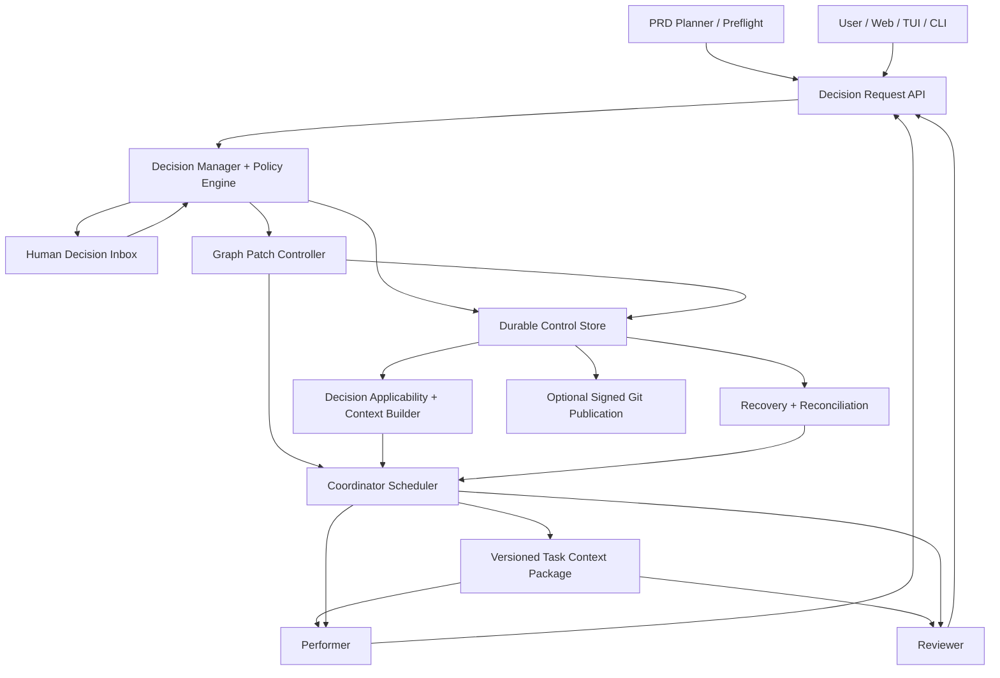

# MACC — Decision Management & Durable Approval Persistence

**Architecture Decision Baseline, Verified Implementation, and Recommendation Review — Revision 1.4**<br>
**Status:** Reviewed target architecture; opt-in local implementation added; full release qualification remains pending<br>
**Date:** 2026-10-29  
**Revision:** 1.4 — responsive Web/TUI decision interfaces, explicit never-ask autonomy and universal decision traceability; source baseline remains `13ca933`<br>
**Scope:** MACC native Rust coordinator, PRD planner, performers, reviewers, worktrees, CLI/TUI, local web client, and durable control-plane state.

> **Document status:** The six choices in Section 1 remain the project-owner architectural requirements. Section 2 records the implementation inspected on 2026-10-29 at commit `13ca933`; Sections 3–16 describe the **target extension**, except where an existing behavior is explicitly identified. Section 12.6 validates or qualifies all 43 recommendations technically; this review neither invents project governance nor certifies unimplemented capabilities. The filename is retained for existing references. This revision changes documentation only; no runtime feature or new acceptance test was implemented or executed for this review.

> **Implementation update (2026-10-29):** The local implementation, activation, commands, migration/trust boundaries and validation scope are documented in [Decision management: local implementation](../architecture/decision-management.md). Section 2 remains the historical inspection at `13ca933`; its statements of absence describe that snapshot. The opt-in implementation does not claim secure approver isolation, signed Git transport or certification of the complete AT01–AT68 matrix.

**Owner clarification incorporated in revision 1.3:** performers must be free to raise important unresolved decisions without making questions systematic. The coordinator filters requests and remains as autonomous as possible. The user controls the minimum risk level for discretionary human questions, thereby granting more or less decision latitude within existing authority. Section 7.3 specifies this mechanism; the opt-in local setting is documented in the implementation guide.

**Owner clarification incorporated in revision 1.4:** Web and TUI must offer approachable, responsive question/approval/request interfaces while the coordinator runs. The autonomy selector also includes a **never-ask mode**: performers can choose and implement their recommended solutions at any risk level without human consultation through MACC. Every material resolution, whether human or autonomous and whatever the threshold, is durably recorded, propagated and accessible to other affected agents/clients. This explicitly extends revision 1.3's threshold-only behavior; automated choices must remain identifiable as delegated agent decisions, never fabricated human votes.

## 1. Accepted architectural decisions

| ID | Topic | Accepted decision | Non-negotiable consequence |
|---|---|---|---|
| **ADR-DM-001** | Human intervention | Use project governance, risk, and reversibility to decide when a human must intervene. | A deterministic policy engine evaluates requests; agents do not independently grant themselves authorization. |
| **ADR-DM-002** | Runtime DAG | Enable **fully dynamic DAG mutation from the first release**. | The initial release must support safe, versioned add/update/supersede/disable and dependency/gate changes **at runtime**, not merely annotations or follow-up manual PRD edits. |
| **ADR-DM-003** | Persistence | Use a **local durable Decision Ledger**, with optional publication to Git. | Decision history survives `macc clear` by default. Git Notes are a transport/export mechanism, not automatically trusted. |
| **ADR-DM-004** | Approval reuse | Support policy-based reuse: `exact_revision`, `content_equivalent`, or `never`. | Record an approval's subject and policy context, not only a task ID or yes/no answer. |
| **ADR-DM-005** | Restart/recovery | Verify and restore applicable approvals, then rebuild runtime state before dispatch. | Recovery is ordered, idempotent, auditable, and fail-closed if validity cannot be established. |
| **ADR-DM-006** | Downstream execution fidelity | **Every applicable human answer, remark, choice, correction, or orientation must be propagated to affected present and future tasks, and supplied to their performers and reviewers.** | Acknowledged, versioned task decision contexts are mandatory at dispatch and after relevant changes; downstream work and reviews cannot silently ignore or contradict applicable human input. |

### 1.1 Explicit scope of “fully dynamic” in release 1

“Fully dynamic” means the coordinator can accept an authorized graph patch **while running** and safely change the remaining executable plan. Release 1 must implement all these **classes of graph operation**:

1. Add executable tasks, decision tasks, and human gates.
2. Change metadata, instructions, conditions, and dependencies for tasks that have not entered immutable execution history.
3. Insert, remove, or redirect dependency edges, subject to DAG and policy checks.
4. Supersede or cancel scheduled/in-flight tasks through an explicit controlled transition; **never rewrite delivered task history**.
5. Replan downstream tasks when human decisions invalidate original assumptions.
6. Pause only affected tasks/subgraphs; continue independent tasks.
7. Atomically validate and commit a graph version, with predictable conflict resolution, replays, and crash recovery.
8. Rebuild the current graph and its decision bindings after runtime state is cleared.
9. Recalculate and deliver the applicable user decisions, clarifications, comments, and constraints to every new, re-dispatched, or affected task.

Not required for the first release: unrestricted automatic autonomous replanning without policy checks, seamless migration of arbitrary live agent session state to a new task, remote multi-operator collaboration, or automatic approval of dangerous operations. These are different capabilities, not exceptions to dynamic graph support.

## 2. Verified implementation and remaining gaps

### 2.1 Evidence and scope

The baseline below comes from the checked-out Rust, shell and web sources at commit `13ca933`, not from conversation transcripts or the installed `macc` binary. Links refer to repository files; named tests are existing source evidence, **not a claim that they were run during this documentation review**. [MACC.md](../../MACC.md) is supporting documentation; runtime code takes precedence when they differ.

| Area | Current implementation verified in source | Consequence for this design |
|---|---|---|
| Gate model and validation | [model.rs](../../core/src/coordinator/model.rs) defines `TaskGate`, `GateKind::{Verdict, HumanApproval}`, `RequiredApprover`, `Quorum`, `ApprovalRecord` and `ApprovalState`. Human gates require a subject in their dependencies, nonempty roles, positive counts, a valid quorum and `bind_to: commit_sha`; `invalidate_on_subject_change` defaults to true. [validation.rs](../../core/src/prd_generation/validation.rs) reuses this validation and rejects executable write scope on a human gate. | Extend these contracts and migrations; do not build a second incompatible approval state machine. |
| Existing decision ledger | [coordinator_storage.rs](../../core/src/coordinator_storage.rs) stores `gate_decisions` in **`.macc/state/coordinator.sqlite`**, with `id`, `task_id`, `decision`, `role`, `actor`, optional `revision/evidence/reason`, and `recorded_at`. The API appends records and reads them in insertion order. | This is persistent approval history already, but not the proposed independently retained, signed, plan-scoped control ledger. API append-only behavior does not prevent direct SQL modification. |
| Approval evaluation | [approval.rs](../../core/src/coordinator/approval.rs) derives gate state each cycle from the latest decision per `(actor, role)` for the subject revision, current quorum and optional TTL. Rejections block; expired votes require renewal; writing `approved` into the registry without a matching quorum is reverted. | Preserve the existing evaluator; add explicit provenance, policy/subject manifests, revocation and reuse policy around it. |
| Scheduling and PRD queue | [task_selector.rs](../../core/src/coordinator/task_selector.rs) excludes human gates from worker dispatch. [prd_queue.rs](../../core/src/prd_queue.rs) accepts `Task::satisfies_dependants()` for delivery, registry transition and cross-PRD dependency preservation, including `approved` gates. [logging.rs](../../core/src/prd_queue/logging.rs) emits the final queue result after delivery checks. | The former `approved` versus `merged` queue bug is already fixed. Preserve this behavior when introducing graph/context versions. |
| Human interfaces | [coordinator_workflow.rs](../../core/src/service/coordinator_workflow.rs) exposes approval listing and `approve`, `reject`, `request-changes` through shared service logic. [approval_prompt.rs](../../cli/src/coordinator/approval_prompt.rs), [approval.rs](../../tui/src/approval.rs) and [web coordinator.rs](../../cli/src/commands/web/coordinator.rs) expose the existing question, subject, revision, risks, roles, evidence and choices. Web routes include `GET /api/v1/coordinator/approvals` and `POST /api/v1/coordinator/approvals/:id/decision`. | Reuse these views and commands; a general decision inbox and free-form decision workflow remain additions. |
| Identity and web mutation control | `operator_identity()` reads Git name/email unless an actor is supplied. `validate_decision()` checks a nonempty actor and a declared role, not independent role membership or a cryptographic human identity. Web mutation endpoints use [mutation_gate.rs](../../cli/src/commands/web/mutation_gate.rs): ownership is checked when a project lease exists; absent leases permit mutation. The [CLI](../../cli/src/main.rs) defaults to `127.0.0.1`. | Existing ownership is client coordination, **not authentication**. There is no implemented `secure_approval` mode or trusted approver/signature registry in this path. |
| Git reconciliation | [commit_reconciler.rs](../../core/src/coordinator/commit_reconciler.rs) restores implementation completion/agent verdict evidence but explicitly skips human approval gates. Existing test `reconciliation_restores_agent_verdict_but_never_human_approval` captures the distinction. | Retain this boundary; optional signed exports must use a separate verified import path. |
| PRD edits and audit | [control_plane/base.rs](../../core/src/coordinator/control_plane/base.rs) synchronizes registry tasks from the PRD. [prd_auditor.rs](../../core/src/coordinator/prd_auditor.rs) constructs an AI prompt to edit notes/todo descriptions and move completed objects into `tasks_done`; it is not a graph-patch controller. [web/prd.rs](../../cli/src/commands/web/prd.rs) validates basic task IDs, makes a backup, and writes the PRD file directly. Queue fingerprints detect out-of-band input changes and block progression. | Existing editing/sync is **not** an atomic, authorized, versioned live-DAG protocol. Both audit and web writes must join the future patch pipeline and preserve archived task identity/history. |
| Clear and retained data | [service/clear.rs](../../core/src/service/clear.rs) requires stopped session authority before cleanup and protects dirty worktrees. [lib.rs](../../core/src/lib.rs) removes listed managed files and empty directories; it does not recursively erase every `.macc` file. [o2/activation.rs](../../core/src/o2/activation.rs) explicitly retains `.macc/memory.db`, its WAL/SHM files and legacy tool-session files. | `coordinator.sqlite` has **no explicit retention exception** there. Its survival depends on managed-path membership and must not be promised or confused with retained O2 state. No graph journal is currently available to restore after clear. |
| Checkpoints and task context | [checkpoint_preflight.rs](../../core/src/coordinator/control_plane/checkpoint_preflight.rs) blocks checkpoint drift before a performer starts when the session DB exists. [checkpoint recovery](../../core/src/session_store/checkpoints/recovery/context.rs) compares authoritative PRD/task sources and retained worker ownership. [performer.sh](../../automat/performer.sh) supplies task prompts, refuses human-gate execution, and distinguishes `precondition_unmet` from tool failure. | Reuse these guards and session/claim identities. They do not implement decision applicability, human-feedback receipts, graph epochs or binding-level compliance. O2 memory is not an approval authority. |

### 2.2 Capabilities not implemented in this checkout

No implementation of the proposed general `DecisionManager`, policy-driven decision intake, `GraphPatchController`, `graph_versions` journal, standalone `control.sqlite`, `HumanFeedbackEvent` lifecycle, decision applicability index, `TaskDecisionContext`, task-context receipts, graph/context fencing or signed decision import was found in the inspected runtime paths. Generic `events`, task/runtime rows and checkpoint records are not substitutes for these contracts.

`content_equivalent` and `never` are not existing approval reuse settings. Current `commit_sha` binding resembles a **limited local exact-revision policy**, without the complete identity/policy/context validation required by Section 9. Agent verdict gates and O2 memory review also use approval-related terms; they are separate from human governance approval.

The `macc-prd-planner` implementation and its claimed validator codes `8001–8006` were not found as versioned source in this checkout. [skills.catalog.json](../../catalog/skills.catalog.json) identifies its external source as `mod-one/skills`, subpath `skills/macc-prd-planner`, tracking `main` with a null catalog checksum. That catalog entry is verified; the remote implementation was not inspected in this review and must be pinned to a concrete version for integration. The repository's verified gate validation is the Rust path above; do not invent a mapping to unverified numeric planner codes.

### 2.3 Current limitations that affect the recommendations

1. **Revision binding is best-effort today.** `same_revision()` accepts matching prefixes of at least seven characters. When Git cannot resolve the subject, `evaluate_gate()` falls back to the last ledger revision; `validate_decision()` can accept a sufficiently long supplied revision without resolving it to a current Git object. This is not the target full-object, fail-closed verifier.
2. **Expiry and evidence are not strong attestations.** Invalid timestamp parsing currently returns “not expired”; evidence validation checks for a nonempty value when required, not proof of a review or immutable artifact. Migration must label these limits, not silently promote legacy records to verified approvals.
3. **Authority is declarative.** Votes are counted by actor/role strings. A person can satisfy different declared roles; there is no independent entitlement check or separation-of-duties rule. Secure mode needs a genuinely separate trust boundary.
4. **Ledger append and projections are separate writes.** `coordinator_record_gate_decision()` appends the vote, emits an event and updates gate/registry state through separate calls. The ledger allows reevaluation, but this is not a single transaction covering graph mutation, context updates and outbox effects.
5. **Preservation is not reconstruction.** A retained coordinator DB may support ordinary reevaluation, but no durable dynamic graph history or full post-clear decision-context recovery exists. Existing save/session facilities must be extended explicitly rather than assumed to back up future control data.

These are verified design gaps to address in work packages A–D, not fixes made by this document. The existing tests for forged approval state, quorum, revision invalidation, TTL, queue transitions and checkpoint drift provide regression foundations; additional negative and crash-recovery tests are still required.

## 3. Design principles and trust boundaries

1. **Separate decisions from executable workflow.** A decision can affect many tasks, plans, and revisions; a gate is one enforcement point for that decision.
2. **Separate preservation from validity.** Keep historical decisions forever (subject to retention rules), but reuse them only after current-policy verification.
3. **Separate agent proposals from privileged mutations.** Performers/reviewers may propose decisions and graph patches, never directly certify human consent or bypass mutation validation.
4. **Preserve immutable history.** Completed tasks, previous graph versions, approval/rejection events, and original evidence cannot be silently rewritten.
5. **Fail closed for sensitive actions.** Missing governance, stale approvals, ambiguous signatures, or inconsistent graph state block the affected operation.
6. **Continue unrelated work.** A pending human question should not globally halt independent work unless the risk policy demands it.
7. **Determinism at the control plane.** LLMs may explain and propose; Rust validation owns transitions, authorization, graph invariants, and persistence.
8. **No implied security from Git metadata.** Commit authorship, Git notes, local paths, and text fields do not establish real human identity.
9. **Readable human decisions.** Every request must explain what changed, available options, recommended option, alternatives' effects, and the consequences of inaction.
10. **Reproducible recovery.** Runtime state can be reconstructed without re-running tasks or suppressing genuinely required approvals.
11. **Human intent must reach implementers.** Unblocking a task is never a substitute for delivering the human decision, its exact wording, and its practical constraints.
12. **Provenance-aware propagation.** Bind applicable instructions to specific task attempts, preserve human wording verbatim and distinguish binding constraints from advisory comments.
13. **No stale execution.** A relevant decision update invalidates a task's former context snapshot even if the DAG topology has not changed.

## 4. Component architecture

**Target architecture:** the named decision, graph and context components below are not existing modules. Reuse points are identified in Section 2; the diagram is a responsibility map, not a diagram of the current implementation.



### 4.1 Logical responsibilities

| Component | Responsibility | Explicitly must not do |
|---|---|---|
| `DecisionManager` | Request intake, classification, identity/policy checks, resolution, effect tracking | Independently invent human authorization |
| `DecisionLedger` | Durable event history, signed decision evidence, projection of current decision status | Conflate event existence with current authorization |
| `PolicyEngine` | Governance mapping, risk/reversibility, quorum, validity/reuse/TTL | Let free-form LLM text override binding policy |
| `GraphPatchController` | Validate, scope, serialize, commit and broadcast dynamic graph changes | Change committed history or skip DAG invariants |
| `Coordinator` | Schedule against current authorized graph version; pause/reassign/resume | Interpret an agent's output as a direct graph mutation |
| `Performer/Reviewer` | Produce artifacts, detect unknown decisions, propose structured requests/patches | Approve their own work on behalf of a human |
| `PRD Planner` | Preflight known uncertainties; generate initial graph and planned decisions | Assume it is the only source of future decisions |
| `ApprovalVerifier` | Check identity, policy, content/revision match, expiry, revocation | Restore approval solely by matching task ID |
| `RecoveryEngine` | Replay durable graph/decision events and reconcile Git/runtime | Dispatch before validation of the restored state |
| `DecisionApplicabilityResolver` | Calculate which active decisions, human responses and remarks apply to each task using explicit scope and graph impact | Assume all descendants are relevant or ignore a cross-cutting constraint |
| `TaskContextBuilder` | Build a deterministic, versioned context package with exact user text, binding constraints, sources and evidence | Rely on gate status or an opaque LLM memory summary as the sole context |
| `DecisionComplianceVerifier` | Check delivered work against applicable decisions and report traceable evidence/violations | Mark a decision complied with merely because a performer acknowledged it |

### 4.2 Persistence: one atomic control-plane boundary

**Technically validated default, subject to the constraints below:** maintain one durable local SQLite **control database** for decision, feedback and graph authority. `<git-common-dir>/macc/control.sqlite` is a proposed location, not an implemented or mandatory path. Resolve `git rev-parse --git-common-dir` relative to its invocation directory when necessary; do not assume `.git` is a directory. The implementation must handle linked worktrees, repository relocation and unavailable/read-only storage without silently creating a second authority.

The common Git directory is shared by linked worktrees. Use an explicit persisted `project_id`, `plan_id`, graph lineage and branch/revision scope in keys and queries; a shared repository DB must not mix distinct plans or reuse approvals merely because task IDs collide. A clone/import needs an explicit identity-transfer policy, not identity inferred from a remote URL. Retain the existing one-controller-per-project execution policy; shared storage does not authorize two dispatch owners.

Logical collections/tables:

- `decision_requests`, `decision_options`, `decision_resolutions`, `decision_events`;
- `approval_events`, `approval_signatures`, `approver_policy_bindings`;
- `graph_versions`, `graph_patch_events`, `graph_nodes`, `graph_edges`, `decision_task_bindings`;
- `human_feedback_events`, `decision_applicability`, `task_context_manifests`, `task_context_receipts`, `decision_compliance_results`;
- `outbox_events`, `recovery_markers`, `schema_migrations`.

**Migration boundary:** the current `.macc/state/coordinator.sqlite` mixes runtime projections with the only `gate_decisions` ledger. It is **not disposable today**. Only after a verified, idempotent import and cutover may its task/lease/registry data be treated as rebuildable execution projections. Retain the old DB as recovery evidence until import counts, provenance, ordering and integrity checks pass. Label imported records `legacy_local_trust`; do not manufacture missing signatures, policy digests or verified identities. Use SQLite-consistent backup/migration procedures, including WAL handling, rather than copying a live main DB file alone.

The new control DB holds the **decision and plan history that must survive `clear`**. A single transaction commits each accepted mutation's graph version, applicable bindings, decision/feedback references and outbox records. A human response may first be persisted as a pending resolution; it must not enable dispatch until its graph/context effects are committed. Separate SQLite databases do **not** gain cross-database atomicity from this design: the coordinator DB, PRD files, Git refs, runner context files and SSE remain projections/side effects. Process them through an idempotent outbox, fence stale readers and block only affected dispatch/merge transitions until their required projection versions are ready. Do not claim exactly-once external delivery; require at-least-once replay with idempotency keys.

Keep control transactions short, with one logical mutation owner, version CAS, bounded busy/retry behavior and observable failures. Never hold a write transaction or scope lock while waiting for a person or AI tool. Large evidence belongs in content-addressed files with verified hashes and retention rules, not unbounded database/prompt blobs.

**Critical note:** A database beneath the Git common directory survives ordinary MACC cleanup but not removal of the entire repository or `.git` directory. Git publication/export or backup is needed for machine-to-machine recovery. Same-UID agents with direct filesystem write access may tamper with a local DB; do not represent this layout alone as a security boundary.

### 4.3 Versioned PRD as a projection

This changes the current PRD-file/sync model. It requires an explicit migration/cutover; it is not already enforced by the web editor or queue fingerprints.

- The initial `prd.json` is the imported, versioned **plan baseline**.
- Once the coordinator runs, authoritative runtime DAG changes are committed as validated `graph_patch_events` in the durable control database.
- `prd.json` / the web PRD editor is a human-readable **materialized projection** of the current plan; it must not overwrite live graph history via uncoordinated file writes.
- Every projection includes a `graph_version` and `plan_id`, and exports can be committed to the repo by an explicit action.
- An externally edited PRD triggers a compare-and-reconcile operation; it must not silently replace runtime state.
- A durable outbox event requests regeneration of the PRD projection after DB commit. On startup, reconcile pending projections before dispatch.
- If a source file is authoritative for certain projects, its edits are treated as *proposed patches* and pass through the same validation pipeline.

This avoids a dangerous first-release failure: restoring a previous approval while losing the dynamic task/gate that originally depended on it.

## 5. Domain contracts

### 5.1 Separate concerns

**Naming compatibility:** `coordinator::approval::DecisionRequest` already means an operator's vote (`task_id`, `decision`, `role`, `actor`, `revision`, `evidence`, `reason`). The proposed general question below must use a separate namespace/type (for example `decisions::DecisionRequest`) and versioned wire schema. Preserve existing approval command payloads and `TaskGate` serialization. New states such as `superseded`, `cancelled` or `quarantined` require deliberate FSM/storage migrations; these are not existing `WorkflowState` variants.

| Domain entity | Meaning | Preferred identity |
|---|---|---|
| `DecisionRequest` | A question or unresolved problem awaiting resolution | Stable `request_id` |
| `DecisionRecord` | The accepted resolution and its provenance/conditions | Stable `decision_id`, immutable versions/events |
| `ApprovalGate` | A rule that blocks one or more workflow transitions until conditions pass | Stable `gate_id` |
| `AuthorizationGrant` | Permission for a specific sensitive operation | `authorization_id`, usually one-shot |
| `GraphPatch` | A proposed or accepted change to the execution DAG | `patch_id`, `base_graph_version` |
| `GraphVersion` | Immutable committed DAG snapshot reference and event sequence | Monotonic `graph_version` |
| `SubjectRevision` | Exact artefact/code/requirements binding evaluated by a gate | Content and Git revision references |
| `DecisionBinding` | Associates a decision with affected tasks and enforceable constraints | `decision_id + task_id + version` |
| `HumanFeedbackEvent` | Preserves an original human answer, instruction, remark, correction or explanation and its intended effect | Immutable `feedback_id`, linked to decision and principal |
| `TaskDecisionContext` | Complete, reproducible set of applicable human and autonomous decisions, with original human input when present, for a particular task attempt | `task_id + attempt_id + context_digest` |
| `TaskContextReceipt` | Records which context version a performer/reviewer was actually issued and acknowledged | `attempt_id + context_digest + phase` |

### 5.2 Human interaction types

- **`clarification`** — supply missing information; usually generated during PRD preflight.
- **`decision`** — select an alternative, or provide a custom proposal, to change implementation direction.
- **`approval`** — accept/reject/request revision of a concrete deliverable against a defined subject revision.
- **`authorization`** — permit a particular sensitive operation under explicit scope, timing, and actor constraints.

An `approval` may contain structured questions, but a human selecting architectural option B is not equivalent to approving a finished implementation. A gate may reference a `DecisionRecord`, but a Decision Record does not necessarily imply a gate.

**Mandatory feedback semantics:** a human answer may be an option selection, free-form answer, acceptance with conditions, rejection with requested changes, design correction, or broader project orientation. Preserve the exact answer as immutable evidence; separately derive structured effects. A human note is not automatically a new privileged approval or a change to governance. A material ambiguity in translating the answer must be clarified or escalated instead of silently inferred.

### 5.3 Decision request contract (illustrative)

```json
{
  "schema_version": 1,
  "request_id": "DREQ-0042",
  "kind": "decision",
  "origin": { "actor_type": "performer", "task_id": "DB-017", "attempt_id": "ATT-003" },
  "plan_id": "PLAN-001",
  "base_graph_version": 14,
  "question": "How should legacy relationships be migrated?",
  "context": "The validated model cannot preserve all existing relationships.",
  "options": [
    { "id": "A", "label": "Extend the schema", "risks": ["Additional migration work"] },
    { "id": "B", "label": "Transform legacy records", "risks": ["Potential irreversible loss"] }
  ],
  "recommended_option_id": "A",
  "affected_tasks": ["DB-017", "API-021", "TEST-012"],
  "risk": "high",
  "reversibility": "limited",
  "evidence_refs": ["artifact://DB-017/migration-findings.json"],
  "idempotency_key": "DB-017:ATT-003:legacy-relationships"
}
```

Recommended request validation: known origin and task attempt; bounded/validated schema; stable idempotency key; evidence hash; explicit unknowns and consequences; scoped affected tasks; no executable instructions treated as authority. A request is evidence, not a workflow command.

### 5.4 Dynamic graph patch contract (illustrative)

```json
{
  "schema_version": 1,
  "patch_id": "GP-0015",
  "plan_id": "PLAN-001",
  "base_graph_version": 14,
  "reason": "DEC-0042 requires preserving legacy records",
  "decision_refs": [{ "decision_id": "DEC-0042", "version": 1 }],
  "operations": [
    {
      "op": "add_task",
      "task": { "id": "DB-018", "category": "implementation", "dependencies": ["GATE-0042"] }
    },
    { "op": "add_dependency", "task_id": "API-021", "depends_on": "DB-018" },
    { "op": "bind_decision", "task_id": "API-021", "decision_id": "DEC-0042", "version": 1 },
    { "op": "supersede_task", "task_id": "DB-017", "replacement_task_id": "DB-018" }
  ],
  "idempotency_key": "DEC-0042-v1-graph-adjustment"
}
```

**Important:** The graph-patch envelope and operations are target contracts. Embedded tasks retain MACC's existing `dependencies` and `category` fields rather than introducing competing `depends_on`/`type` task fields. This abbreviated example assumes referenced gate/task IDs already exist and omits required production task details; it is not an executable PRD. Preserve backward compatibility through versioned serialization.

### 5.5 Ledger event model (illustrative)

```json
{
  "schema_version": 1,
  "event_id": "DEVT-0142",
  "decision_id": "DEC-0042",
  "event_type": "approved",
  "subject": {
    "task_id": "SEC-ADR-003",
    "commit_sha": "<full-object-id>",
    "artifact_digest": "sha256:<digest>",
    "requirements_digest": "sha256:<digest>",
    "policy_digest": "sha256:<digest>"
  },
  "actor": { "principal_id": "operator-001", "role": "architect" },
  "scope": "exact_revision",
  "timestamp": "2026-10-29T14:00:00Z",
  "expires_at": null,
  "evidence_refs": [],
  "signature": null
}
```

A `signature: null` record may be accepted only under an explicitly declared *local-trust mode*. Secure mode must reject unsigned or untrusted approval records for sensitive gates. Hash fields must be computed by the trusted engine from canonical data, not taken at face value from the agent's output.

## 6. Decision and approval state machines

The request and authorization state machines are **new target contracts**. Existing human approvals use the mapping in Section 6.2; do not rename stored states or reuse a vote status as a workflow state without migration.

### 6.1 Decision request lifecycle

`proposed -> triaged -> (auto_resolved | pending_human | investigation_required | rejected_as_invalid)`

`pending_human -> (resolved | changes_requested | withdrawn | expired)`

`resolved -> (implemented | superseded | revoked)`

- `auto_resolved` requires explicit policy: a verified existing/default answer or the user-selected `never_ask` delegation. Agent recommendations may determine the choice in full autonomy, while the control plane deterministically validates authority, subject and resulting effects; model output does not authorize itself.
- `changes_requested` can return a request to investigation or proposal revision; it is not an implicit approval.
- `superseded` preserves historical resolution and explains the replacement decision.
- Prefer an explicit `needs_reconciliation` condition rather than destructively mutating the old outcome when the subject changes.

### 6.2 Approval gate lifecycle

Current `WorkflowState` mapping:

`todo (dependencies not satisfied) -> waiting_approval -> approved | rejected | expired`

`changes_requested` is an `ApprovalStatus`/vote while the human gate's workflow state remains `waiting_approval`; the executable-task `WorkflowState::ChangesRequested` is a different review/fix state. There is no current human-gate workflow state named `pending_approval`, `waiting_for_subject` or `stale`.

On a new resolved subject revision, existing evaluation withdraws prior matching-revision approval and recomputes the gate. The target verifier additionally requires trusted current subject/policy/actor information and records an explicit stale/reconciliation explanation. Historic votes remain intact. Existing actor/role strings must not be described as independently trusted actor records.

**Delegated-mode extension:** `never_ask` additionally needs a typed gate outcome/resolution origin for `delegated_autonomous`, evaluated against the current delegation, subject and policy. Adapt readiness/dependency satisfaction and all clients explicitly; an autonomous gate resolution is not evidence that the original human quorum voted. Preserve the human-only evaluator for risk-threshold modes and historical records. Never enable full autonomy by merely setting `task.state = approved` or ignoring the gate in the UI.

### 6.3 Authorization lifecycle

`requested -> authorized -> consumed` or `requested -> denied` or `authorized -> expired/revoked`.

An authorization may be tied to a single operation ID, target environment, window, commit, and principal, and must not be automatically reused because its script or subject content is unchanged.

## 7. Human intervention policy

### 7.1 Policy inputs

**Implementation gap:** `governance_ref`, `approval_trigger` and `risks` already exist as declarative gate fields, but no general governance precedence/risk/reversibility policy engine is implemented. A reference to a document does not mean its authority or rules have been parsed and enforced. Projects must explicitly configure authority precedence, permitted automatic decisions and role entitlements before privileged decisions can use them.

- Repository governance documents (e.g. CODEOWNERS / ADR / RACI / project policy), with explicit precedence and version.
- Risk category, reversibility, sensitivity, blast radius, environment and data impact.
- Current user decisions, approved requirements, delegated authorities and existing constraints.
- Task provenance and operation type (proposal, code review, file change, production action).

### 7.2 Decision rules

| Situation | Default action |
|---|---|
| Fully specified choice governed by existing approved standard | Resolve automatically; record provenance. |
| Minor reversible implementation choice | Auto-resolve only if permitted by policy; record rationale. |
| Unresolved product behavior, meaningful architecture fork, security/privacy choice | Investigate and classify; ask only if the configured threshold or a mandatory authority rule requires it. Existing approved policy may already settle the choice. |
| Unplanned material change or contradiction with an accepted decision | Apply the threshold/authority filter; conflicting binding decisions require scoped escalation rather than unilateral override. |
| Destructive/production-sensitive operation | Operation-specific authorization; in risk-threshold modes obtain required fresh human consent, or in `never_ask` evaluate explicit delegated authority and record the autonomous operation resolution. External access/authority cannot be fabricated. |
| Unknown or conflicting governance | Resolve through the configured authority; threshold modes may request human clarification, whereas `never_ask` records an autonomous resolution or a precise impossible-to-execute diagnostic without prompting. |

Human intervention is **risk-based, not model-confidence-based**. A model's confidence score may help triage but must not independently override governance. Deduplicate related questions by semantic key + explicit task/subject scope; batch only when dependencies do not make ordering ambiguous.

### 7.3 Performer initiative and configurable question threshold

#### 7.3.1 Autonomous-first question flow

Performers and reviewers **may raise an important unresolved decision at any phase**; the planner need not anticipate it or create a gate first. A question is neither a mandatory end-of-task ritual nor evidence that the task/tool failed. The coordinator is the sole routing/filtering authority for MACC-managed human questions; performers submit structured requests rather than bypassing it through an interactive tool prompt.

1. **Investigate first.** The performer checks the task/PRD, relevant code, dependency contracts, applicable human decisions and existing policy within a bounded investigation budget. Routine naming, local organization and reversible implementation details are decided autonomously when authorized. Do not ask the user for information already available in these sources.
2. **Submit a meaningful request if needed.** Include the concrete unresolved choice, why it materially affects the result, sources checked, remaining unknowns, options and recommendation, consequences of each option/inaction, reversibility, affected tasks and proposed risk with evidence. Reuse the request/attempt identity and idempotency contract in Section 5.3. Do not submit an empty “what should I do?” question or treat low confidence alone as a decision request.
3. **Filter centrally.** The coordinator validates provenance and independently applies versioned policy. It may resolve from an existing decision, delegate an authorized reversible choice to the performer, perform/request a bounded complementary investigation, or route the important unresolved question to the user. An agent's proposed risk is an input, not an authority to authorize itself or force a popup.
4. **Continue useful work.** A submitted request does not automatically create a gate, mutate the DAG, mark a task failed or stop the run. Hold only work that genuinely depends on the missing decision; independent ready tasks continue. If complementary investigation yields no answer, report the precise missing prerequisite instead of looping or inventing requirements.
5. **Record and propagate the outcome.** Persist the resolution and its provenance; deliver applicable human wording and constraints to performers/reviewers through Section 8.6. Create a graph patch only if the answer changes the work/dependencies; otherwise update the relevant decision/task-context versions without manufacturing DAG nodes.

#### 7.3.2 User-controlled autonomy

**Required setting:** a user-visible autonomy selector, provisionally named `human_question_min_risk`, supports the ordered thresholds `low < medium < high < critical` **and the distinct mode `never_ask`**. For a risk threshold, it is the level **at or above which an unresolved, material choice may be presented to the user**, after investigation, deduplication and checks for an existing answer. Crossing the threshold does not mean every task at that risk needs a question. `never_ask` disables human consultation rather than inventing a fifth risk level.

| Threshold | Discretionary human questions | Decision latitude below the threshold |
|---|---|---|
| `low` | Material unresolved choices at any risk level may be asked after filtering. | Least additional delegation; still no routine or redundant questions. |
| `medium` | Material unresolved `medium`, `high` and `critical` choices may be asked. | Authorized low-risk choices are decided autonomously. |
| `high` | Only important unresolved `high` and `critical` choices may be asked. | Authorized low/medium-risk choices are decided autonomously. **Proposed default** for the autonomy-first workflow. |
| `critical` | Only critical discretionary choices may be asked. | Greatest delegation for authorized low/medium/high-risk choices; mandatory approvals still apply. |
| `never_ask` | **No human questions, approvals or clarification prompts from MACC, regardless of risk.** | **Full decision autonomy:** performers choose and implement their recommended solutions; coordinator validates/applies their structured resolutions and records them under explicit user delegation. See Section 7.3.5. |

**Direction of the control:** raising the threshold grants more autonomous decision latitude and reduces discretionary questions; lowering it increases human consultation. Selecting **“Full autonomy — never ask”** (`never_ask`) removes the human-question loop entirely, including MACC-managed approval requests, and applies the delegated decision path in Section 7.3.5. Display this distinction beside the setting in CLI/TUI/web; do not label an autonomous decision “approved by the user.”

Illustrative target configuration, **not a field supported by current MACC**:

```yaml
automation:
  coordinator:
    decisions:
      human_question_min_risk: high
```

The final path must be added to the canonical schema, validation, save/restore and all clients consistently, accepting all five values. For full autonomy the illustrative value is `human_question_min_risk: never_ask`. Show the effective mode, policy source and delegated resolution behavior in coordinator settings and the live coordinator view. The proposed `high` default and detailed risk classification below are design defaults to validate during implementation. An authorized user selecting `never_ask` supplies the explicit MACC decision delegation; no per-question confirmation is then requested.

#### 7.3.3 Risk evaluation and authority boundaries

Risk classifies the **consequences of the actual decision**, not the performer's uncertainty or the whole task's generic risk label. A starting classification is:

| Level | Typical decision characteristics |
|---|---|
| `low` | Local, reversible implementation detail with no change to specified behavior, shared contracts or protected assets. |
| `medium` | Bounded, reversible technical choice within authorized scope, with limited module impact and a testable rollback. |
| `high` | Material product/scope ambiguity, shared architecture/API/data-contract change, meaningful security/privacy or cost impact. |
| `critical` | Irreversible data consequences, production/destructive action, exposure of sensitive authority/assets or major blast radius. |

The trusted policy engine derives the effective risk from structured impact, reversibility, environment and scope rules. Resolve missing/contradictory impact evidence conservatively by bounded investigation or a scoped diagnostic; do not silently label it `low`. Projects may tighten the matrix and mandatory rules. The performer cannot edit the threshold, downgrade its own risk classification, split one material change into smaller requests to evade the threshold, or reinterpret silence as consent.

Apply the following precedence **for the four risk-threshold modes**. In `never_ask`, use Section 7.3.5 instead of routing any outcome to a human prompt:

1. **An existing applicable decision or authorized policy already settles the choice:** reuse/verify it and continue; do not ask again solely because the task has a high risk label.
2. **An explicit human approval, fresh operation authorization or binding-policy conflict requires intervention:** preserve that requirement regardless of threshold. Raising the threshold is not a waiver of a gate, an authorization to alter product scope, or permission to contradict a human decision.
3. **No applicable answer exists, but policy delegates the choice and effective risk is below threshold:** choose autonomously, record rationale and constraints, and continue. Do not ask a discretionary question to avoid ordinary engineering responsibility.
4. **No applicable answer exists and the material choice meets/exceeds threshold:** submit one deduplicated, actionable human question with options and a recommendation; continue independent work.
5. **Below threshold but no safe authorized choice or necessary factual prerequisite exists:** investigate within budget, then record the precise scoped block. The threshold must not force hallucinated requirements or out-of-scope execution. A genuine mandatory authority exception follows rule 2 and is shown as such; a technical/environment problem remains a diagnostic, not a fabricated product question.

The user can change this policy through the same authorized settings boundary as other coordinator controls. Version/audit the change, communicate its effective value to future/current task contexts, and re-evaluate pending requests at a safe boundary. Changing a risk threshold does not waive mandatory human approval; switching to `never_ask` activates the explicit delegated-resolution path for pending and future requests. Neither change rewrites past decisions or automatically treats an unanswered request as a human approval. Existing graph changes and newly affected in-flight work still follow Sections 8–9.

#### 7.3.4 Operator visibility and acceptance of autonomy

Human prompts must show why a question passed the filter: effective risk, threshold or mandatory-rule exception, unresolved issue, options, recommendation, impact and affected tasks. The operator can see automatically resolved/delegated choices in an audit view without answering each one. Do not insert a new confirmation dialog merely to confirm a permitted autonomous choice.

Measure discretionary questions per completed task, duplicate/avoidable question rate, autonomous resolutions, scoped waiting time and escalations by mandatory rule. These metrics evaluate usefulness and must not become a quota that suppresses an important question. A request repeated unchanged is deduplicated; unresolved investigation is bounded rather than retried indefinitely.

#### 7.3.5 Full autonomy: `never_ask`

In this mode, the user delegates MACC-managed implementation decisions, clarifications, approvals and specific performer requests to the coordinator/performers **for every risk class**, including `critical`. A performer may select its recommended alternative and implement it without consulting the user. The coordinator still owns validation, state transitions, graph/context consistency and audit; autonomy does not require bypassing the control plane or turning model output into direct database edits.

- **Resolution, not a hidden pending question.** Create and resolve material requests through the same structured decision channel, using the best available evidence, applicable requirements and the performer's recommendation. The resolution may select, revise or reject a recommendation with a recorded rationale; no user popup, CLI prompt or interactive tool question is issued. A general advice question may become a documented implementation assumption instead of a wait state.
- **Approval compatibility.** Extend gate policy/evaluation to accept an explicit `delegated_autonomous` resolution where this mode delegates MACC approval. Keep original `human_approval` declarations and historical votes visible, but record which policy version and user delegation permitted this specific automated outcome. Expose a separate resolution origin/evidence type; never forge a human actor, role, signature, vote or attestation, and never make the existing evaluator accept a fake `gate_decisions` row. This requires a new versioned gate/decision contract, not only suppressing the approval dialog.
- **All questions, not only low-risk choices.** Product alternatives, architectural forks, specific performer requests, corrections and high/critical-risk questions follow this path. A conflict requiring a new project decision is explicitly resolved or superseded through that authority and lineage, rather than silently rewriting a prior human statement. Human evidence remains verbatim; the new agent decision is separately attributed.
- **Pending work.** On entering this mode, re-evaluate already pending requests and resolve them individually through the delegated policy. Withdraw their interactive prompts once the corresponding durable outcome is committed. Do not blindly mark all pending requests “approved”; each requires an actual chosen resolution and applicable graph/context effects. Returning to a threshold affects future/re-evaluated requests without erasing prior autonomous choices.
- **No fabricated capabilities or evidence.** This setting delegates decisions within MACC; it cannot create unavailable credentials, access rights, missing external data or attest that an independent person approved something. If execution is genuinely impossible, record a precise blocked/failed diagnostic and continue independent work, **without replacing the failure with a human question**. Technical validation, required tests and DAG/history invariants remain enforced.
- **Visible, recoverable autonomy.** Show the active mode in Web/TUI. Automatic outcomes appear in the decision timeline/history and task context views, without modal interruptions or acknowledgement requirements. The user can inspect, change mode or introduce a corrective direction later; that creates a new versioned decision rather than deleting history.

#### 7.3.6 Universal traceability, distribution and discoverability

**For every threshold and `never_ask`, material decisions use the same durable ledger and propagation guarantees.** Autonomous does not mean transient or private to one performer. Record at least:

- decision/request ID and version, project/plan, originating task/attempt/phase and coordinator run;
- origin (`human`, `performer_recommendation`, `coordinator_resolution`, or verified existing-policy reuse), actual actor/tool identity and authorizing delegation/policy version;
- question/problem, options considered, recommendation, chosen outcome, rationale, risk, assumptions, source evidence and any superseded decision;
- affected tasks/contracts, binding/advisory effects, graph patch or context-only update, applicability explanation and resulting versions/digests;
- commit status, timestamps, context issuance/receipts and independent compliance results as they become available.

Commit a material autonomous choice **before dependent implementation/merge relies on it**. If the ledger or required propagation is unavailable, preserve a recoverable diagnostic and fence affected transitions; do not silently continue with an unrecorded private decision. Routine details need not each create a human-style question, but their material task-level choices must remain reconstructable through a bounded structured resolution record and linked implementation evidence.

Publish the resolution through the same applicability/context/outbox pipeline to affected current, downstream, parallel and newly added tasks, including reviewers. Unaffected agents need not receive every decision in their prompt, but scoped decisions must be discoverable through the shared decision service and CLI/TUI/web history/search, with access/provenance rules preserved. Reused sessions receive refreshed context explicitly; another performer must not have to infer a decision from the original agent's conversation. Persist and restore this lineage after restart/clear like human-origin decisions. The operator can see which autonomous choice each agent received and what changed because of it.

## 8. Runtime dynamic DAG mutation: initial-release design

This section is **release-1 mandatory** because of ADR-DM-002.

### 8.1 Mutation pipeline

Apply this complete pipeline when a resolved decision requires a graph mutation. A question resolved by an existing answer or a context-only clarification follows Section 7.3/8.6 without creating artificial tasks, gates or graph patches.

1. **Detect:** performer, reviewer, planner, or operator submits a structured decision request / patch proposal.
2. **Authenticate source:** bind request to task attempt, agent identity, PRD/graph version, and evidence artifacts.
3. **Triage:** Policy Engine applies Section 7.3's risk threshold or `never_ask` delegation to determine automatic resolution, bounded investigation or, only in human-consulting modes, a human question. Record the chosen authority and resolution origin.
4. **Compute affected subgraph:** dependency descendants, shared resources, decision consumers, and potentially affected running tasks.
5. **Establish scope barrier:** prevent newly affected work from dispatching; negotiate stop/cancel for incompatible in-flight tasks; preserve other work.
6. **Resolve decision:** record authorized outcome before accepting any patch that depends on it.
7. **Propose patch:** graph-aware planner or authorized operator generates `GraphPatch` with explicit operations and rationale.
8. **Validate:** version, permissions, references, cycles, task invariants, committed-history constraints, resource conflicts, approval policy, and risk gates.
9. **Commit:** perform a transaction in the durable control DB storing the decision event, graph patch, new version, and outbox notifications; use compare-and-swap on `base_graph_version`.
10. **Materialize:** update PRD projection, decision applicability index, and runtime task registry through idempotent projection workers; reconcile on failure.
11. **Propagate:** compute the affected present/future task set, bind the resolved human feedback and regenerate relevant context manifests. Invalidate stale dispatched/running contexts before further integration.
12. **Resume:** recompute READY tasks and release only those satisfying current graph, gate **and decision-context** constraints.
13. **Audit:** emit durable events and user-visible graph diff; link the patch to decision, evidence, actor, resulting graph version, and affected context digests.

### 8.2 Required invariants

- Every committed graph version is a DAG (topological sort succeeds).
- Task IDs are stable; no silently reused ID after supersession or deletion.
- Completed/merged task records and prior graph versions remain immutable.
- A patch cannot silently grant approval, change a human decision, or remove a required gate.
- No task may be dispatched from a stale graph snapshot after a graph revision barrier is established.
- A task may not be marked satisfied solely because its predecessor was superseded; satisfaction must be explicitly migrated by policy or new evidence.
- Mutations have stable idempotency keys and optimistic concurrency checks.
- In-flight tasks have a deliberate disposition: continue unchanged, cancel at safe point, finish-but-quarantine, or re-review against new graph.
- Resource locks are released or migrated consistently; worktree branches and tool leases remain recoverable.
- A decision required by a task is referenced by an explicit versioned binding, not only an unstructured prompt string.
- Every dispatched task attempt is bound to an immutable, verified `TaskDecisionContext` manifest; the performer and reviewer receive the applicable constraints and exact human response text.
- A context change may invalidate running work even if the graph retains the same nodes and edges.
- A task cannot become READY if applicable binding constraints cannot be materialized or its required decisions are unresolved.
- Acknowledging context delivery is not proof that implementation complies with it.
- Graph changes that would alter delivered work produce new corrective tasks, not rewritten history.

### 8.3 Concurrency with active worktrees

- Dispatchers pin the graph version and task lease at scheduling time.
- Use per-task contract/context versions and trusted compatibility checks: an unrelated graph change must not invalidate every lease solely because the plan-wide counter increased. Establish barriers before publishing the new version, and recheck applicability before launch, phase completion and merge; a dispatch-only check has a race window.
- During mutation, the GraphPatchController obtains a short-lived graph-write lock or equivalent serialized transaction (not a global pause for the duration of human deliberation).
- Task completions racing with a patch enter reconciliation: accept under unchanged constraints, quarantine for re-review, or supersede through an explicit rule.
- Keep worker-scoped sessions/worktree reuse compatible with the new task identity; do not resume an old session against a changed scope without a validated context reset.
- On conflict, recompute patch from the latest graph version or require review; never silently overwrite another accepted patch.

### 8.4 Graph-patch risk gates

A graph patch is not intrinsically valid because it parses. Removing security tests, dropping governance dependencies, altering task purpose, or changing protected file scopes must be classified and resolved under the current policy. In risk-threshold modes this may require human approval; `never_ask` records a delegated autonomous resolution instead of prompting. Every patch still requires a machine-readable impact summary, valid authority and graph/history invariants; agents cannot change their own delegation by editing a patch.

### 8.5 `audit-prd` integration

The existing audit prompt asks the selected AI tool to edit the PRD; the Rust auditor itself constructs context/prompt rather than committing a graph. Replace this file-edit workflow with an **untrusted GraphPatch proposal** through the GraphPatchController. Route the web PRD editor and every sync/replan mutation entry point through that same authority after cutover. Queue fingerprint checks are useful existing drift diagnostics, not a replacement for version CAS. Completed task notes may be appended as evidence; delivered history cannot be rewritten; approved decisions cannot be implicitly contradicted.

### 8.6 Mandatory human-feedback propagation and performer awareness (release 1)

**Accepted requirement ADR-DM-006:** When a person answers a question, selects an alternative, rejects a proposal, provides a correction, adds a remark, or changes the desired implementation direction, MACC must carry the *applicable content and its intended effects* to all affected present and future tasks. Merely setting a task's derived state to `approved`, updating a DAG edge, or storing a note in SQLite is insufficient. The runtime MUST produce and verify an actionable **Decision Context Package** for each affected performer and reviewer.

#### 8.6.1 Classification: what the human actually expressed

Treat the original user input as a first-class, immutable `HumanFeedbackEvent`, not as a status flag. Record the verbatim text, option IDs when present, target/reply thread, identity and provenance, timestamp, attachments/artefact references, and version of the question shown to the human. Derive an *explicitly separate* semantic classification:

| Kind | Example | Normal downstream effect |
|---|---|---|
| `clarification_answer` | "The API must remain backward compatible" | Add an acceptance constraint to relevant implementation/test tasks. |
| `option_selection` | Choose option B instead of the agent's recommended A | Bind chosen alternative; supersede any assumptions built around A. |
| `binding_direction` | "Do not migrate existing user records" | Apply mandatory negative constraint and adjust graph/tasks as needed. |
| `approval_condition` | "Approved, provided rollback is tested" | Gate remains conditional until explicit evidence/criteria are satisfied, per policy. |
| `change_request` | "Keep the current navigation pattern" | Amend affected future work or create corrective tasks for delivered work. |
| `advisory_remark` | "Prefer readable names" | Preserve original guidance, classify as advisory; do not silently treat as hard authorization. |
| `question_or_uncertainty` | "Would another option be safer?" | Open/continue decision investigation; do not mistake it for consent. |

A verified human may also submit a new correction or orientation **without answering a pre-existing gate**. The Decision Manager records it as a scoped event, evaluates its policy impact, and propagates it through the same pipeline; it must not be dropped merely because no question was pending.

**Guardrail:** an LLM may suggest how to interpret free-form language, but cannot pass its own interpretation off as a human statement, approval or waiver. In threshold modes, material ambiguity outside delegated authority requires targeted clarification. In `never_ask`, resolve the interpretation/assumption under explicit agent delegation, keep it separately attributed and traceable, and do not issue a follow-up question. Preserving the full original human text is mandatory in either path; corrections/supersessions use explicit lineage rather than altering that text.

#### 8.6.2 Applicability and recipient determination

`DecisionApplicabilityResolver` runs whenever human feedback is resolved, when a GraphPatch is committed, before task dispatch, and during restart. Determine affected tasks using more than graph descendants:

1. **Explicit references:** selected task IDs, feature IDs, requirements, design artefacts, and affected file ownership/scope.
2. **Decision scope:** task, feature, component, project, or operation, with permitted inheritance and exclusions.
3. **Graph impact:** downstream dependencies and dynamically added descendants, with a relevance check (not unconditional broadcast of every ancestor's comments).
4. **Cross-cutting impacts:** auth/privacy/API contracts, shared data model, frontend design system, or other affected consumers not directly linked by an existing edge.
5. **Temporal impact:** scheduled, running, reviewed, merged and newly created tasks may require different actions.

Store the applicability explanation for each binding (`why_this_task`, `source_event`, `scope`, `effect`, `version`); compute deterministic closure from explicit scope/graph data and require review if semantic scope is uncertain. **Newly inserted tasks inherit applicable decisions immediately**; no separate manual copy is necessary. Do not flood every agent with unrelated human feedback.

#### 8.6.3 Structured Task Decision Context Package

Before dispatching *each task attempt* (including fix/review phases), build a deterministic, immutable, tool-agnostic context manifest containing at least:

- `plan_id`, `task_id`, `attempt_id`, `graph_version`, `decision_epoch`, `context_digest`, generation timestamp;
- current task objectives, acceptance criteria, expected outputs and dependency contract versions;
- all applicable `DecisionRecord` IDs/versions and related human `feedback_id` values;
- **verbatim human response and remarks** (not only summarized paraphrases), selected option, conditions and explicit prohibitions;
- binding/advisory classification, priority derived from governance, precise task-specific action required, and reason for applicability;
- references and hashes for approved ADRs, design-system files, API contracts and other protected artefacts;
- invalidated alternatives, superseded instructions and relevant contradiction/waiver status;
- verification obligations for both the performer and reviewer, plus evidence links.

Use a structured machine-readable JSON manifest as the authoritative context representation. Render a concise human-readable Markdown companion, with the **same digest and complete mandatory constraints**, for use by different CLI tools. For long historical discussions, include exact binding clauses inline and expose verbatim source material by content-addressed reference; token-saving summaries MUST NOT erase material constraints or change approved meaning. The manifest must be reproducible from durable records rather than generated solely by an LLM.

**Digest contract refinement:** define a versioned canonical UTF-8 JSON payload and hash it in Rust. Include project/plan, task/attempt identity, task-contract version, decision versions, applicable constraints and artifact digests; exclude the digest field itself, issuance timestamps and transport-specific paths. Define key ordering, numeric encoding, array ordering, newline/path rules and digest algorithm explicitly. The Markdown companion references the JSON payload digest; its own rendered bytes are not asserted to have that same hash. Store issuance metadata separately so regenerating the same pinned payload produces the same digest. A plan-wide epoch is an invalidation hint, not sufficient evidence that an unrelated task's contract changed.

Record plan-wide `graph_version`/`decision_epoch` as envelope watermarks; the per-task semantic digest binds the relevant dependency/task-contract versions instead of changing for an unrelated plan mutation. A trusted compatibility check must establish that relevance, never an agent assertion. Define `attempt_id` in terms of existing run/claim and phase/lease identities; `coordinator_epoch` is existing controller fencing, not a substitute for a graph or decision version.

Example target shape (illustrative, not an existing MACC schema):

```json
{
  "schema_version": 1,
  "task_id": "API-021",
  "attempt_id": "ATT-008",
  "graph_version": 15,
  "decision_epoch": 9,
  "context_digest": "sha256:<trusted-canonical-digest>",
  "bindings": [
    {
      "decision_id": "DEC-0042",
      "decision_version": 1,
      "feedback_id": "HFE-0091",
      "kind": "binding_direction",
      "scope": "feature:data-migration",
      "human_verbatim": "Choose A. Preserve all historical relations. Do not discard legacy records.",
      "selected_option_id": "A",
      "required_behavior": [
        "Preserve existing historical relationships",
        "Do not delete legacy records"
      ],
      "source_artifacts": ["artifact://DB-017/migration-findings.json"],
      "compliance_checks": ["migration-preserves-legacy-relations"]
    }
  ]
}
```

Do **not** treat the illustrative `required_behavior` generated from natural language as authoritative without a traceable, policy-valid resolution. The approved resolution and original human wording always remain available as the source of intent; contradictions require escalation, not model-selected reinterpretation.

#### 8.6.4 Actual delivery into performers/reviewers

- At schedule time, the coordinator queries current decision applicability and gate validity, creates the context package, and pins `graph_version`, `decision_epoch` and `context_digest` to the task lease.
- Before launching a runner, MACC materializes task-local, **MACC-managed** context files inside the worktree (proposed: `.macc/runtime/task-decision-context.json` and `.macc/runtime/task-decision-context.md`, excluded from version control). Paths/ownership must follow actual worktree configuration.
- `performer.sh` and each supported tool adapter receive both the context-file path and the mandatory instructions to read and comply with applicable approved requirements. The task prompt points explicitly to the generated files and includes the highest-priority binding constraints within its allowed context budget. Do not assume arbitrary tools automatically read an unreferenced file.
- On session reuse, regenerate the context; **do not rely on the agent remembering a previous conversation**, even if session IDs remain stable. Start a fresh context/session when old memory may conflict with new decisions.
- The tool wrapper reports a `TaskContextReceipt` with `task_id`, `attempt_id`, `phase`, `context_digest` and delivery/acknowledgement state; the coordinator refuses phase advancement if mandatory context delivery failed.
- `review` and `fix` must receive the same applicable source decisions plus any newer applicable corrections. The reviewer checks evidence of implementation rather than trusting the performer's summary or receipt alone.

**Integration refinement:** issue per-attempt/phase paths derived from existing run/claim/lease identities, not a shared mutable filename reused by concurrent invocations. Bind the current checkpoint to the task-contract and decision-context digests, and extend existing checkpoint preflight/recovery rather than bypassing it. Mandatory context must fit a declared runner budget or fail with an actionable diagnostic before invocation; a file reference alone does not prove the model actually received its content. Verify the adapter's effective prompt construction and resumed-session handling for every supported runner, including AGY and Vibe as well as Claude, Codex and Gemini.

#### 8.6.5 When new feedback arrives while tasks are running

A decision update advances a durable `decision_epoch` and re-computes the applicability index. This happens **even if the DAG has no structural change**. The coordinator finds all affected task leases and compares context digests:

The following rows describe conceptual execution positions and required target dispositions, not new stored state names. Map them explicitly to the existing `WorkflowState`, runtime phase/status, claim and checkpoint records during implementation.

| Task state | Required response to new applicable human input |
|---|---|
| `todo` / `ready` | Rebuild context before dispatch; gate on unresolved or contradictory requirements. |
| `dispatched` but not launched | Replace context atomically; refuse launch with a stale digest. |
| `running` | Set an affected-task barrier; either cancel/restart at a safe point, deliver verified interruption with acknowledgement and re-validation, or quarantine output for review. **Never assume a live CLI model ingested a file update.** |
| `review` / `fix` | Refresh context and re-run relevant compliance checks; invalidate stale review verdict. |
| `delivered` / `merged` | Preserve history; assess inconsistency and generate a new corrective/superseding task if needed, rather than rewrite completion. |
| New dynamically created task | Inherit all applicable current decisions at graph commit and again at dispatch. |

Completion or merge is blocked when `context_digest` (and any relevant policy/graph contract versions) no longer matches the applicable current decision set, unless a separately audited, deterministic compatibility check establishes that changes are irrelevant to that task.

#### 8.6.6 Enforcement: from awareness to verifiable compliance

The system must support three distinct checks:

1. **Delivery:** Did the trusted wrapper construct and pass the verified package through the adapter's effective prompt/input for the pinned attempt? Secure mode may additionally require verified signatures; local mode must not pretend to supply them.
2. **Protocol acknowledgement:** Did the runner/model return the expected package digest for that phase? A trusted wrapper's delivery record and an agent-origin acknowledgement are distinct fields. Neither proves that a model read or understood the instructions, and an echoed digest is not a security or compliance attestation.
3. **Compliance:** Does the result actually satisfy the binding human choices, hard constraints and objective acceptance criteria? Run deterministic checks where practical; otherwise require an evidence-linked reviewer judgement. Record `pass`, `fail`, or `needs_human_review` per binding.

Required behaviour for a missing binding, stale digest, contradictory approved instructions, or unverifiable material requirement: **block the affected transition** and raise a scoped diagnostic. An agent may propose an alternative via `decision_required`, but cannot silently override, omit, or reinterpret an approved human constraint.

`decision_required` is a **proposed new structured protocol event**, not an existing `MACC_TASK_RESULT` value. Version and validate it at the trusted runner/IPC boundary, tied to run, task, claim/attempt and phase. Preserve `precondition_unmet` for current missing-prerequisite behavior; legacy tools must not turn an unsupported decision event into success, an approval, or an endlessly retried execution error.

#### 8.6.7 Integration with dynamic replanning and PRD evolution

A new human response may produce a `GraphPatch` that adds/removes dependencies, changes task descriptions, generates tests, supersedes invalid tasks, or injects newly required acceptance criteria. In addition to the graph mutation itself, **update/version the binding index and propagate fresh context packages**. Include selected choice, verbatim response, structured effects and invalidated assumptions in patch provenance. A graph patch that only changes text still increments the applicable task contract/context version, even if its edge set is unchanged.

`audit-prd` and the PRD planner must resolve relevant current decisions as immutable source constraints; they may propose explicit supersession, never quietly rewrite or discard approved human intent. Planner-generated tasks should include relevant decision references and task-specific acceptance criteria, while runtime context resolution is authoritative for the *latest* applicable decisions.

#### 8.6.8 Worked example — answer changes downstream implementation

1. Planner originally proposes migration option A and creates `DB-017 -> API-021 -> TEST-012`.
2. During DB implementation, performer reports that A would lose legacy relationships and asks about A vs B.
3. The user replies: **"Use option B, but preserve all historical relationships; do not delete legacy records."** The verbatim response is durably stored as `HumanFeedbackEvent` and classified into an option choice plus two binding constraints.
4. Decision Manager validates the response, determines impacted nodes, and the graph-aware planner proposes a patch modifying DB implementation, API contract and regression tests. `GraphPatchController` validates and commits the patch plus affected bindings.
5. When `API-021` starts, its performer receives `TaskDecisionContext` containing the actual user response, option B, relevant schema artefacts and prohibited data deletion. The `TEST-012` performer independently receives the same applicable obligations in its own context package.
6. If `API-021` was already running, it must be safely restarted with the new context or placed in quarantine/re-review; it must not merge using its original instructions.
7. The reviewer validates actual behavior and records results against specific binding IDs. After `macc clear`, the coordinator reconstructs both the modified DAG and the decision context packages, and does not ask the identical approval question again if the applicable reuse policy still permits it.

**Design rule:** Human feedback is part of the executable specification, not optional conversational history. The coordinator must be able to answer, for any task: *Which human decisions apply? What exactly did the user say? Which version did the agent receive? What was changed as a result? How was compliance verified?*

## 9. Durable approval validity, reuse, and recovery

**Target behavior:** these policies and post-clear recovery steps are not currently implemented. Current local `commit_sha` behavior and its permissive fallbacks are recorded in Section 2.3. Retaining O2/session checkpoints is not a substitute for retaining the decision/graph authority.

### 9.1 Three reuse modes

| Mode | Acceptance condition | Example use | Default |
|---|---|---|---|
| `exact_revision` | Exact approved Git object/subject revision **and** current policy, approver eligibility, TTL and other contextual constraints still valid | Sensitive ADR, security schema | **Default** |
| `content_equivalent` | Trusted canonical artifact bytes/manifest, relevant requirements and approval-policy context match, and policy expressly permits reuse | Stable design specification, ADR across recreated commits | Opt-in only |
| `never` | Previous event retained for audit but never authorizes another execution | Production deployment, destructive migration, one-shot permission | Mandatory for destructive authorizations |

Do not treat content-equivalence as simply `SHA256(file contents)`. It requires an explicit **subject manifest**: selected files/paths, normalized or bytewise hashing rules, requirement versions, dependencies, relevant schema/environment and approval policy. Default to exact bytes unless a reviewed canonicalizer exists. If any requirement cannot be verified, choose non-reuse.

Resolve exact revisions to complete existing Git object IDs; reject an unknown or ambiguous object rather than accepting prefix similarity as proof. Record repository/plan/gate identity and policy context, not SHA alone. For `content_equivalent`, enumerate the semantic inputs the canonicalizer is entitled to ignore and bind its version. For `never`, consume the operation-scoped authorization atomically with the durable operation reservation; crash recovery reconciles that same operation ID instead of authorizing another operation. Retry only when the external operation supports verified idempotency. If a non-idempotent operation's result is unknown after a crash, block for reconciliation rather than claiming exactly-once execution or repeating it blindly.

### 9.2 Approval verifier

Evaluate the resolution's declared origin: human votes use verified human-role/quorum rules; `delegated_autonomous` uses the applicable recorded user delegation and automated gate policy. Both bind the same subject/context and retain audit/reuse checks. A human vote and an autonomous resolution are not interchangeable evidence, even when both permit the next workflow transition.

For each gate, check:

1. Gate identity and policy digest are the expected ones.
2. Required subject and artifact references exist.
3. Binding matches exact revision or certified content-equivalence policy.
4. Approver identities and roles meet current governance/quorum requirements.
5. Signature/trust level is sufficient for gate severity.
6. Approval is not revoked, expired, superseded or changed by policy.
7. Referenced decision and graph versions are applicable to the current workflow.
8. Any required fresh authorization is specific to this operation and unconsumed.

Store the explanation for both restored and rejected legacy approvals so the operator understands why a popup did or did not reappear.

### 9.3 Recovery order after `macc clear`

1. Acquire the project/controller recovery lock; discover Git common directory and explicit project/plan identity. Prevent another controller or clear operation from racing recovery.
2. Open durable ledger/control DB; verify database integrity, migration version, event-chain consistency and configured signature trust.
3. Load initial plan baseline and replay committed graph patches to reconstruct the latest authorized DAG.
4. Reconcile exported PRD projection and detect out-of-band file edits or missing projection updates.
5. Rebuild task registry from DAG plus verified Git commit/task evidence. **Do not infer completed implementation from approvals.**
6. Reconstruct decision/gate projections; verify validity using current subjects, policy, expiry, revocation and quorum.
7. Rebuild decision-applicability indexes, `decision_epoch`, and deterministic task context manifests from durable human feedback events; compare their digests against any recovered leases and phase receipts.
8. Reconcile interrupted task leases, worktrees and running processes using existing coordinator recovery rules; invalidate attempts with stale context.
9. Show a summary of restored/rejected/stale decisions, affected task contexts, and graph differences.
10. Resume scheduling only after consistency checks succeed; maintain per-subgraph blocking as necessary. Corrupt authority, an unresolvable graph lineage or an unknown required migration blocks the whole affected plan; an isolated stale approval blocks its consumers, not unrelated work.

The `macc clear` command must not remove durable decision and graph journals by default. A destructive option such as `--including-decisions` must include explicit confirmation and a backup/export opportunity; if retained graph history would become invalid, the operation must describe and reconcile the corresponding consequences.

Keep current session/O2 retention and dirty-worktree safeguards intact. Add explicit control-store retention to both real clear and dry-run/save/restore reporting, and test linked-worktree and custom-path cases. Ordinary clear must not rely on accidental absence from `managed_paths`; destructive deletion must stop writers, handle WAL files safely and leave other plans/projects untouched. `--including-decisions` is illustrative, not an existing CLI flag.

### 9.4 Git publication (optional)

- Export **signed** decision events, metadata and subject manifests to an explicit Git transport such as `refs/notes/macc-approvals` or a dedicated signed ref.
- Require explicit push/fetch configuration and reconcile concurrent note writers.
- Import as **untrusted records** until signature, issuer authority, repository identity, policy and revision are verified.
- Do not infer human approval from commit messages, Git commit author, or unsigned notes.
- Exporting to Git does not solve trust if the signing key is accessible to performers.
- Publishing a decision does not publish authoritative dynamic graph revisions unless a separate graph export/sync mechanism is explicitly implemented.

## 10. Security architecture

### 10.1 Threat model

Relevant threats: an agent silently ignoring or misrepresenting a human answer; stale task context after a new decision; a fabricated task-context receipt; agent spoofing an approver; agent editing SQLite files; malicious `git notes` entry; replaying valid approval for a new subject; stale actor role; malicious embedded instructions in PRD/evidence; untrusted remote web access; concurrent graph patch races; hand-edited PRD bypassing a gate; destructive authorization reused twice.

### 10.2 Recommended safeguards

- **Current baseline:** the project-ownership gate and `X-Macc-Client-Id` are existing coordination controls; a caller-provided actor/role or client ID is not authenticated human authority. Preserve existing ownership checks while adding authentication/authorization; do not substitute one for the other.
- Distinguish `local_trust` and `secure_approval` modes explicitly. Do not claim strong authorization from a text `--as` parameter or same-UID CLI invocation.
- In secure mode, route approval via an independent broker/principal or protected signing key inaccessible to agent worker processes; verify against trusted approver identities and policies.
- Enforce authorization at the Rust API boundary for approving, signing, changing policy, publishing decisions, and applying high-risk graph patches.
- Recognize `never_ask` as explicit user-configured decision delegation, not verified human consent to each resulting choice. Authenticate/audit the mode change and autonomous resolution origin. A secure human-vote requirement cannot be satisfied by an agent signature presented as that person's signature; the gate contract must explicitly support delegated authority or report inability to execute without issuing a human prompt.
- Treat the web client on `0.0.0.0` as remote-capable: require authentication, authorization, CSRF/origin protection where applicable, and appropriately scoped sessions for mutations.
- Ensure agent runners cannot forge privileged event types in stdout; agent-origin events must be bound to supervised task sessions and sanitized.
- Preserve raw evidence hashes and trusted source identifiers, but do not execute instructions embedded in evidence.
- Produce context manifests from verified human events and policy sources; never trust an agent-written copy of the context as an authorization record.
- Enforce a task-context digest and context freshness at the Rust control plane; runner acknowledgement is not an approval or compliance attestation.
- Isolate human feedback from untrusted task artefacts; nonhuman text cannot escalate itself into binding human policy.
- Make changes to governance itself a controlled action; never let a graph patch remove its own approval requirement.

Security note: local mode is adequate for convenience within a trusted development environment but not a cryptographic proof that a human consented.

## 11. Integration implications by subsystem

| Subsystem | Release-1 implementation obligations | Migration/compatibility work |
|---|---|---|
| `macc-prd-planner` skill/scripts (external implementation not located in this checkout) | Emit unresolved questions, explicit gate placement, decision IDs, governable policy refs, initial versioned graph; preserve design-system constraints; attach applicable decision refs and acceptance criteria to generated tasks | Identify/pin the skill package; extend the repository's Rust validator. Do not depend on unverified `8001–8006` planner codes. |
| `performer.sh` + runners | Report `decision_required` with structured payload and evidence; task attempt identity; safe stop/handoff; receive current task Decision Context Package, verify its digest, report context receipt, and restart/refresh safely after a change | Keep compatibility with `precondition_unmet` for genuine missing prerequisites |
| Reviewer | Emit decision requests on material unresolved divergences; verify each binding against delivered artefacts and report per-decision compliance evidence | Avoid infinite review-fix loops for architectural disputes |
| Rust coordinator core | DecisionManager, PolicyEngine, GraphPatchController, DecisionApplicabilityResolver and TaskContextBuilder; local subgraph blocking; re-dispatch from graph and context versions; crash-safe transactions | Extend registry, task selector, FSM, leases, error recovery and resource locks |
| `sync-prd` / Git reconciler | Merge completion evidence with current graph history and decisions; avoid treating commit tags as human approval | Preserve existing task commit parser; introduce immutable supersession mappings |
| `audit-prd` | Produce patch proposals through same graph validator, never directly overwrite protected decisions | Replace unconstrained `prd.json` mutation during active runs |
| Storage / migration | Durable control DB with decision, human-feedback and graph event journals, task context manifests/receipts, outbox, repair and schema migration | `gate_decisions` is present in `coordinator.sqlite`; migrate it idempotently with legacy trust labels before making that DB disposable. |
| `macc clear` | Preserve durable ledger + graph journal by default; clear runtime projections and worktrees safely | Amend documented cleanup semantics; backups and explicit destructive option |
| CLI/TUI | Decision inbox, options, custom response, affected graph diff, history, verification, graph patch preview/approval, and per-task "what the agent received" context view | Keep existing approval commands as compatibility aliases where appropriate |
| Web API/UI | Decision Center; graph version timeline; diff/impact preview; applied-to-task coverage, context freshness, human action audit and SSE state updates | Extend existing approval endpoints/dialog and ownership checks; replace direct PRD writes after cutover; add authenticated mutations for exposed instances. |
| Security / operator identity | Trusted approver registry, mode separation, strong authorization for sensitive operations | Evaluate current local identity assumptions and web security boundary |
| Tests/CI | Deterministic mutation/recovery/conflict, approval reuse, tamper, role/quorum and crash-replay tests | Include cross-worktree and `clear` end-to-end scenarios |

### 11.1 Suggested Rust module boundaries (illustrative)

```text
core/src/coordinator/
  decisions/
    mod.rs
    model.rs
    manager.rs
    policy.rs
    approval_verifier.rs
    ledger.rs
    applicability.rs
    feedback.rs
    task_context.rs
    compliance.rs
  graph/
    mod.rs
    model.rs
    patch.rs
    validator.rs
    impact.rs
    journal.rs
  recovery/
    mod.rs
    replay.rs
    projection.rs
  ... existing coordinator modules ...
```

Use existing crate naming, storage abstractions and module boundaries where they already solve these responsibilities; this is not a prescribed file-by-file refactor.

### 11.2 Proposed CLI/API surface (not existing commands)

Existing approval commands remain `macc coordinator approvals`, `approve`, `reject` and `request-changes`; use shared `coordinator_workflow` validation for all clients. The following general decision, task-context and graph commands are proposals only, including the illustrated `recover --verify-only` form; do not advertise them as executable today.

```bash
macc decisions list --status pending
macc decisions show DEC-0042
macc decisions answer DEC-0042 --option A
macc decisions verify --all
macc decisions history DEC-0042
macc decisions feedback add --scope feature:data-migration --text "Preserve historical relations"
macc decisions impact DEC-0042 --show-tasks
macc coordinator task-context show API-021 --include-human-feedback
macc coordinator task-context verify API-021
macc decisions export --format json
macc decisions import decisions.json --verify

macc coordinator graph show --version current
macc coordinator graph diff --from 14 --to 15
macc coordinator graph patch preview graph-patch.json
macc coordinator graph patch apply graph-patch.json
macc coordinator recover --verify-only
```

CLI naming and backwards compatibility are open questions; avoid exposing destructive state writes without the same policy enforcement as the web client.

### 11.3 Proposed web UX

- `/ops/decisions`: pending/resolved/expired/revoked decision inbox, scope, actor, evidence, options, recommendations, decision impact.
- `/ops/decisions/:id`: decision detail, **verbatim answer/remarks**, normalized effects, affected tasks, subject diff, revision/equivalence status, signatures, quorum, approvals and graph patches.
- `/ops/worker/:id`: "Applicable user decisions" tab: exact human wording, selected options, binding/advisory status, context version and compliance results.
- `/prd`: graph timeline with current version, pending mutations, affected-subgraph overlay, live workers, patch preview and rollback/supersession explanations.
- `/ops/console`: explicit blocked-reason states and restored-approval counts.
- SSE notifications: `decision.requested`, `decision.resolved`, `decision.context.updated`, `task.context.issued`, `task.context.stale`, `decision.compliance.failed`, `approval.invalidated`, `graph.patch.committed`, `graph.projection.rebuilt`, `recovery.completed`.

### 11.4 Required user-friendly, responsive Web and TUI decision interaction

**Release-1 requirement:** while `macc coordinator` runs, both clients provide an understandable decision inbox and contextual popup/panel for performer/reviewer questions, approvals, clarifications and specific requests. Extend the existing approval dialog/window and shared service rather than showing raw logs or requiring the user to find a CLI command to answer. Web and TUI must offer equivalent meaning/actions even though their layouts differ. The user should understand what is needed, why, and what answering will change without reading technical protocol fields.

#### 11.4.1 A clear question and appropriate response controls

The primary view contains:

- a plain-language title, originating task/performer and question/request type;
- concise context, the unresolved point, why a human is being asked under the current mode, risk and affected work; advanced evidence/digests remain in expandable details;
- available options, the recommended choice clearly labeled **as a recommendation**, expected consequences and relevant constraints;
- subject revision/artifact/diff, required roles and current votes when it is a human approval; a question about implementation direction must not pretend to approve an artifact;
- visible pending/answered/processing/stale status, with a clear primary action and access to decision history.

Match controls to the request: select an alternative; enter a custom/free-text answer or remark; approve, reject or request changes with the required reason/evidence; or ask for complementary investigation. A performer-specific request can define a validated structured form, with readable field labels, required information and optional explanation. Preserve verbatim human input and attachments/evidence references alongside normalized effects. A recommended option may be preselected for convenience, but is **not submitted as consent** without an explicit user action.

Show inline validation near the field and explain the corrective action. Never force users to edit task JSON, enter a digest or remember a shortcut to complete an ordinary response. The final action identifies its effect, such as “Send answer”, “Approve this revision” or “Request changes”; closing the popup is not a decision.

#### 11.4.2 Responsive and accessible behavior

| Web client | TUI client |
|---|---|
| Responsive dialog/side panel on larger screens, usable full-screen sheet/page on narrow/mobile viewports. Long content scrolls without hiding the question or making submit/cancel actions unreachable. No horizontal overflow of the normal answer form. | Size popup/pane to terminal width and height; reflow text, scroll long questions/evidence and keep input/actions reachable after resize. On terminals too small for a popup, use a compact full-screen question view with a visible way back rather than clipped controls. |
| Semantic labels, keyboard navigation, visible focus, appropriate dialog focus handling/return, screen-reader status/error announcements and no color-only meaning. Multiline Enter edits text; submission is a deliberate control/shortcut. | Full keyboard operation with visible contextual shortcuts: move/select, edit, inspect details, submit and defer/back. Distinguish newline from submission for multiline answers. Do not hide required actions behind an undiscoverable command palette. |
| Preserve answer drafts through SSE refresh, resizing, switching task/request and temporary disconnects. Reconnect reloads authoritative state before allowing stale submission. | Preserve drafts when leaving a popup, navigating logs, refreshing state or resizing the terminal. Do not steal keystrokes while the user edits another field or types a command. |

Auto-present a new actionable request only at an appropriate interaction boundary. If the user is typing, reviewing another request, or a modal is already open, show a pending-count badge/nonintrusive notice and queue it instead of stacking dialogs or stealing focus. Users may defer/close and reopen from the inbox; the request remains pending and only dependent work waits. Handle multiple concurrent performer requests as a prioritized, deduplicated queue with originating tasks visible.

#### 11.4.3 Reliable submission and cross-client consistency

Use the same versioned request, authorization and resolution API for Web/TUI/CLI. Validate current request/subject/policy version and write idempotently; double-click, retry or reconnect must not duplicate a vote, answer or patch. Preserve project ownership and secure-mode access rules: another viewer cannot answer using an unauthenticated actor string or take over a controller's response silently.

Show a submitting state and keep the draft on error. Confirm **“Answer recorded” only after the durable response commit**, then show propagation/application progress separately. The UI must distinguish response saved, relevant graph/context effects applied, context issued and implementation compliance; it must not promise that all agents understood merely because a popup closed. If the request changed, was superseded or another client answered first, explain the conflict and preserve the draft for comparison/review rather than overwriting the newer resolution. A reply to an obsolete revision cannot resume the wrong work.

Publish updates to every connected client and reconcile from durable state on reconnect/restart; an ephemeral SSE event is not the only copy of a request. The history/detail view shows the response, source actor, delegated policy if any, affected tasks and where the current decision was distributed. Resolving a request does not stop or restart unrelated work.

#### 11.4.4 Full-autonomy presentation and decision availability

In `never_ask`, **do not open decision/approval popups or show a hidden “awaiting your answer” workflow**. Display the active autonomy mode and automatically resolved requests in a nonblocking timeline/inbox history, including recommendations, actual choices and effects. All material autonomous decisions remain inspectable/searchable through the same UI and shared service used by other agents. Pending interactive dialogs are withdrawn after their delegated resolution commits, preserving any unsent draft as unsent text; it must not be stored as a human vote.

The user can inspect or introduce a later correction without having to acknowledge every automatic choice. Such feedback creates a new versioned event and follows the same applicability/propagation path; merely opening the decision view or changing presentation size does not interrupt autonomous execution.

## 12. Remaining open questions and recommended defaults

**Statuses:** `REQUIRED` = must be resolved or explicitly accepted as a documented default before initial-release coding; `DESIGN` = can be settled during detailed design if interfaces are kept stable; `LATER` = not a release-1 dependency.

### 12.1 Governance and human interaction

| ID | Remaining question | Recommended default / design implication | Status |
|---|---|---|---|
| **Q01** | Which governance file has precedence when CODEOWNERS, RACI, ADR and project policy conflict? | Define a versioned precedence hierarchy and fail closed for contradictory authority. | REQUIRED |
| **Q02** | Which risk classes and thresholds require human consent? | User-visible `human_question_min_risk` with `low`/`medium`/`high`/`critical` thresholds and explicit full-autonomy mode `never_ask`; proposed default `high`. Section 7.3 defines filtering, threshold-mode human rules and delegated autonomous resolutions. | REQUIRED |
| **Q03** | Which sources may submit a decision request? | Planner, performer, reviewer, operator; agents submit proposals, coordinator owns mutations. | REQUIRED |
| **Q04** | Which human interaction kinds and response forms are supported? | `clarification`, `decision`, `approval`, `authorization`; options, custom answer and request investigation. | DESIGN |
| **Q05** | Who may approve and what quorum is required? | Governance-derived identities, roles, quorum; distinguish individual votes from gate outcome. | REQUIRED |
| **Q06** | When can MACC automatically resolve a request? | Reuse a valid answer, delegate a below-threshold choice, or resolve any risk class under `never_ask`; record actual origin, rationale, delegation and propagated effects. | REQUIRED |
| **Q07** | How to prevent repeated or duplicate questions from parallel workers? | Stable idempotency key plus bounded semantic deduplication, grouping only compatible cases. | DESIGN |
| **Q08** | What happens if a human does not respond? | Wait without global freeze; impacted subgraph blocked; reminders only by user opt-in. | DESIGN |
| **Q09** | Is preflight mandatory before each run and what code exploration budget applies? | Include configurable PRD preflight; do not block implementing runtime requests on exhaustive preflight. | DESIGN |

### 12.2 Dynamic DAG and in-flight execution

| ID | Remaining question | Recommended default / design implication | Status |
|---|---|---|---|
| **Q10** | What is the canonical graph source of truth once execution begins? | Durable versioned graph journal; PRD JSON as baseline/export projection. | REQUIRED |
| **Q11** | Which patch operations and validation invariants are available in release 1? | Add/update/supersede/disable tasks, dependency and gate changes, diff preview, no rewrite of delivered history. | REQUIRED |
| **Q12** | How does a graph patch race with task dispatch or completion? | Optimistic graph version CAS, patch barrier, locked/reviewed in-flight dispositions. | REQUIRED |
| **Q13** | What is the exact policy for a running task invalidated by a new decision? | Classify continue/cancel/quarantine/review; quarantine uncertain completions before merge. | REQUIRED |
| **Q14** | How should a finished task be changed without rewriting history? | Supersede task and create corrective/replacement task with lineage mapping. | REQUIRED |
| **Q15** | How are patch conflicts, cycle detection and stale dependency references handled? | Deterministic validation; reject stale patch and require explicit rebase/reproposal. | REQUIRED |
| **Q16** | Can agents propose patches automatically, and who applies high-risk ones? | Agents propose; trusted policy engine applies. Human-consulting modes enforce their review rules; `never_ask` uses audited delegated autonomous resolutions at every risk level. | REQUIRED |
| **Q17** | How are `.macc` PRD files synchronized to DB graph changes safely? | Transactional DB commit plus durable outbox and idempotent projection, not dual uncoordinated writes. | REQUIRED |
| **Q18** | How should reviewers verify decisions and prescribed design systems? | Evidence-linked binding, file/hash references, deterministic checks when possible plus semantic review. | DESIGN |

### 12.3 Downstream decision propagation and execution fidelity

| ID | Remaining question | Recommended default / design implication | Status |
|---|---|---|---|
| **Q33** | What kinds of human remarks are binding versus advisory, and who confirms ambiguous interpretation? | Preserve exact text; policy-based classification; no unapproved material reinterpretation or waiver. | REQUIRED |
| **Q34** | How are applicable decisions mapped to existing, parallel, downstream and dynamically added tasks? | Scoped explicit bindings, graph-impact closure and cross-cutting requirement references; auditable applicability reasoning. | REQUIRED |
| **Q35** | What is the machine-readable task context contract and how is its digest computed? | Canonical versioned JSON manifest, verbatim feedback, binding constraints and referenced artefacts; trusted deterministic hashing. | REQUIRED |
| **Q36** | How are constraints actually delivered to Claude/Codex/Gemini runners and reused sessions? | Per-attempt generated files and explicit runner prompt integration; context receipt; no reliance on implicit model memory. | REQUIRED |
| **Q37** | What happens to running/reviewed work when a nonstructural decision changes? | Decision epoch, context digest invalidation, scoped restart/cancel/quarantine and stale-review rejection. | REQUIRED |
| **Q38** | How are human input and implemented behavior compared? | Binding-level reviewer verification and deterministic tests when possible, with cited evidence and explicit failures. | REQUIRED |
| **Q39** | How can context be concise without dropping mandatory user decisions? | Exact binding text inline, references to full original answers, lossless manifest and token-budgeted auxiliary evidence. | DESIGN |
| **Q40** | How are conflicting feedback, overrides, or revoked decisions handled? | Explicit supersession lineage, source precedence and material conflict escalation; never silently choose a new direction. | REQUIRED |
| **Q41** | How are context packages reconstructed after clear and across different graph revisions? | Rebuild deterministically from verified ledger events + active graph; compare pinned digests before resuming work. | REQUIRED |
| **Q42** | What does an operator see to confirm agents received their choices? | Per-task context receipt, version, verbatim human wording, affected-task mapping and compliance result in CLI/TUI/web. | DESIGN |
| **Q43** | Can the operator introduce a new instruction or correction without an outstanding approval gate? | Yes: authorized scoped feedback becomes a durable human-feedback event; route it through applicability, impact analysis and graph/context update. | REQUIRED |

### 12.4 Durable decisions, reuse and Git

| ID | Remaining question | Recommended default / design implication | Status |
|---|---|---|---|
| **Q19** | Exact durable storage location and project identity? | Git common directory + stable repo identity; support worktrees and explicit recovery on moves. | REQUIRED |
| **Q20** | How are existing `gate_decisions` migrated? | Read existing schema; import only verifiable provenance, mark legacy local-trust decisions explicitly. | REQUIRED |
| **Q21** | What is the subject manifest for `content_equivalent` approval? | Canonical file set, requirements and policy digests, dependency/context criteria; conservative defaults. | REQUIRED |
| **Q22** | Which gate categories permit each reuse mode? | `exact_revision` default; narrow opt-in content equivalence; `never` for one-shot authorizations. | REQUIRED |
| **Q23** | How do revocation, expiry and a changed approver role propagate downstream? | Append events; invalidate current applicability and re-evaluate affected tasks, including completed outputs when relevant. | REQUIRED |
| **Q24** | How will the ledger be backed up, compacted or migrated? | Versioned schema, backup on migration, integrity test, replayable events, explicit retention policy. | DESIGN |
| **Q25** | How will decisions be shared across machines? | Verified export/import first; optional signed Git Notes later with explicit ref sync and merge rules. | LATER |
| **Q26** | Can decisions be reused across PRD generations or branches? | Scope to task/feature/project; require context compatibility, never infer operation authorization. | LATER |

### 12.5 Identity, security, recovery and product UX

| ID | Remaining question | Recommended default / design implication | Status |
|---|---|---|---|
| **Q27** | What guarantees prevent AI agents from posing as a human approver? | Local-trust mode openly limited; secure mode requires isolated identity/signing authority inaccessible to agents. | REQUIRED |
| **Q28** | How is approval/patch access secured through a remotely exposed web UI? | Explicit authn/authz, origin/CSRF controls, default localhost binding, no unauthenticated privileged operations. | REQUIRED |
| **Q29** | What exact data survives `macc clear`, and what may a destructive clear erase? | Preserve decisions + graph history; separate explicit destructive/reset command with confirmation and export option. | REQUIRED |
| **Q30** | What if the PRD file, Git history and durable graph journal disagree at restart? | Fail closed and present a reconciliation report; do not dispatch until authoritative version selected. | REQUIRED |
| **Q31** | How much information must an approval screen show? | Current artefact/diff, tests/review status, alternatives, risks, affected tasks, validity and actor/governance requirements. | DESIGN |
| **Q32** | What telemetry demonstrates the workflow is useful rather than noisy? | Questions per PRD, dedupe rate, blocked time, patch failures, reused vs stale approvals, compliance violations. | DESIGN |

**Interpretation:** The 6 project-owner choices remain accepted requirements. The 43 entries describe implementation/governance decisions, not 43 missing existing features of identical scope. `REQUIRED`, `DESIGN` and `LATER` express release dependency, not implementation or validation status. Their technical review is below; approval of concrete governance rules is not inferred from this review.

### 12.6 Technical validation of all recommendations

**Verdicts:** `V` = technically validated direction; `R` = validated with the stated refinement; `G` = the mechanism is sound, but a project-specific governance choice must be configured or explicitly reviewed before privileged use. None means “implemented” or “new owner ADR accepted.” The six existing ADRs, including full dynamic DAG support in release 1, are unchanged.

| Question | Verdict | Validated implementation requirement / refinement |
|---|---|---|
| Q01 | G | Version authority precedence explicitly; CODEOWNERS, ADR and RACI are inputs, not automatically equivalent sources of approver entitlement. Conflicts block only affected authority. |
| Q02 | G | Section 7.3 incorporates configurable autonomy and the owner-requested `never_ask` mode. Validate the proposed `high` default/matrix; full autonomy needs typed delegated resolutions, never fake human votes or agent self-editing of the mode. |
| Q03 | V | Planner, performer, reviewer and operator may submit bounded proposals; trusted service code owns state transitions. Authenticate attempt provenance independently of payload claims. |
| Q04 | R | Support the four distinct interaction kinds; keep current `approval::DecisionRequest` vote contract compatible and introduce a separate general request type. |
| Q05 | G | Reuse current roles/quorum mechanics, adding explicit principal membership and separation-of-duties policy. Existing actor strings are not verified human identities. |
| Q06 | G | Coordinator resolves existing answers or delegates authorized below-threshold choices; `never_ask` delegates all risk classes and MACC approval requests under Section 7.3.5. All outcomes are durable/distributed without a human confirmation loop; unanswerable factual prerequisites remain diagnostics, not invented consent. |
| Q07 | R | Use exact scoped idempotency first. Semantic deduplication may suggest a grouping, never silently merge different subjects, policy versions or conflicting human input. |
| Q08 | V | Waiting must not hold SQLite transactions or global graph locks. Continue unrelated work; reminders remain opt-in. |
| Q09 | R | Reuse existing readiness/checkpoint preparation. Optional exploratory preflight must be bounded and must not postpone runtime decision intake. |
| Q10 | R | Use a durable graph journal after explicit cutover. Current PRD files/queue fingerprints remain authoritative inputs until then; avoid two competing live authorities. |
| Q11 | R | Keep every required release-1 operation, adding versioned states for cancellation/supersession/quarantine and schema compatibility with `dependencies`/`category`. |
| Q12 | R | CAS plus per-task fences at dispatch, launch, completion and merge; a SQLite commit alone does not fence already running work. |
| Q13 | R | Specify safe continue/cancel/quarantine/review transitions and timeout/resource handling; never assume updating a file reaches a live model. |
| Q14 | V | Preserve delivered task identity/history; corrective tasks reference the original task and decision/patch lineage. |
| Q15 | V | Deterministic reference/cycle/scope checks; stale proposals require explicit rebase/revalidation, not last-writer-wins overwrites. |
| Q16 | G | Agents propose; configured authority applies. High-risk changes use human review or typed `never_ask` delegation according to the active mode, never a self-authorizing policy supplied by the patch. |
| Q17 | R | One control-DB transaction plus idempotent outbox; coordinator DB and files are fenced projections, with at-least-once side effects rather than claimed cross-DB atomicity. |
| Q18 | R | Use binding-level evidence and deterministic checks where possible; evidence links must be resolved/hashed, and semantic review remains fallible. |
| Q19 | R | Common-Git-dir storage is feasible only with explicit project/plan/lineage namespaces, worktree resolution, relocation and authority-conflict behavior. Location alone is not security. |
| Q20 | R | Migrate the verified existing ledger, preserving event order/provenance and rejecting unsupported promotion to secure trust. Back up and validate before cutover. |
| Q21 | R | Specify a canonical subject manifest and canonicalizer version; bind requirements, policy and environment, not only file bytes. Unknown relevance means no reuse. |
| Q22 | G | Full exact-revision verification is the safe default; explicitly allowlist content equivalence. One-shot authorization uses a consumed operation reservation, never repeated consent. |
| Q23 | R | Persist explicit revocation/supersession; recompute current entitlement, expiry and consumers. Existing latest-vote behavior is not a full revocation model. |
| Q24 | R | Versioned migrations, SQLite-consistent backups/WAL handling and integrity checks; define evidence/privacy retention and replay checkpoints before compaction. |
| Q25 | V | Verified local export/import before optional signed Git distribution; explicit ref sync, issuer trust and collision rules are required. |
| Q26 | R | Keep present cross-PRD completed-dependency behavior. General cross-plan/branch decision reuse remains optional and requires explicit scope compatibility; matching task IDs are insufficient. |
| Q27 | R | Local trust is an explicit limitation. Secure approval requires broker/key/principal isolation outside worker access; same-UID permissions or a text `--as` option cannot provide it. |
| Q28 | R | Preserve project ownership checks and add independent authentication, authorization and origin/CSRF policy for remote mutation. This includes changing autonomy mode; `never_ask` is not permission for an anonymous client to alter policy. |
| Q29 | R | Add explicit control-data retention, dry-run and save/restore coverage while preserving O2/session retention. Existing clear is managed-path based, not unconditional recursive deletion. |
| Q30 | R | Fail closed for ambiguous authority/graph lineage; isolate a stale decision when the graph is sound. PRD projections reconcile through versioned patches, not silent overwrite. |
| Q31 | V | Extend existing approval views with Section 11.4's responsive Web/TUI question/request forms, drafts, discoverable actions and reliable submission; no interactive interruption in `never_ask`. |
| Q32 | R | Add local correlation IDs and bounded metrics for blocked time, freshness and replay; omit raw human answers/secrets from metrics. Measure delivery and compliance separately. |
| Q33 | G | Store original human text first. Binding/advisory interpretation and material waivers require traceable authority; unclear text cannot silently grant consent. |
| Q34 | R | Derive deterministic applicability from explicit scope, graph and requirement bindings; uncertain semantic impact needs review, not automatic global broadcast. |
| Q35 | R | Hash a versioned canonical payload excluding self-digest/issuance time; Markdown references the JSON digest. Pin semantic task contract as well as decision versions. |
| Q36 | R | Integrate every adapter's effective prompt and reused-session path. Separate trusted wrapper delivery from agent acknowledgement; neither proves understanding. |
| Q37 | R | Use per-task contract/context invalidation with a plan epoch for indexing. Unrelated changes must not restart all workers; reject stale completion/review/merge. |
| Q38 | R | Receipts do not prove compliance. Require binding-linked deterministic tests or evidence-based reviewer outcomes, with explicit unresolved/human-review states. |
| Q39 | R | Never truncate mandatory constraints or silently rely on model memory. If the effective prompt cannot carry them, reduce task scope or fail before invocation with a clear budget diagnostic. |
| Q40 | G | Record explicit supersession and configured authority precedence; a later remark does not silently override a protected decision or rewrite history. |
| Q41 | R | Rebuild context from verified control events and graph lineage; bind recovered checkpoints/leases to current per-task versions. Existing O2 restoration alone is insufficient. |
| Q42 | V | Extend CLI/TUI/web with source wording, autonomous/human provenance, applicability, issued/acknowledged context and separate compliance evidence. Every mode exposes the same durable decision history to affected agents/clients. |
| Q43 | V | Accept authorized scoped feedback without an existing gate, using the same persistence, interpretation, impact and propagation contracts. |

**Feasibility assessment:** the architecture fits the current Rust control plane and SQLite stack, but it is a substantial new subsystem, not an approval-persistence bug fix. Keep internal integration milestones/feature gating and negative/crash tests while retaining the complete release-1 capability required by ADR-DM-002/006. A deployment must declare whether it operates in local trust or implements the isolated secure boundary; missing secure authority must never fall back silently to local trust.

## 13. Migration strategy and first-release execution plan

Because dynamic DAG mutation is required in the **first release**, no initial milestone may ship an approval ledger that assumes a permanently static DAG. Implement in integrated work packages, not as sequential product releases.

### Work package A — Domain and storage contracts (release 1)

- Use the source baseline in Section 2; verify it again if the implementation commit changes. Identify and pin the external planner package; its policy codes remain unverified.
- Add schema versioned contracts for decisions, human feedback, decision applicability, per-task context manifests/receipts, gates, graph versions/patches and event lineage.
- Define project/plan identity, trust mode and explicit governance inputs. Design the durable control DB and safe import of existing `gate_decisions`, including SQLite-consistent backup, idempotency, cutover and rollback.
- Add model validation and negative tests before any UI integration.

### Work package B — Dynamic DAG runtime (release 1)

- Implement GraphPatchController and full mutation operation set.
- Extend scheduler, FSM, checkpoints and task/resource leases for graph-version pins, per-task contract/context versions and invalidation barriers at launch, completion and merge.
- Add transactionally stored graph patches, optimistic CAS, stable task identity, supersession, replay and projection updates.
- Make decision-epoch/context invalidation independent of graph-topology changes; include it in leases and readiness checks.
- Provide patch preview/diff/impact and failure recovery.
- Route audit, web PRD edits and registry sync through the same mutation authority after cutover; preserve current queue order/fingerprint diagnostics and approved-gate dependency behavior.

### Work package C — Decision loop and enforcement (release 1)

- Accept decision requests from performers/reviewers/planner.
- Apply governance/risk/reversibility policy and human decision resolution.
- Implement Section 7.3's performer request protocol, coordinator filter, four risk thresholds plus `never_ask`, typed delegated gate resolutions, bounded investigation and deduplication. Every mode uses the same durable decision/propagation pipeline; expose the effective policy to every adapter and all configuration clients.
- Bind decisions **and verbatim human answers/remarks** to graph mutations, task-specific constraints, generated runner context packages and acceptance tests.
- Implement DecisionApplicabilityResolver and TaskContextBuilder; deliver context to all tool adapters, capture receipts and prevent stale contexts from advancing.
- Ensure new dynamically added tasks inherit all applicable decisions and reviewers verify binding-level compliance.
- Validate approvals against subject/revision, policy and expiry; support exact/content/never policies.
- Remove permissive unknown-revision/invalid-timestamp fallbacks from the new verified path; keep legacy behavior explicitly labeled during migration, not silently trusted.
- Add reviewer compliance checks on deliverables.

### Work package D — Recovery, cleanup and interfaces (release 1)

- Update `macc clear` and startup recovery to preserve decisions, human feedback, graph journal and reconstructable context lineage.
- Complete and test the work-package-A migration; do not relabel legacy local actor strings as verified secure principals.
- Provide basic CLI/TUI and web Decision Center visibility for requests, votes, **downstream delivery/receipt/compliance**, history, graph changes and recovery results.
- Implement Section 11.4's responsive Web/TUI request/approval popups, answer forms, pending queue, preserved drafts and authoritative cross-client submission. In full autonomy, present inspectable history without blocking response dialogs.
- Add appropriate authorization for mutations in exposed web mode.
- Test ordinary clear, dry-run, save/restore and destructive reset against the new authority, existing O2/session retention, dirty workers and linked worktrees. Remote privileged mutation must remain unavailable until the selected authentication/authorization boundary is implemented.

### Work package E — Optional follow-on enhancements (post-release-1)

- Signed Git Notes publication and multi-machine conflict resolution.
- Sophisticated inter-PRD reuse and governance delegation UX.
- Advanced semantic deduplication and cost-aware AI triage.
- Rich decision analytics and broader enterprise approval integrations.

**Release definition:** A first release is not complete until a running coordinator can accept a new decision request, persist verbatim human resolution and its structured effects, *dynamically alter the current DAG*, **deliver validated current human decisions to all affected performer/reviewer attempts and enforce compliance**, safely handle affected worktrees, continue unrelated tasks, survive `macc clear`, and restore valid approvals without re-prompting unnecessarily.

It must also implement `never_ask` with typed delegated resolutions, the same durable decision/context propagation in every mode, and Section 11.4's responsive Web/TUI response flow for modes that consult the user. A fully autonomous run need not elicit a human answer to exercise these capabilities; its choices must be equally inspectable and recoverable.

## 14. Release-1 acceptance scenarios

**Baseline column:** `NEW` means the complete scenario requires the new decision/graph/context extension; `PARTIAL` means existing primitives or tests cover only part of it. Neither denotes a passing release-1 acceptance test. Existing unit tests were inspected as source; no execution of this target acceptance suite is claimed. Full-DAG release acceptance remains mandatory even if implementation proceeds through internal milestones.

| ID | Test scenario | Expected result | Current baseline |
|---|---|---|---|
| AT01 | Planner creates a known sensitive decision gate | Governing trigger, approver roles, subject reference and downstream dependencies are valid. | PARTIAL — Gate declaration/validation exists; policy derivation still required. |
| AT02 | Performer encounters an unplanned architecture decision | Structured request created; affected tasks blocked; independent tasks continue. | NEW — full target contract not implemented. |
| AT03 | Reviewer discovers policy conflict during review | Request escalates; review loop does not auto-fix by overriding policy. | NEW — full target contract not implemented. |
| AT04 | Human chooses option B instead of agent recommendation A, with extra remark | Verbatim choice and remark stored; patch reflects B; all affected downstream performer/reviewer contexts contain applicable text and constraints. | NEW — full target contract not implemented. |
| AT05 | New task and dependency are inserted during active run | DAG version increments; new task scheduled only when ready. | NEW — full target contract not implemented. |
| AT06 | A patch introduces a dependency cycle | Patch rejected atomically; previous graph remains valid. | NEW — full target contract not implemented. |
| AT07 | Two agents propose patches against the same graph version | One commits; other gets a version conflict and must rebase/repropose. | NEW — full target contract not implemented. |
| AT08 | Patch affects an active worktree/task | Defined cancel/quarantine/review handling; no invalid completion silently merged. | NEW — full target contract not implemented. |
| AT09 | Patch changes an already merged task | Old task history remains; a new corrective/superseding task is created. | NEW — full target contract not implemented. |
| AT10 | Coordinator process crashes after graph DB commit but before PRD projection | Outbox replay materializes the accepted graph idempotently; repeated replay yields the same projection. | NEW — full target contract not implemented. |
| AT11 | `macc clear` runs after an approval and dynamic patch | Durable decision and graph history survive; runtime worktrees/registry are cleaned as defined. | PARTIAL — Managed clear and O2 retention exist; durable graph/decision retention missing. |
| AT12 | Coordinator restarts after clear on unchanged subject | Valid approval restored without prompting; no completed task is inferred from approval alone. | PARTIAL — Retained-ledger reevaluation exists; full post-clear graph recovery missing. |
| AT13 | Same artifact, different SHA under `content_equivalent` | Approval reused only if canonical subject manifest and context match. | NEW — full target contract not implemented. |
| AT14 | Same SHA but policy/required quorum changes | Approval re-evaluated and invalidated if no longer sufficient. | PARTIAL — Current quorum reevaluation exists; policy digests and verified entitlement missing. |
| AT15 | `never` approval for one-shot destructive action exists | Approval is not reused for a second operation. | NEW — full target contract not implemented. |
| AT16 | Expired/revoked approval is restored from disk | Retained historically, not treated as currently valid; gate remains blocked. | PARTIAL — TTL evaluation exists; explicit revocation and verified restoration missing. |
| AT17 | Unsigned forged Git note claims human approval | Rejected as untrusted in secure mode; no gate bypass. | NEW — full target contract not implemented. |
| AT18 | Same-UID agent calls a privileged approval CLI in local-trust mode | Threat is documented; secure mode blocks without isolated authorization. | PARTIAL — Local identity limitations verified; isolated secure approval not implemented. |
| AT19 | PRD manually edited while coordinator runs | Edit treated as proposal/reconciliation conflict; no silent overwrite of live DAG. | PARTIAL — Queue drift detection exists; editor still writes the file directly. |
| AT20 | `audit-prd` suggests changing an approved ADR | Contradiction escalates as a request; no silent replacement. | NEW — full target contract not implemented. |
| AT21 | Restart with missing/corrupt graph event segment | Recovery reports failure and avoids dispatch until repaired. | NEW — full target contract not implemented. |
| AT22 | 20 parallel workers and a decision affects only one feature subtree | Independent ready work continues; only impacted tasks are held. | PARTIAL — Parallel scheduling exists; decision-specific mutation barriers missing. |
| AT23 | Approval quorum contains multiple required roles | Gate resolves only after verified role policy and necessary votes. | PARTIAL — Role/count quorum exists; independent actor entitlement checks missing. |
| AT24 | Web server exposed beyond localhost attempts anonymous mutation | Privileged operation rejected. | NEW — full target contract not implemented. |
| **AT25** | User selects B and adds a negative constraint while performer expected A | Future performer receives correct option and verbatim constraint; no stale A assumption accepted. | NEW — full target contract not implemented. |
| **AT26** | User adds an applicable remark after a task is already running; DAG topology unchanged | Decision epoch and context digest change; affected attempt is safely restarted/revalidated or quarantined; unaffected work continues. | NEW — full target contract not implemented. |
| **AT27** | Graph patch dynamically inserts a new task | New task inherits applicable existing human decisions and its context is materialized before dispatch. | NEW — full target contract not implemented. |
| **AT28** | Reviewer receives the same affected task as the performer | Reviewer gets applicable current decision manifest, not merely performer's claim of compliance; validates with evidence. | NEW — full target contract not implemented. |
| **AT29** | Long PRD conversation exceeds model prompt budget | All mandatory constraints retained exactly in manifest/runner input; ancillary history summarized with source links only. | NEW — full target contract not implemented. |
| **AT30** | User guidance contradicts prior binding design requirement | No silent override; decision conflict blocks affected transition and opens explicit supersession workflow. | NEW — full target contract not implemented. |
| **AT31** | Runner acknowledges obsolete context digest | Completion/merge refused; context regenerated and task retried or reviewed. | NEW — full target contract not implemented. |
| **AT32** | `macc clear` after user answered a mid-run question and graph changed | Both decision and dynamic graph restored; reconstructed package contains the same applicable human feedback; no needless repeated question. | NEW — full target contract not implemented. |
| **AT33** | Human provides advisory feedback that is not a hard constraint | Performer receives note with advisory classification; policy does not fabricate a blocking approval. | NEW — full target contract not implemented. |
| **AT34** | Agent claims to have followed an approved instruction but violates it | Delivery receipt alone cannot pass compliance; reviewer/tests fail with decision ID and evidence. | NEW — full target contract not implemented. |
| **AT35** | Human posts a new project direction with no prior gate or request | Feedback is persisted, policy-checked and propagated to applicable pending/running/new tasks; graph/context version changes even without a gate. | NEW — full target contract not implemented. |


Additional requirements: unit property tests for acyclicity and stable identity; fault injection around SQLite commit/outbox projection; idempotent replay; migration from old PRD schema; cross-platform filesystem and Git-worktree tests.

### 14.1 Additional cases required by the source review

| ID | Test scenario | Expected result |
|---|---|---|
| AT36 | An approval is supplied for an unresolved/ambiguous revision or has an invalid expiry timestamp | New verified path fails closed; no fallback to an arbitrary ledger revision or “not expired.” Legacy records retain an explicit trust label. |
| AT37 | Two plans/worktrees reuse the same task ID in a shared Git-common-dir DB | Votes, graph lineage, context and dispatch authority remain isolated by project/plan scope. |
| AT38 | Accepted control mutation commits but coordinator DB/context projection is unavailable | Outbox survives; only affected transitions remain fenced; replay is idempotent and no stale completion merges. |
| AT39 | An unrelated graph branch or advisory note changes while another task runs | Compatibility/applicability checks preserve the unaffected task; a global counter alone does not trigger restart. |
| AT40 | Context is regenerated twice with unchanged pinned content but different issuance timestamps/rendering | Canonical JSON payload digest stays reproducible; the Markdown companion references that digest without claiming equal byte hashes. |
| AT41 | A runner echoes the right digest but never receives a mandatory constraint in its effective prompt | Wrapper delivery validation fails before invocation/advancement; the echo cannot count as compliance evidence. |
| AT42 | Migration or clear races an active SQLite writer, including uncheckpointed WAL data | Writer exclusion and consistent backup preserve all committed votes/graph events; failed cutover leaves the prior authority recoverable. |
| AT43 | Crash occurs after reserving a one-shot authorization but before observing the external operation result | Recovery reconciles the same operation ID, retries only with verified idempotency, and blocks an unknown non-idempotent result; no second operation is authorized from the old consent. |
| AT44 | An already approved human gate is the last remaining PRD entry | Queue advances and preserves its cross-PRD dependency evidence; logs, durable result and UI counts agree. Preserve the existing regression behavior. |

### 14.2 Performer questions and configurable autonomy acceptance cases

These are target acceptance cases for Section 7.3, not implemented tests.

| ID | Test scenario | Expected result |
|---|---|---|
| AT45 | A performer encounters routine naming/local implementation choices, even with threshold `low` | Authorized routine choices are made autonomously; no systematic end-of-task questions or confirmation prompts. |
| AT46 | A material unresolved choice has effective risk exactly equal to the configured threshold | After bounded investigation and existing-answer checks, coordinator presents one actionable question with options/recommendation, risk, policy reason and impact. |
| AT47 | User raises threshold from `high` to `critical`, then a new high-risk choice within explicit delegated scope arises | More autonomy: coordinator may delegate/resolve it without a discretionary human question, recording rationale. Lowering the threshold increases consultation for subsequent qualifying choices. |
| AT48 | Threshold is `critical` but an explicit human gate, binding-policy conflict or fresh operation authorization requires intervention | Mandatory rule prevails; no gate bypass or consent inferred from the autonomy setting. Prompt explains the exception. |
| AT49 | High-risk task encounters a choice already answered by an applicable verified decision/policy | Reuse the valid answer and continue without re-asking solely because of the task risk label. |
| AT50 | Model reports low confidence, or proposes an unsupported lower risk class | Confidence alone does not trigger a human question; trusted impact/reversibility policy determines risk and prevents agent self-downgrading. |
| AT51 | User changes the threshold while human requests are pending | Policy version is recorded; requests are re-evaluated at a safe boundary without marking unanswered requests approved or rewriting historical decisions. |
| AT52 | One performer asks an important question while independent tasks remain ready; response changes instructions but no dependencies | Only genuinely dependent work waits. Other tasks proceed; response/context is propagated without an unnecessary graph patch or new gate. |
| AT53 | Invalid autonomy value is entered or the same policy is edited through CLI/TUI/web | Canonical validation rejects invalid values; clients show identical effective thresholds, direction of autonomy and mandatory-rule exceptions. |
| AT54 | A below-threshold task lacks essential factual data and has no authorized safe default | Bounded investigation ends in a precise scoped prerequisite block; performer does not fabricate requirements or silently exceed scope to avoid asking. |
| AT55 | Parallel/reused tool sessions discover the same unresolved decision, or a tool attempts a direct interactive question | Coordinator deduplicates by scoped decision/subject identity and filters centrally. Adapters use the structured request channel rather than bypassing policy; unchanged requests do not form retry/question loops. |

### 14.3 Responsive interfaces and fully autonomous decisions

These target cases extend Sections 7.3.5–7.3.6 and 11.4; they do not claim current implementation.

| ID | Test scenario | Expected result |
|---|---|---|
| AT56 | A Web question with long context/options is opened on a narrow/mobile viewport and then resized | Readable layout without normal-form horizontal overflow; content scrolls, actions remain reachable and draft survives. |
| AT57 | TUI receives a long question in a small terminal, then terminal dimensions change | Popup/pane reflows or switches to a usable full-screen view; visible shortcuts, scrolling, editing and explicit submission remain available without clipping or draft loss. |
| AT58 | Performer submits a clarification, option choice, approval or specific structured request | Both clients show the appropriate readable controls, recommendation, free-text/custom answer and required evidence/reason fields; original human wording is stored without fabricated approval semantics. |
| AT59 | A new request arrives while the operator is typing, another popup is open or the user defers a request | No focus/keystroke theft or stacked dialogs; pending queue/badge updates and saved draft can be reopened; close/defer does not submit a response. |
| AT60 | Double-submit, transient disconnection, stale subject or two clients answering the same request | Idempotent durable resolution; stale/conflicting submission explains the issue and preserves the draft; UI confirms recording only after commit and shows propagation separately. |
| AT61 | `never_ask` encounters low through critical questions, including a MACC human-approval declaration | No human prompt or waiting-for-human state. Performer/coordinator selects and implements a recommendation through typed delegated policy, logging actor/delegation/subject/outcome; no human votes or signatures are fabricated. |
| AT62 | Human or autonomous decision occurs under each of the five selector values, then a downstream/reused/new task starts | Every material resolution is persisted with provenance and applicability; affected performers/reviewers receive its current context, and history survives restart/clear. |
| AT63 | Operator enters `never_ask` with pending dialogs and unsent human text, then later returns to a threshold | Each pending request is resolved under the recorded delegation before its popup is withdrawn; draft remains unsent and no consent is inferred. Historical autonomous choices remain traceable. |
| AT64 | User answers by keyboard/screen reader, with color unavailable and long multiline input | Labels/focus/status feedback and visible TUI shortcuts convey meaning; newline does not accidentally submit, and explicit submit/defer actions remain discoverable. |
| AT65 | `never_ask` lacks necessary credentials, independent external approval evidence or indispensable factual input | Precise execution diagnostic and scoped blocking where unavoidable; no fabricated credential/evidence, no user question and no global freeze of independent work. |
| AT66 | Parallel performers recommend conflicting autonomous changes to a shared contract | Trusted coordinator resolves/reconciles via versioned decision/graph authority; affected peers receive the chosen outcome, with no silent private choice or last-writer-wins mutation. |
| AT67 | An autonomous choice cannot be durably recorded or required context projection is unavailable | Affected implementation/merge is fenced with a recoverable diagnostic; no unrecorded private decision or fallback human prompt. |
| AT68 | User or another authorized agent inspects an autonomous decision from a different task/client | Shared scoped service/history exposes choice, rationale, actual actor, delegation, affected tasks and version; issuance/acknowledgement/compliance remain distinct. Opening history does not stop the run. |

## 15. Known risks and tradeoffs

| Risk | Severity | Mitigation |
|---|---|---|
| Dynamic DAG changes complicate scheduler and state transitions | High | Serialized GraphPatchController, graph-version pins, explicit task disposition state machine, model-based tests |
| Durable state and PRD file may diverge | High | Single durable authority, outbox projections, restart reconciliation |
| Agent impersonation of human approver | High | Strong trust boundary in secure mode; explicit local-trust limitations |
| Silent reuse of an invalid historic approval | High | Policy- and subject-bound verifier; fail-closed on ambiguity |
| `macc clear` unintentionally deletes dynamic plan history | High | Preserve ledger plus graph journal together by default |
| Persistent graph or approval state becomes tied to one machine | Medium | Versioned export/import; optional signed Git publication |
| Excessive human questions destroy automation benefits | Medium | Governance-driven defaults, scope-limited blocking and deduplication |
| Review/checks become detached from approved decision | High | Versioned task context, binding-level evidence refs, stale-context barriers and compliance verification |
| Human option is recorded but not shown to later performers | High | Deterministic applicability index, per-attempt context package, runner integration and receipts |
| Nonstructural user remark does not change graph but invalidates ongoing work | High | Independent decision epoch/context digest, scoped invalidation and quarantine |
| Concurrent graph changes lead to starvation or partial work | Medium | CAS, bounded retries and explicit recovery/impact UI |
| A plan-wide version change restarts unrelated workers | High | Per-task contract/context pins, explicit applicability and compatibility checks |
| A runner's echoed digest is mistaken for understanding or compliance | High | Separate wrapper issuance, protocol acknowledgement and evidence-based compliance |
| Migration discards the only existing human votes | High | Back up `coordinator.sqlite` consistently; verify ordered/idempotent import before cutover |
| Shared Git-common-dir store mixes distinct plans with identical task IDs | High | Explicit project/plan/lineage keys, scoped reuse and one-controller execution fencing |
| Too many discretionary questions undermine coordinator autonomy | High | Autonomous-first investigation, user-configurable minimum question risk, coordinator filtering and scoped deduplication |
| Full autonomy is confused with a fabricated human approval | High | Four threshold modes retain their human rules; `never_ask` uses explicitly delegated, typed agent resolutions and audited policy provenance |
| Suppressing low-risk questions causes fabricated requirements or silent scope expansion | High | Bounded investigation, authorized-choice checks and precise scoped prerequisite diagnostics |
| Decisions stay private to an autonomous performer's conversation | High | Identical durable ledger, applicability/context delivery and shared discovery for human and autonomous resolutions |
| Question popups interrupt typing or lose an answer on refresh/resize | Medium | Responsive layouts, interaction-boundary presentation, queued requests and preserved drafts |

## 16. Final implementation guidance

1. **Do not implement approval persistence alone.** A durable approval ledger without a durable dynamic graph journal is insufficient under the accepted requirement for release-1 DAG mutation.
2. **Do not let the planner own the entire decision lifecycle.** It defines anticipated gates; performer/reviewer findings can create new requests at runtime.
3. **Do not confuse retaining an event with authorizing future work.** Always verify relevance, subject, policy, actor, expiry and revocation.
4. **Do not make Git commit messages or unverified notes a human-approval credential.** Git is optional distribution and evidence, not a substitute for trust.
5. **Do not mutate completed history to make plans appear consistent.** Supersede with lineage and explicit corrective tasks.
6. **Do not require a global coordinator stop for a local decision.** Hold only the impacted subgraph unless policy requires a global barrier.
7. **Do not rely exclusively on LLM review for DAG integrity, approval applicability, or task state.** Enforce invariants in Rust and persist all transitions.
8. **Do not confuse recording a user answer with propagating it.** Bind the exact feedback to all affected tasks, deliver it explicitly to each performer/reviewer attempt and verify the resulting work.
9. **Keep the implementation baseline pinned.** Section 2 verifies commit `13ca933`; recheck affected contracts against the implementation commit. Do not use transcripts, unversioned planner codes or a separately installed binary as current-source evidence.
10. **Preserve current working safeguards.** Extend the approval evaluator, shared CLI/TUI/web service, queue delivery checks, checkpoint recovery and ownership gates; do not bypass them with a second decision-control path.
11. **Define the atomic boundary precisely.** Control-DB authority is transactional; registry/files/Git/runner delivery are replayable fenced projections, not an implicit distributed transaction.

### Recommended next engineering artifact

Transform this source-aligned baseline into an **implementation PRD organized by work packages A–D**, with schema/migration and coordinator state-machine contracts as blocking prerequisites. Use the verdicts in Section 12.6: implement validated mechanisms, include refinements as acceptance criteria, and leave project-specific governance explicit rather than inventing approvals. Every PRD task should cite its ADR, recommendation ID, existing extension point, migration impact and acceptance cases (AT01–AT68), including Section 7.3's thresholds/full autonomy and Section 11.4's responsive Web/TUI interaction. Internal milestones may be tested behind a feature gate; the first completed release must demonstrate **dynamic DAG mutation, durable recovery, AND end-to-end propagation of human and autonomous decisions to performers and reviewers together**.
